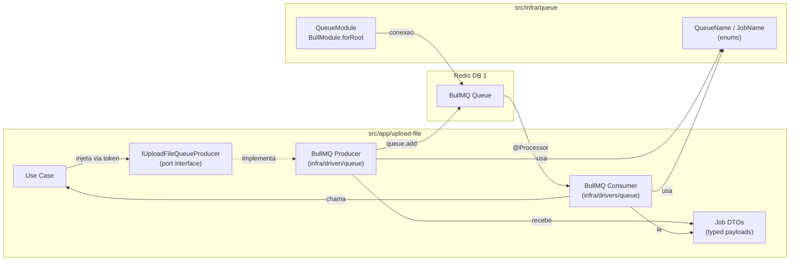

# Implementacao de Filas com BullMQ

## Contexto

O projeto segue ports & adapters (hexagonal). Infra compartilhada fica em `src/infra/`, e cada feature em `src/app/` possui:

- `application/` -- use cases, DTOs, ports (interfaces)
- `infra/driven/` -- adapters secundarios (DB, producers)
- `infra/drivers/` -- adapters primarios (HTTP controllers, consumers)

O Redis ja esta configurado em `[src/core/config/config.service.ts](src/core/config/config.service.ts)` com `redisQueueDatabase` retornando `1`.

---

## Arquitetura




**Confirmacao sobre driven/drivers:**

- **Producers** em `infra/driven/queue/` -- a aplicacao os "dirige" (use case chama o producer para enfileirar)
- **Consumers** em `infra/drivers/queue/` -- eles "dirigem" a aplicacao (recebem o job da fila e chamam use cases), assim como controllers HTTP

---

## 1. Dependencias

Instalar `@nestjs/bullmq` e `bullmq` no `package.json`:

```bash
npm install @nestjs/bullmq bullmq
```

---

## 2. Infraestrutura compartilhada -- `src/infra/queue/`

### 2.1 `src/infra/queue/queue.module.ts`

Modulo global que configura `BullModule.forRoot()` com Redis database 1. Em ambiente de teste, nao registra a conexao BullMQ (consumers e producers usam fakes).

```typescript
@Global()
@Module({})
export class QueueModule {
  static register(): DynamicModule {
    const isTest = process.env.NODE_ENV === Environment.Test;

    if (isTest) {
      return { module: QueueModule };
    }

    return {
      module: QueueModule,
      imports: [
        BullModule.forRootAsync({
          imports: [ConfigModule],
          inject: [ConfigService],
          useFactory: (config: ConfigService) => {
            const url = new URL(config.redisUrl);
            return {
              connection: {
                host: url.hostname,
                port: Number(url.port) || 6379,
                password: url.password || undefined,
                db: config.redisQueueDatabase,
              },
            };
          },
        }),
      ],
    };
  }
}
```

### 2.2 `src/infra/queue/queue-name.enum.ts`

Enum central com todos os nomes de fila do projeto:

```typescript
export enum QueueName {
  UploadFile = 'upload-file',
}
```

### 2.3 `src/infra/queue/job-name.enum.ts`

Enum central com todos os nomes de job:

```typescript
export enum JobName {
  UploadFile = 'upload-file',
  DeleteFile = 'delete-file',
}
```

### 2.4 Registrar em `[src/infra/infra.module.ts](src/infra/infra.module.ts)`

Adicionar `QueueModule.register()` ao array de imports.

---

## 3. Primeiro caso de uso: Upload de Arquivos

### 3.1 Job DTOs -- `src/app/upload-file/application/queue/jobs/`

Classes tipadas para o payload de cada job:

- `upload-file-job.dto.ts` -- dados necessarios para upload (ex: buffer/base64 do arquivo, nome, mimetype, folder)
- `delete-file-job.dto.ts` -- dados necessarios para exclusao (ex: fileUrl ou fileKey)

### 3.2 Producer Port -- `src/app/upload-file/application/queue/upload-file-queue-producer.interface.ts`

Interface definida na camada de aplicacao (o "port"):

```typescript
export interface IUploadFileQueueProducer {
  addUploadJob(data: UploadFileJobDto): Promise<void>;
  addDeleteJob(data: DeleteFileJobDto): Promise<void>;
}
```

### 3.3 Producer Adapter (driven) -- `src/app/upload-file/infra/driven/queue/`

**BullMQ adapter** (`upload-file-queue-bullmq.producer.ts`):

- Implementa `IUploadFileQueueProducer`
- Usa `@InjectQueue(QueueName.UploadFile)` do `@nestjs/bullmq`
- Chama `queue.add(JobName.UploadFile, data)` e `queue.add(JobName.DeleteFile, data)`

**Fake adapter** (`upload-file-queue-fake.producer.ts`):

- Implementa `IUploadFileQueueProducer`
- Armazena jobs em array em memoria (util para testes de integracao)
- Nos testes unitarios dos use cases, o producer pode ser mockado manualmente via token (`TOKENS.UploadFileQueueProducer`) para verificar chamadas e argumentos

### 3.4 Consumer (driver) -- `src/app/upload-file/infra/drivers/queue/upload-file-bullmq.consumer.ts`

```typescript
@Processor(QueueName.UploadFile)
export class UploadFileBullmqConsumer extends WorkerHost {
  async process(job: Job<UploadFileJobDto | DeleteFileJobDto>): Promise<void> {
    switch (job.name) {
      case JobName.UploadFile:
        // chama use case ou gateway de upload
        break;
      case JobName.DeleteFile:
        // chama use case ou gateway de delete
        break;
    }
  }
}
```

### 3.5 Queue Module do feature -- `src/app/upload-file/application/queue/upload-file-queue.module.ts`

Segue o mesmo padrao do `[faq-persistence.module.ts](src/app/faq/application/persistence/faq-persistence.module.ts)` -- registra a fila, vincula o producer ao token, e registra o consumer:

```typescript
@Module({})
export class UploadFileQueueModule {
  static register(): DynamicModule {
    const isTest = process.env.NODE_ENV === Environment.Test;

    return {
      module: UploadFileQueueModule,
      imports: isTest ? [] : [
        BullModule.registerQueue({ name: QueueName.UploadFile }),
      ],
      providers: [
        {
          provide: TOKENS.UploadFileQueueProducer,
          useClass: isTest
            ? UploadFileQueueFakeAdapterProducer
            : UploadFileQueueBullmqAdapterProducer,
        },
        ...(isTest ? [] : [UploadFileBullmqConsumer]),
      ],
      exports: [TOKENS.UploadFileQueueProducer],
    };
  }
}
```

### 3.6 Integracao no feature module

Modificar `[src/app/upload-file/upload-file.module.ts](src/app/upload-file/upload-file.module.ts)` para importar `UploadFileQueueModule.register()`.

---

## 4. Token de DI

Adicionar em `[src/core/di/token.ts](src/core/di/token.ts)`:

```typescript
UploadFileQueueProducer: Symbol.for('UploadFileQueueProducer'),
```

---

## 5. Estrutura final de arquivos

```
src/
├── core/di/token.ts                                          # + UploadFileQueueProducer
├── infra/
│   ├── infra.module.ts                                       # + QueueModule.register()
│   └── queue/                                                # NOVO
│       ├── queue.module.ts
│       ├── queue-name.enum.ts
│       └── job-name.enum.ts
└── app/upload-file/
    ├── upload-file.module.ts                                 # + UploadFileQueueModule
    ├── application/queue/                                    # NOVO
    │   ├── upload-file-queue.module.ts
    │   ├── upload-file-queue-producer.interface.ts
    │   └── jobs/
    │       ├── upload-file-job.dto.ts
    │       └── delete-file-job.dto.ts
    └── infra/
        ├── driven/queue/                                     # NOVO
        │   ├── upload-file-queue-bullmq.producer.ts
        │   └── upload-file-queue-fake.producer.ts
        └── drivers/queue/                                    # NOVO
            └── upload-file-bullmq.consumer.ts
```

---

## 6. Padrao para novos modulos que usem filas

Cada novo modulo que precisar de filas seguira o mesmo template:

1. Adicionar valor ao `QueueName` enum e `JobName` enum
2. Criar Job DTOs em `application/queue/jobs/`
3. Criar port (interface) em `application/queue/`
4. Criar producer adapter (bullmq + fake) em `infra/driven/queue/`
5. Criar consumer em `infra/drivers/queue/`
6. Criar queue module em `application/queue/`
7. Adicionar token em `src/core/di/token.ts`

---

## Nota sobre `IUploadFileGateway`

O gateway atual (`[src/infra/upload-file/upload-file.gateway.ts](src/infra/upload-file/upload-file.gateway.ts)`) so possui o metodo `upload()`. Para o job de exclusao funcionar, sera necessario adicionar um metodo `delete(fileKey: string): Promise<void>` a interface e implementa-lo no adapter S3 (e no fake).