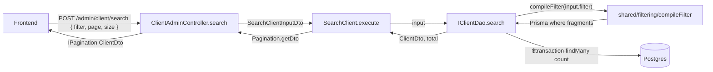

# Filtro avançado: nested filter (platform-wide, primeiro consumidor: `client`)

## Visão geral

- **Tipo:** extensão de módulo existente + nova infraestrutura compartilhada em `src/shared/filtering/`.
- **Padrão:** CRUD simples (DAO já existe). Sem novo schema, sem novos tokens, sem novas claims.
- **Módulo de referência:** `faq` para o uso (use case + DAO `findAll`); padrões da skill `dao-pattern` (secção 3, `conditions[] + AND`) para a montagem do `where`.
- **Decisão de formato (sua opção A):** mapa campo→operadores estilo Prisma/GraphQL, validado por DTOs tipados por categoria. Whitelist sai do **shape do DTO** (toda chave fora dele é silenciosamente removida pelo `ValidationPipe({ whitelist: true })` global; ver `[src/infra/validators/class/config.ts](src/infra/validators/class/config.ts)`).
- **Endpoint:** `POST /admin/client/search` — aditivo. O `GET /admin/client` continua funcionando, então nenhum spec/E2E existente quebra.
- **Reuso futuro:** outros módulos passam a ganhar `Search<X>` + `<X>SearchFilterDto` + `dao.search(...)` consumindo o mesmo `compileFilter(...)`.

## Formato do request (acordado)

```json
{
  "page": 1,
  "size": 20,
  "filter": {
    "groupId":   { "in": [1, 2, 3] },
    "document":  { "eq": "12345" },
    "active":    { "eq": true },
    "createdAt": { "gte": "2026-01-01T00:00:00.000Z", "lte": "2026-12-31T23:59:59.999Z" },
    "parentClientId": { "isNull": true }
  }
}
```

- Múltiplos campos no `filter` => **AND**.
- Múltiplos operadores no mesmo campo => combinam direto no `where` do Prisma (já é AND nativo do Prisma, ex.: `{ id: { gte: 1, lte: 10 } }`).
- Campos não declarados no `ClientSearchFilterDto` são **silenciosamente removidos** (whitelist). Ver "Trade-off de validação" abaixo.

## Fluxo do request



## Skills carregadas para este plano

- `.cursor/skills/dao-pattern/SKILL.md` (secção 3) — padrão `conditions[] + AND`.
- `.cursor/skills/dto-and-validation/SKILL.md` — `@ValidateNested` + `@Type` para DTOs aninhados.
- `.cursor/skills/use-case-creation/SKILL.md` — `@Injectable + execute(...) + Pagination.getDto()`.
- `.cursor/skills/controllers-and-swagger/SKILL.md` — `@Swagger` + `@RequiredClaims` + ordenação de rotas.
- `.cursor/skills/error-handling/SKILL.md` — `AppException` para `InvalidFilterValueError` (caso datas inválidas escapem do `class-validator`).
- `.cursor/skills/testing-strategy/SKILL.md` — co-location, `*.spec.ts` (mocks) + `*.integration.spec.ts` (banco real).
- `.cursor/skills/frontend-integration-docs/SKILL.md` — para a Etapa 5.

## Arquivos a criar

### Infraestrutura compartilhada — `src/shared/filtering/`

1. `[src/shared/filtering/dtos/string-filter.dto.ts](src/shared/filtering/dtos/string-filter.dto.ts)` — classe `StringFilterDto` com operadores opcionais: `eq`, `ne`, `in: string[]`, `notIn: string[]`, `contains`, `startsWith`, `endsWith`, `isNull: boolean`. Cada operador com seu validador (`@IsString` / `@IsArray + @IsString({ each: true })` / `@IsBoolean`) e `@ApiPropertyOptional`. `@Trim()` nos textuais.
2. `[src/shared/filtering/dtos/string-filter.dto.spec.ts](src/shared/filtering/dtos/string-filter.dto.spec.ts)` — `validateSync` cobrindo cada operador (válido + inválido).
3. `[src/shared/filtering/dtos/int-filter.dto.ts](src/shared/filtering/dtos/int-filter.dto.ts)` — `IntFilterDto` com `eq`, `ne`, `in: number[]`, `notIn: number[]`, `gt`, `gte`, `lt`, `lte`, `isNull`. `@IsInt` + `@StringToNumber` quando faz sentido (POST body normalmente já vem JSON tipado).
4. `[src/shared/filtering/dtos/int-filter.dto.spec.ts](src/shared/filtering/dtos/int-filter.dto.spec.ts)`.
5. `[src/shared/filtering/dtos/boolean-filter.dto.ts](src/shared/filtering/dtos/boolean-filter.dto.ts)` — `BooleanFilterDto` com `eq`, `isNull`.
6. `[src/shared/filtering/dtos/boolean-filter.dto.spec.ts](src/shared/filtering/dtos/boolean-filter.dto.spec.ts)`.
7. `[src/shared/filtering/dtos/date-filter.dto.ts](src/shared/filtering/dtos/date-filter.dto.ts)` — `DateFilterDto` com `eq`, `ne`, `gt`, `gte`, `lt`, `lte`, `isNull`. Validar com `@IsISO8601()` e converter via `@Transform(value => new Date(value))`.
8. `[src/shared/filtering/dtos/date-filter.dto.spec.ts](src/shared/filtering/dtos/date-filter.dto.spec.ts)`.
9. `[src/shared/filtering/dtos/search-request.dto.ts](src/shared/filtering/dtos/search-request.dto.ts)` — `SearchRequestDto` base abstrata com `page?` e `size?` (mesmas validações do `Queries`). Cada módulo herda e adiciona `filter: <X>SearchFilterDto`.
10. `[src/shared/filtering/compile-filter.ts](src/shared/filtering/compile-filter.ts)` — função pura `compileFilter<T extends object>(filter: T | undefined): Array<Record<string, unknown>>`. Itera `Object.entries(filter ?? {})`, para cada operador presente do sub-DTO emite o **fragment Prisma** correspondente: `eq → { equals }`, `ne → { not: { equals } }`, `in → { in }`, `notIn → { notIn }`, `gt/gte/lt/lte → { gt/gte/lt/lte }`, `contains → { contains, mode: 'insensitive' }`, `startsWith/endsWith → { startsWith/endsWith, mode: 'insensitive' }`, `isNull: true → null`, `isNull: false → { not: null }`. Retorna o array para o DAO concatenar com seu `conditions[]`. Sem dependência de `@prisma/client` — o shape produzido é **estruturalmente compatível** com `Prisma.<X>WhereInput` (cast no DAO).
11. `[src/shared/filtering/compile-filter.spec.ts](src/shared/filtering/compile-filter.spec.ts)` — testes do compilador por operador, combinação multi-operador, filter vazio, filter `undefined`.
12. `[src/shared/filtering/types.ts](src/shared/filtering/types.ts)` — type alias `WhereFragment = Record<string, unknown>` se ajudar a legibilidade.

### Módulo Client — novo use case e DTO

13. `[src/app/client/client/application/usecases/search-client/dtos/search-client.dto.ts](src/app/client/client/application/usecases/search-client/dtos/search-client.dto.ts)` — `ClientSearchFilterDto` (whitelist): `id (Int)`, `type (String)`, `parentClientId (Int)`, `isSubClient (Boolean)`, `document (String)`, `ie (String)`, `groupId (Int)`, `resaleId (Int)`, `attendanceId (Int)`, `maintenanceTicketId (Int)`, `companyName (String)`, `fantasyName (String)`, `domain (String)`, `headquarters (String)`, `invoiceType (String)`, `generateInvoice (Boolean)`, `active (Boolean)`, `createdAt (Date)`, `updatedAt (Date)`. Cada campo `@ValidateNested + @Type(() => XFilterDto) + @IsOptional + @ApiPropertyOptional({ type: XFilterDto })`. + `SearchClientInputDto extends SearchRequestDto` com `filter?: ClientSearchFilterDto` aninhado.
14. `[src/app/client/client/application/usecases/search-client/dtos/search-client.dto.spec.ts](src/app/client/client/application/usecases/search-client/dtos/search-client.dto.spec.ts)` — payloads válidos, payloads com chaves não-whitelist (silenciosamente strippadas), tipos errados (rejeitados).
15. `[src/app/client/client/application/usecases/search-client/search-client.service.ts](src/app/client/client/application/usecases/search-client/search-client.service.ts)` — `SearchClient` `@Injectable()` com `execute(input: SearchClientInputDto): Promise<IPagination<ClientDto>>`. Igual ao `FindAllClient` em estrutura: chama `dao.search(input)` e devolve `new Pagination(rows, total, input.page, input.size).getDto()`.
16. `[src/app/client/client/application/usecases/search-client/search-client.service.spec.ts](src/app/client/client/application/usecases/search-client/search-client.service.spec.ts)` — unit com `createMock<IClientDao>()`.
17. `[src/app/client/client/application/usecases/search-client/search-client.service.integration.spec.ts](src/app/client/client/application/usecases/search-client/search-client.service.integration.spec.ts)` — banco real, `prisma.truncate()` em `beforeEach/afterAll`. Cobertura: filtro vazio, `eq`, `in`, `contains`, `gte+lte`, `isNull`, combinação multi-campo (AND), paginação.

## Arquivos a modificar

18. `[src/app/client/client/application/persistence/dao/client-dao.interface.ts](src/app/client/client/application/persistence/dao/client-dao.interface.ts)` — adicionar `search(input: SearchClientInputDto): Promise<[ClientDto[], number]>`.
19. `[src/app/client/client/infra/driven/persistence/prisma/client-prisma.dao.ts](src/app/client/client/infra/driven/persistence/prisma/client-prisma.dao.ts)` — implementar `search`. Estrutura segue a skill `dao-pattern` secção 3:

   ```ts
   public async search(input: SearchClientInputDto): Promise<[ClientDto[], number]> {
     const pagination = this.prisma.paginationFactory(input.page, input.size);
     const conditions: Prisma.ClientWhereInput[] = compileFilter(input.filter) as Prisma.ClientWhereInput[];
     const where: Prisma.ClientWhereInput = conditions.length > 0 ? { AND: conditions } : {};
     return this.prisma.$transaction([
       this.prisma.client.findMany({ where, skip: pagination.skip, take: pagination.take, select: ClientSelect, orderBy: { id: 'asc' } }),
       this.prisma.client.count({ where }),
     ]);
   }
   ```

20. `[src/app/client/client/infra/driven/persistence/prisma/client-prisma.dao.spec.ts](src/app/client/client/infra/driven/persistence/prisma/client-prisma.dao.spec.ts)` — adicionar bloco para `search`: cada operador, combinação AND, isNull em `parentClientId`/`fantasyName`, ordering estável.
21. `[src/app/client/client/infra/drivers/http/admin/client-admin.controller.ts](src/app/client/client/infra/drivers/http/admin/client-admin.controller.ts)` — injetar `SearchClient`, adicionar:

   ```ts
   @HttpCode(HttpStatus.OK)
   @Post('search')
   @RequiredClaims(Claim.CLIENT_READ)
   @Swagger({ tags: ['Clientes'], summary: 'Listar clientes com filtros avançados (AND)', applyBadRequest: true, okPaginatedResponse: ClientDto })
   public search(@Body() body: SearchClientInputDto): Promise<IPagination<ClientDto>> {
     return this.searchClient.execute(body);
   }
   ```

   Posicionar **antes** de `Get('sequence')` mas **depois** de `Post('lookup-document-and-cnpj')` (qualquer ordem entre rotas estáticas serve; o que importa é estar **antes** de `:id` qualquer).
22. `[src/app/client/client/infra/drivers/http/admin/client-admin.controller.spec.ts](src/app/client/client/infra/drivers/http/admin/client-admin.controller.spec.ts)` — registrar `SearchClient` mockado, smoke spec do método `search`.
23. `[src/app/client/client/client.module.ts](src/app/client/client/client.module.ts)` — adicionar `SearchClient` em `providers`. Não precisa exportar (consumido só pelo controller deste módulo).

## Itens do checklist Rule 11 que **não se aplicam** (com justificativa)

- **Schema Prisma + truncate**: nenhuma tabela nova; o filtro só lê `clients`.
- **Token DI**: usa o `TOKENS.ClientDao` já existente. O compilador é função pura, sem necessidade de DI.
- **Claim nova**: `Claim.CLIENT_READ` já cobre — é leitura de cliente, mesmo papel.
- **Subject novo**: idem, reusa `ClaimSubject.Client`.
- **Domínio (entity/factory/VO)**: feature 100% de leitura; nenhum invariante novo.
- **Filas**: N/A.
- **Gateway externo**: N/A.

## Trade-off de validação a confirmar

O `ValidationPipe` global está com `whitelist: true` mas sem `forbidNonWhitelisted` (ver `[src/infra/validators/class/config.ts](src/infra/validators/class/config.ts)`). Consequências:

- **Comportamento atual (silencioso):** se o frontend mandar `{ filter: { foobar: { eq: 1 } } }`, o `foobar` é apagado e o filtro vira vazio. Sem 400. Pode confundir no debug.
- **Alternativa (estrito):** instalar `ValidationPipe` local na rota com `forbidNonWhitelisted: true` (`@UsePipes(new ValidationPipe({ whitelist: true, transform: true, forbidNonWhitelisted: true }))`) — campo desconhecido vira 400.

**Recomendação:** ir com o comportamento global (silencioso) por consistência com o resto do projeto. Se quiser estrito, marca no review e a gente troca.

## Use cases a implementar

- `SearchClient` — recebe `SearchClientInputDto`, chama `dao.search`, devolve `IPagination<ClientDto>`.

## Rotas

- `POST /admin/client/search` — `@RequiredClaims(Claim.CLIENT_READ)`, body `SearchClientInputDto`, resposta `IPagination<ClientDto>` (`@HttpCode(200)` para POST que retorna lista — segue padrão de `lookupDocumentAndCnpj` no mesmo controller).

## Testes (ordem TDD)

1. `compile-filter.spec.ts` — testa cada operador → fragment Prisma esperado (sem banco).
2. `string/int/boolean/date-filter.dto.spec.ts` — `validateSync` valida válido/inválido.
3. `search-client.dto.spec.ts` — payload completo, payload vazio, chave fora da whitelist é dropada, tipos errados rejeitados.
4. `search-client.service.spec.ts` (unit) — `createMock<IClientDao>()`, valida pagination.
5. `client-prisma.dao.spec.ts` — extender com bloco "search" (banco real, padrão dos outros DAOs do módulo).
6. `search-client.service.integration.spec.ts` — fim-a-fim no `ClientModule`.
7. `client-admin.controller.spec.ts` — smoke spec do `search` com `SearchClient` mockado.

## Decisões de escopo (v1)

- **Apenas AND** entre campos (sua escolha). `OR` / agrupamento `(A AND B) OR C` ficam para v2 — adicionando um campo `or?: ClientSearchFilterDto[]` no `SearchClientInputDto`.
- **Apenas campos diretos** do `Client` (sua escolha). Nada de `companies.name`, `addresses.city`, etc. Isso simplifica o whitelist e o `select` continua sendo o `ClientSelect` atual.
- **Sem ordenação custom**. Mantém `orderBy: { id: 'asc' }` igual ao `findAll`. Adicionar `orderBy?: Array<{ field, direction }>` é trivial depois.
- **Coexistência com `GET /admin/client`**: mantida. O controller passa a ter dois caminhos: o legado por querystring (com `search` multi-campo OR) e o novo por POST (granular AND). Nenhum spec/E2E existente quebra.
- **`createdAt` / `updatedAt`**: aceitos como ISO 8601 string e convertidos para `Date` no DTO via `@Transform`. O Prisma aceita `Date` natural.

## Pontos de atenção

- Manter `compileFilter` 100% **framework-agnóstico** (sem `@nestjs/*`, sem `@prisma/client`). O cast para `Prisma.ClientWhereInput[]` acontece no DAO. Mantém `src/shared/` portátil.
- Reutilização cross-module: para um próximo módulo X, basta criar `<X>SearchFilterDto` (whitelist), `Search<X>` use case e adicionar `dao.search` ao `IXxxDao`. O compilador é o mesmo.
- O nome do método no DAO é **`search`** (não `findAll`) para deixar claro que é a variante "filtro avançado" e evitar quebrar a assinatura atual de `findAll(queries: FindAllClientQueryDto)` que muitos specs já consomem.
- Em integração, atenção a um fato do Prisma: `{ field: null }` no `where` significa "campo é NULL" e `{ field: { not: null } }` significa "campo NÃO é NULL". O compilador reflete isso em `isNull`.

## Etapa 5 — Doc para o frontend

Depois da implementação, criar `[docs/frontend-integracao-cliente-search-filter.md](docs/frontend-integracao-cliente-search-filter.md)` cobrindo:

- Endpoint `POST /admin/client/search`, claim `CLIENT_READ`, exemplo de body.
- Tabela de campos filtráveis × tipos × operadores suportados.
- Diferenças vs `GET /admin/client` (querystring legacy, ainda válido).
- Erros 400 esperados (tipo errado, ISO inválida) e formato `{ message }`.
- Checklist (gerar tipos OpenAPI, mock E2E, visibilidade por claim).

## Validação local antes do PR

1. `npm run lint`
2. `npm test`
3. `npm run build`
4. (manual) subir `npm run start:dev` e testar via Swagger em `/swagger`.

## Itens fora do escopo deste plano (registrar como follow-ups)

- `OR` entre fields / agrupamento booleano.
- `orderBy` plug-and-play.
- Filtros em campos de relacionamento (`group.name`, `companies.id`, etc.).
- Estender o filtro a outros módulos (próximas iterações, plug-and-play após esta base).
- Migrar o `GET /admin/client` para POST (atualmente mantido como legado por compatibilidade).
