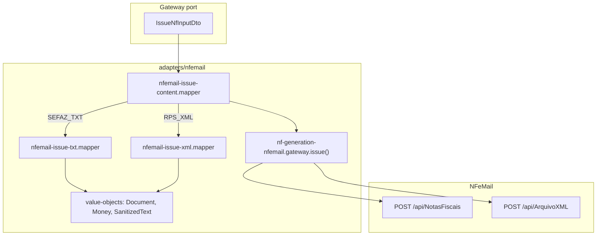

# Payload tipado para emissão NF + builders nfemail (com Reforma Tributária)

## Contexto

Hoje [`IssueNfInputDto`](src/infra/nf-generation/dtos/issue-nf.dto.ts) exige `content: string` e o gateway repassa direto para a NFeMail (`sTXT` ou `sXML`). O domínio já modela os dados de negócio via [`NfmDto`](src/app/tax-invoice/nfm/application/dtos/nfm.dto.ts) (`client`, `clientInvoiceConfig`, `clientItems`), mas **não há builder fiscal**.

Escopo acordado:
- Implementar **ambos** os formatos (`SEFAZ_TXT` e `RPS_XML`)
- Payload **alinhado ao NfmDto** + **complemento fiscal** para campos ausentes no banco
- Mappers **DEVEM incluir campos da Reforma Tributária (IBS/CBS)** conforme exemplos oficiais NFeMail:
  - TXT: [NOTAFISCAL400_RT_NovosCampos.txt](https://integrador4.nfemail.com.br/NOTAFISCAL400_RT_NovosCampos.txt)
  - XML: [NOTAFISCAL_RT_NovosCampos.xml](https://integrador4.nfemail.com.br/NOTAFISCAL_RT_NovosCampos.xml)

## Arquitetura alvo



**Regra de camadas:** DTOs do port ficam em [`src/infra/nf-generation/dtos/`](src/infra/nf-generation/dtos/) (sem importar `app/client` ou `app/company`). Mappers/VOs ficam **somente** em [`src/infra/nf-generation/adapters/nfemail/`](src/infra/nf-generation/adapters/nfemail/). Um mapper futuro em `tax-invoice` converterá `NfmDto + CompanyDto` → `IssueNfInputDto` (fora deste escopo).

## Referência canônica — Reforma Tributária (NFeMail)

Os mappers devem reproduzir a estrutura dos arquivos oficiais. Usar cópias locais como fixture de teste:

- `src/infra/nf-generation/adapters/nfemail/fixtures/NOTAFISCAL400_RT_NovosCampos.txt`
- `src/infra/nf-generation/adapters/nfemail/fixtures/NOTAFISCAL_RT_NovosCampos.xml`

### TXT — grupos RT por item (após impostos ICMS/PIS/COFINS)

| Grupo | Campos (exemplo oficial) | Mapeamento DTO |
|-------|--------------------------|----------------|
| `UB\|` | cabeçalho bloco RT do item | — |
| `UB12\|` | `CST`, `cClassTrib`, vazio, `vBC` | `item.ibsCbs.cst`, `cClassTrib`, `baseValue` |
| `UB15\|` | `vBC`, `vIBS` | `baseValue`, `ibsTotalValue` |
| `UB17\|` | `pIBSUF`, `vIBSUF` | `ibsStateRate`, `ibsStateValue` |
| `UB36\|` | `pIBSMun`, `vIBSMun` | `ibsCityRate`, `ibsCityValue` |
| `UB55\|` | `pCBS`, `vCBS` | `cbsRate`, `cbsValue` |
| `VB01\|` | `vItem` | `itemTotalValue` |

### TXT — totais RT (após grupo `W02|`)

| Grupo | Campos (exemplo oficial) | Mapeamento DTO |
|-------|--------------------------|----------------|
| `W04c\|` | `vDif` IBS UF | `totals.ibsCbs.ibsStateDiff` |
| `W04e\|` | `vDevTrib` IBS UF | `totals.ibsCbs.ibsStateDevTrib` |
| `W04g\|` | `vIBSUF` total | `totals.ibsCbs.ibsStateValue` |
| `W34\|` | `vBCIBSCBS` | `totals.ibsCbs.baseValue` |
| `W36\|` | `vDif`, `vDevTrib`, `vIBSMun` | totais município |
| `W37\|` | `vDif`, `vDevTrib`, `vIBS` | totais IBS |
| `W42\|` | `vDif`, `vDevTrib`, `vCBS` | totais CBS |
| `W50\|` | `vCredPres`, `vCredPresCondSus`, `vCBS`, `vDif`, `vDevTrib` | créditos CBS |
| `W60\|` | `vNFTot` | `totals.nfTotalValue` |

### XML — por item (`det/imposto/IBSCBS`)

```xml
<IBSCBS>
  <CST>000</CST>
  <cClassTrib>000001</cClassTrib>
  <gIBSCBS>
    <vBC>0.82</vBC>
    <gIBSUF><pIBSUF>0.10</pIBSUF><vIBSUF>0.00</vIBSUF></gIBSUF>
    <gIBSMun><pIBSMun>0.00</pIBSMun><vIBSMun>0.00</vIBSMun></gIBSMun>
    <vIBS>0.00</vIBS>
    <gCBS><pCBS>0.90</pCBS><vCBS>0.01</vCBS></gCBS>
  </gIBSCBS>
</IBSCBS>
<vItem>1.00</vItem>
```

### XML — totais (`total/IBSCBSTot` + `vNFTot`)

Espelhar `gIBS` (com `gIBSUF` e `gIBSMun` e créditos), `gCBS` (com créditos) e `vNFTot` conforme exemplo oficial.

## 1. Novos DTOs do port (`infra/nf-generation/dtos/issue-nf/`)

Substituir o conteúdo monolítico de [`issue-nf.dto.ts`](src/infra/nf-generation/dtos/issue-nf.dto.ts) por tipos compostos (classes sem decorators):

| DTO | Campos principais | Origem esperada |
|-----|-------------------|-----------------|
| `IssueNfAddressDto` | `zipCode`, `street`, `number`, `complement?`, `neighborhood`, `city`, `state`, `cityCode` (IBGE), `countryCode` (default `1058`) | `Company` / `ClientAddress` + complemento |
| `IssueNfPartyDto` | `document`, `type` (PJ/PF), `ie?`, `companyName`, `fantasyName?`, `email?`, `phone?`, `address`, `crt?` (emitente) | Emitente/destinatário |
| `IssueNfItemTaxationDto` | `cnaeCode`, `nbsCode`, `indopCode` | `ClientItem.cnaeNbsIndop` |
| `IssueNfItemFiscalDto` | `cfop`, `ncm`, `cstIcms`, `cstPis`, `cstCofins`, `icmsRate`, `icmsBase`, `icmsValue`, `origin` | Complemento fiscal clássico |
| **`IssueNfItemIbsCbsDto`** | `cst`, `cClassTrib`, `baseValue`, `ibsStateRate`, `ibsStateValue`, `ibsCityRate`, `ibsCityValue`, `ibsTotalValue`, `cbsRate`, `cbsValue`, `itemTotalValue` | **RT por item** (complemento fiscal) |
| `IssueNfItemDto` | `description`, `quantity`, `unitValueInCents`, `taxation`, `fiscal`, **`ibsCbs`** | `ClientItem` + complemento |
| `IssueNfFiscalComplementDto` | `environment`, `series`, `nfeNumber?`, `naturezaOperacao`, `operationType`, `finalidade`, `presenceIndicator`, `intermediaryIndicator`, `paymentMethod`, `paymentValue`, `freightMode`, `additionalInfo?`, `orderReference?` | Config fiscal externa |
| **`IssueNfTotalsIbsCbsDto`** | `baseValue`, `ibsStateDiff`, `ibsStateDevTrib`, `ibsStateValue`, `ibsCityDiff`, `ibsCityDevTrib`, `ibsCityValue`, `ibsDiff`, `ibsDevTrib`, `ibsTotalValue`, `ibsCredPres`, `ibsCredPresCondSus`, `cbsDiff`, `cbsDevTrib`, `cbsValue`, `cbsCredPres`, `cbsCredPresCondSus`, `nfTotalValue` | **RT totais da nota** |
| **`IssueNfTotalsDto`** | `productValue`, `nfValue`, `icmsBase`, `icmsValue`, **`ibsCbs`** | Totais calculados ou informados |
| `IssueNfInputDto` | `format`, `orderNumber?`, `emitter`, `recipient`, `items[]`, `fiscal`, `totals?` | Corpo da emissão |

`IssueNfOutputDto` permanece igual.

**Validação mínima no gateway** (antes de montar conteúdo):
- emitente/destinatário presentes, `items.length >= 1`
- por item: `fiscal` + **`ibsCbs` obrigatórios** (RT é requisito desta entrega, não opcional)
- totais RT: se `totals` omitido, **calcular** a partir dos itens (soma de `vBC`, `vIBS`, `vCBS`, `vItem`); se informado, usar valores explícitos
- campos fiscais clássicos obrigatórios faltando → `ExternalApiError` pt-BR

## 2. Value Objects (`adapters/nfemail/value-objects/`)

- **`nf-document.vo.ts`** — remove máscara, valida CPF(11)/CNPJ(14)
- **`nf-money.vo.ts`** — centavos → `"1234.56"`; decimais RT com 2 ou 4 casas conforme campo (ex.: `qCom` 4 casas, valores monetários 2)
- **`nf-rate.vo.ts`** — formata alíquotas percentuais (`0.10` → `"0.10"`, `18` → `"18.00"`)
- **`nf-sanitized-text.vo.ts`** — normaliza texto para TXT SEFAZ (sem acentos/aspas)
- **`nf-pipe-line.vo.ts`** — `joinFields(...fields): string` com `|` + `\n`

## 3. Mappers (`adapters/nfemail/mappers/`)

### `nfemail-issue-content.mapper.ts` (fachada)

Roteia por `format` para TXT ou XML.

### `nfemail-issue-txt.mapper.ts` — layout NOTAFISCAL 4.00 + RT

Seguir ordem do [exemplo oficial TXT](https://integrador4.nfemail.com.br/NOTAFISCAL400_RT_NovosCampos.txt):

**Cabeçalho/nota:** `NOTAFISCAL|1|`, `A|`, `B|`

**Emitente:** `C|`, `C02|` (CNPJ), `C05|` (endereço)

**Destinatário:** `E|`, `E03|` (CPF/CNPJ), `E05|` (endereço)

**Por item:** `H|`, `I|`, `M|`, `N|`, `N10d|`, `Q|`, `Q04|`, `S|`, `S04|`, depois bloco RT:
`UB|`, `UB12|`, `UB15|`, `UB17|`, `UB36|`, `UB55|`, `VB01|`

**Totais:** `W|`, `W02|`, grupos RT `W04c|` … `W60|`, `X|`, `YA`, `YA01|`

Valores monetários e alíquotas RT saem de `IssueNfItemIbsCbsDto` / `IssueNfTotalsIbsCbsDto`.

### `nfemail-issue-xml.mapper.ts` — XML NF-e 4.00 + RT

Seguir [exemplo oficial XML](https://integrador4.nfemail.com.br/NOTAFISCAL_RT_NovosCampos.xml):

- `infNFe/ide`, `emit`, `dest`
- `det/prod` + `det/imposto` (ICMS, PIS, COFINS + **`IBSCBS`**)
- `det/vItem`
- `total/ICMSTot` + **`total/IBSCBSTot`** + **`total/vNFTot`**
- `transp/modFrete`, `pag/detPag`
- `infAdic` opcional

**Sem assinatura digital** no XML gerado — NFeMail assina no recebimento (o exemplo oficial inclui `Signature`, mas nosso builder envia apenas `infNFe` sem `Signature`, como entrada bruta para a API).

> **Nota:** enum `RPS_XML` aponta para `/api/ArquivoXML` (XML SEFAZ NF-e). Manter nome nesta entrega; documentar no mapper.

### `nfemail-issue-totals.calculator.ts` (helper interno)

Função pura que agrega `items[].ibsCbs` → `IssueNfTotalsIbsCbsDto` quando `input.totals` não for informado. Usada por ambos os mappers para manter TXT e XML consistentes.

## 4. Refatorar gateway nfemail

Em [`nf-generation-nfemail.gateway.ts`](src/infra/nf-generation/adapters/nfemail/nf-generation-nfemail.gateway.ts):

1. Remover validação de `input.content`
2. Validar payload tipado (incl. `ibsCbs` por item)
3. Chamar `buildNfemailIssueContent(input)` dentro de `issue()`
4. Alterar `getIssueRequest(format, content: string)` para receber string montada
5. Manter POST `application/x-www-form-urlencoded` inalterado

## 5. Atualizar controller de teste

Em [`nf-generation-test.dto.ts`](src/app/nf-generation-test/infra/drivers/http/dtos/nf-generation-test.dto.ts):
- Estrutura espelhando `IssueNfInputDto` com `class-validator` + `@ApiProperty`
- Exemplo Swagger baseado nos valores do arquivo oficial NFeMail RT (CST `000`, cClassTrib `000001`, alíquotas IBS/CBS)
- Incluir `ibsCbs` em cada item e opcionalmente `totals.ibsCbs`

## 6. Testes (co-locados)

| Arquivo | Cenários |
|---------|----------|
| `nfemail-issue-txt.mapper.spec.ts` | snapshot contém grupos `UB12`, `UB55`, `VB01`, `W34`, `W60`; valores batem com fixture oficial |
| `nfemail-issue-xml.mapper.spec.ts` | XML contém `IBSCBS`, `IBSCBSTot`, `vNFTot`, `vItem`; estrutura compatível com fixture oficial |
| `nfemail-issue-totals.calculator.spec.ts` | agregação de totais RT a partir de N itens |
| `nfemail-issue-content.mapper.spec.ts` | roteamento por `format` |
| `nf-generation-nfemail.gateway.spec.ts` | `issue()` monta `sTXT`/`sXML` com blocos RT |

Helper `makeValidIssueNfInput(overrides?)` com `ibsCbs` preenchido (valores do exemplo NFeMail).

**Critério de aceite RT:** output TXT/XML do mapper, para input equivalente ao exemplo oficial, deve conter **todos os grupos/tags RT** listados acima com os mesmos valores de entrada.

## 7. Riscos e decisões

- **RT obrigatória nesta entrega:** não tratar IBS/CBS como opcional; payload sem `ibsCbs` por item é rejeitado.
- **Totais RT:** preferir cálculo automático; permitir override via `totals` para casos com arredondamento específico.
- **Layout clássico + RT:** impostos ICMS/PIS/COFINS (grupos `N|`, `Q|`, `S|`) permanecem obrigatórios no TXT, conforme exemplo oficial — não emitir só bloco RT isolado.
- **Integração NFM:** fora deste PR; use case futuro montará `ibsCbs` a partir de regra de negócio/tabela de alíquotas.

## Arquivos principais a criar/alterar

**Criar:**
- `src/infra/nf-generation/dtos/issue-nf/*.dto.ts` (~10 arquivos, incl. `issue-nf-item-ibs-cbs.dto.ts`, `issue-nf-totals-ibs-cbs.dto.ts`)
- `src/infra/nf-generation/adapters/nfemail/value-objects/*.vo.ts` (5 arquivos)
- `src/infra/nf-generation/adapters/nfemail/mappers/nfemail-issue-*.mapper.ts` (4 arquivos, incl. totals calculator)
- `src/infra/nf-generation/adapters/nfemail/fixtures/NOTAFISCAL400_RT_NovosCampos.txt`
- `src/infra/nf-generation/adapters/nfemail/fixtures/NOTAFISCAL_RT_NovosCampos.xml`
- Specs co-locados

**Alterar:**
- [`src/infra/nf-generation/dtos/issue-nf.dto.ts`](src/infra/nf-generation/dtos/issue-nf.dto.ts)
- [`src/infra/nf-generation/adapters/nfemail/nf-generation-nfemail.gateway.ts`](src/infra/nf-generation/adapters/nfemail/nf-generation-nfemail.gateway.ts)
- [`src/infra/nf-generation/adapters/fake/nf-generation-fake.gateway.ts`](src/infra/nf-generation/adapters/fake/nf-generation-fake.gateway.ts)
- [`src/app/nf-generation-test/infra/drivers/http/dtos/nf-generation-test.dto.ts`](src/app/nf-generation-test/infra/drivers/http/dtos/nf-generation-test.dto.ts)

**Verificação:** `npm run build`, `npm test`, teste manual `POST /nf-generation-test/issue` com payload incluindo `ibsCbs`.
