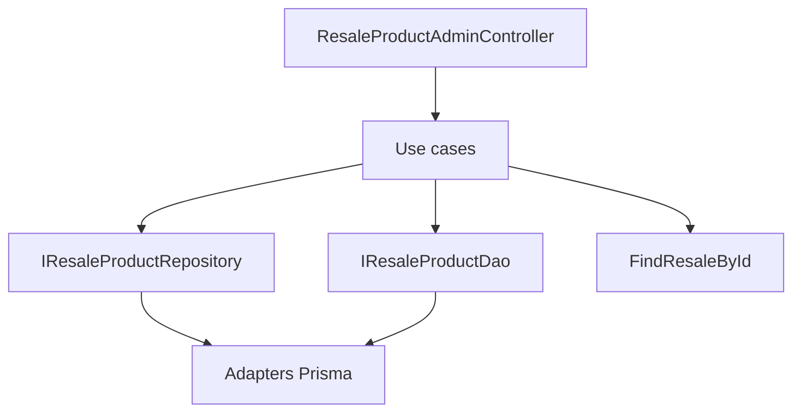

# Plano: módulo `resale-product`

**Tipo:** novo módulo CRUD dentro do contexto existente **resale**  
**Padrão:** **DDD-light** (Entity + Factory + `IResaleProductDao` + `IResaleProductRepository` + adapter Prisma), alinhado a [resale-contact](src/app/resale/resale-contact/resale-contact.module.ts)  
**Módulo de referência:** **ResaleContact** (mesma árvore de pastas, controller admin, `FindResaleById` no create)

### Premissas (onde o pedido não detalhou)

- **`status`:** opcional no banco (`String?` no Prisma), texto livre, `@MaxLength` alinhado a `@db.VarChar(128)` no schema.
- **`product` / `license`:** obrigatórios; limites `@db.VarChar(512)` (DTOs com `@MaxLength(512)` + `@Trim()`).
- **Sem** campo `active` e **sem** rotas `activate`/`deactivate` (somente **Edit** para mudar `status` ou outros campos). Se no futuro quiserem paridade com contatos, evolui-se com boolean `active` + use cases extras.
- **Unicidade:** nenhum `@@unique` até haver regra de negócio explícita (ex. licença única por revenda).
- **FK `resaleId`:** relação `ResaleProduct.resale → Resale`, `onDelete: Restrict` (padrão seguro; destrutivo em cascata só com requisito explícito).
- **Listagem:** `FindAllResaleProductQueryDto extends Queries` com **`resaleId` obrigatório** (igual [FindAllResaleContactQueryDto](src/app/resale/resale-contact/application/usecases/find-all-resale-contact/dtos/find-all-resale-contact.dto.ts)), mais `search` genérico em `product` e `license` via DAO (`contains`, `insensitive`).

### 1. Schema Prisma e truncate

- Alterar [prisma/schema/resale.prisma](prisma/schema/resale.prisma):
  - Novo model `ResaleProduct` com `id`, `resaleId`, `product`, `license`, `status?`, `createdAt`, `updatedAt`, `@@map("resale_products")`.
  - Em `Resale`, relação inversa: `products ResaleProduct[]`.
- Alterar [src/infra/database/prisma/prisma.service.ts](src/infra/database/prisma/prisma.service.ts): em `truncate()`, `await tx.resaleProduct.deleteMany()` **antes** de tabelas que referenciam `resale` (inserir junto ao bloco que já apaga `resaleContact` / `resale` — ordem consistente com FKs).
- Rodar `npm run db:migration` após implementação (conforme fluxo do projeto).

### 2. Tokens e autorização

- [src/core/di/token.ts](src/core/di/token.ts): `ResaleProductDao`, `ResaleProductRepository`.
- [src/app/authentication/domain/authorization/claim-subject.enum.ts](src/app/authentication/domain/authorization/claim-subject.enum.ts): subject `ResaleProduct = 'resale-product'` + label em português (ex.: “Produtos de revenda”).
- [src/app/authentication/domain/authorization/claim.ts](src/app/authentication/domain/authorization/claim.ts): `RESALE_PRODUCT_READ` / `RESALE_PRODUCT_WRITE`.

### 3. Estrutura `resale-product` (espelho de `resale-contact`)

**Domínio**

- `domain/entities/resale-product.entity.ts` — props: `id`, `resaleId`, `product`, `license`, `status`; métodos mínimos de edição se necessário (ou só mutação via Factory `edit`).
- `domain/factories/resale-product.factory.ts` — `create`, `edit`, `load`; invariantes: `product`/`license` não vazios (mensagens pt-BR via erros se aplicável).
- `domain/errors/resale-product-not-found.error.ts` — 404.
- Specs: `*.entity.spec.ts`, `*.factory.spec.ts`.

**Application**

- `application/dtos/resale-product.dto.ts` — `ResaleProductDto` (sem decorators): `id`, `resaleId`, `product`, `license`, `status`, `createdAt`, `updatedAt`.
- `application/persistence/dao/resale-product-dao.interface.ts` — `findAll`, `findById`, métodos que o módulo precisar (espelhar necessidade do contact para listagem/detalhe).
- `application/persistence/repository/resale-product-repository.interface.ts` — `save`, `edit`, `delete` (ou só `save`/`edit` se delete for só no repository — seguir assinaturas reais do [resale-contact-repository.interface.ts](src/app/resale/resale-contact/application/persistence/repository/resale-contact-repository.interface.ts)).
- `application/persistence/resale-product-persistence.module.ts` — bind tokens → adapters Prisma.

**Use cases** (classes **sem** sufixo `Service`; arquivo `*.service.ts`)

- `CreateResaleProduct` — valida revenda com `FindResaleById.execute(resaleId, { onlyActive: true })` (import [ResaleModule](src/app/resale/resale/resale.module.ts) que já exporta `FindResaleById`), persiste via Repository.
- `EditResaleProduct` — `PartialType` do create + `Params` para id; not found via DAO/repository.
- `DeleteResaleProduct` — remover por id; not found tipado.
- `FindAllResaleProduct` — paginação + `Pagination.getDto()`; filtro `resaleId` obrigatório.
- `FindResaleProductById` — retorno `ResaleProductDto`.

Cada um: DTOs em `dtos/`, `*.service.spec.ts` (mocks), `*.service.integration.spec.ts` (truncate + helper de revenda, reutilizando padrão de [resale-integration-test.helper.ts](src/app/resale/resale/application/usecases/resale-integration-test.helper.ts) onde fizer sentido).

**Infra**

- `infra/driven/persistence/prisma/resale-product-prisma.dao.ts` — `ResaleProductSelect satisfies Prisma.ResaleProductSelect`, where com `conditions[]` + `AND`, `findMany`+`count` em `$transaction`.
- `infra/driven/persistence/prisma/resale-product-prisma.repository.ts` — transações alinhadas ao contact.
- `infra/driven/persistence/prisma/resale-product-prisma.dao.spec.ts` — testes de DAO com banco real.
- `infra/drivers/http/admin/resale-product-admin.controller.ts` — `@Controller('admin/resale-product')`, `@RequiredRoles(ADMIN)`, claims `_READ`/`_WRITE`, `@Swagger`; ordem de rotas: rotas mais específicas antes de `:id` (se houver).

**Module**

- [src/app/resale/resale-product/resale-product.module.ts](src/app/resale/resale-product/resale-product.module.ts) — `imports`: `ResaleProductPersistenceModule`, `ResaleModule`, `AuthenticationGuardsModule`; `exports`: `FindResaleProductById` (opcional mas recomendado para consistência).
- [src/app/resale/resale-module.module.ts](src/app/resale/resale-module.module.ts) — incluir `ResaleProductModule` na lista de imports/exports.

### 4. Rotas HTTP (admin)

| Método | Rota | Claim |
|--------|------|--------|
| POST | `/admin/resale-product` | RESALE_PRODUCT_WRITE |
| GET | `/admin/resale-product` | RESALE_PRODUCT_READ |
| GET | `/admin/resale-product/:id` | RESALE_PRODUCT_READ |
| PATCH | `/admin/resale-product/:id` | RESALE_PRODUCT_WRITE |
| DELETE | `/admin/resale-product/:id` | RESALE_PRODUCT_WRITE |

### 5. Testes e qualidade

- Specs de DTO (`validateSync` / pipe) para create/edit/find-all.
- `npm run lint`, `npm test`, `npm run build` ao final.

### 6. Documentação frontend (Etapa 5 do comando)

- Novo arquivo [docs/frontend-integracao-resale-product.md](docs/frontend-integracao-resale-product.md) seguindo [.cursor/skills/frontend-integration-docs/SKILL.md](.cursor/skills/frontend-integration-docs/SKILL.md): payloads, query `resaleId` obrigatório na listagem, claims CASL, erros 404, exemplos de JSON.

### Fluxo de dependências (resumo)

### Pontos de atenção

- **Auditoria:** mutações POST/PATCH/DELETE entram no fluxo global do `AuditInterceptor` (sem passo extra, salvo campos sensíveis — aqui não há senha).
- **Nome do model Prisma:** `ResaleProduct` → cliente Nest `prisma.resaleProduct`.
