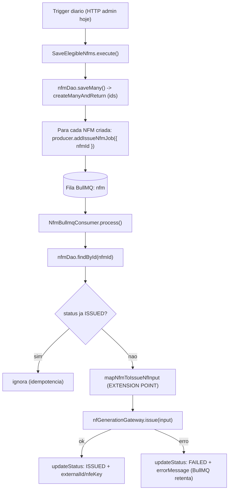

# Integracao assincrona da emissao de NFM via fila BullMQ

## Resposta a pergunta
Sim, fila e a abordagem correta: execucao diaria em lote + volume potencialmente alto + chamada externa lenta ao governo pedem desacoplar a emissao da persistencia, com retry/backoff isolado por NFM e sem que uma falha aborte o lote inteiro. Seguimos o padrao canonico de `src/app/upload-file/` (Rule 10 + skill `queue-bullmq`).

## Decisoes confirmadas
- 1 job por NFM/cliente (retry e falha isolados).
- Escopo: arquitetura de fila + tracking de status. O mapper `NfmDto -> IssueNfInputDto` (dados do emitente/tributacao) fica como ponto de extensao marcado, pois faltam dados do emitente (provavel origem: `prisma/schema/company.prisma`).

## Fluxo alvo

## 1. Schema e status
- `prisma/schema/nfm.prisma`: adicionar `externalId Int?`, `nfeKey String?`, `errorMessage String?`, `issuedAt DateTime?` (colunas dedicadas para o resultado da emissao). Manter `status String` e o `@@unique([clientId, referenceMonth, referenceYear])`.
- `src/app/tax-invoice/nfm/domain/enums/nfm-status.enum.ts`: adicionar `PROCESSING`, `ISSUED`, `FAILED` (mantendo `PENDING`).
- `src/infra/database/prisma/prisma.service.ts` ja trunca `nfm` (linha 25) — sem mudanca.
- Rodar `prisma migrate dev` para gerar a migration + client.

## 2. DAO (`INfmDao` + adapter)
Em [nfm-dao.interface.ts](src/app/tax-invoice/nfm/application/persistence/dao/nfm-dao.interface.ts) e [nfm-prisma.dao.ts](src/app/tax-invoice/nfm/infra/driven/persistence/prisma/nfm-prisma.dao.ts):
- `saveMany(rows)`: trocar `createMany` por `createManyAndReturn({ data, skipDuplicates: true, select: { id: true } })` e retornar as NFMs criadas com `id` (Prisma 5.22 + PostgreSQL suportam). Sera a fonte dos ids para enfileirar.
- `findById(id): Promise<NfmRecordDto | null>`: retorna id, status, `data` (snapshot `NfmDto`) e colunas necessarias para o consumer mapear/emitir.
- `updateIssuanceResult(id, patch)`: atualiza `status` + `externalId`/`nfeKey`/`errorMessage`/`issuedAt`.
- Novo DTO `NfmRecordDto` em `application/dtos/` (id + colunas + snapshot `data: NfmDto`).

## 3. Enums, token e infra de fila
- [queue-name.enum.ts](src/infra/queue/enums/queue-name.enum.ts): `Nfm = 'nfm'`.
- [job-name.enum.ts](src/infra/queue/enums/job-name.enum.ts): `IssueNfm = 'issue-nfm'`.
- [token.ts](src/core/di/token.ts): `NfmQueueProducer: Symbol.for('NfmQueueProducer')`.
- `QueueModule` global (`src/infra/queue/queue.module.ts`) ja carregado pelo InfraModule — sem mudanca.

## 4. Producer / Consumer / Module (padrao upload-file)
- `application/queue/jobs/issue-nfm-job.dto.ts`: classe pura `{ nfmId: number }` (payload minimo e serializavel; consumer re-le do banco).
- `application/queue/nfm-queue-producer.interface.ts`: `INfmQueueProducer { addIssueNfmJob(data: IssueNfmJobDto): Promise<void> }`.
- `infra/driven/queue/bullmq/nfm-queue-bullmq.producer.ts`: `@InjectQueue(QueueName.Nfm)` + `queue.add(JobName.IssueNfm, data)` (sem try/catch).
- `infra/driven/queue/fake/nfm-queue-fake.producer.ts`: `addedIssueNfmJobs: Array<...>`.
- `infra/drivers/queue/bullmq/nfm-bullmq.consumer.ts`: `@Processor(QueueName.Nfm)` + `WorkerHost`; injeta `TOKENS.NfmDao` e `TOKENS.NfGenerationGateway`; no `case IssueNfm`: carrega NFM, guard de idempotencia (pula se `ISSUED`/tem `externalId`), marca `PROCESSING`, chama o mapper, `gateway.issue(...)`, grava `ISSUED`+resultado; em erro grava `FAILED`+`errorMessage` e re-lanca (retry BullMQ); `default: throw new AppException('Unknown job name: ...')`.
- `infra/drivers/queue/bullmq/mappers/nfm-to-issue-nf.mapper.ts`: **EXTENSION POINT** — funcao pura `mapNfmToIssueNfInput(record): IssueNfInputDto` com TODO explicito (emitente via `company`, tributacao dos itens). Lanca erro claro enquanto nao implementado, para nao emitir nota incorreta.
- `application/queue/nfm-queue.module.ts`: `static register()` — `BullModule.registerQueue({ name: QueueName.Nfm, defaultJobOptions: { removeOnComplete: true, removeOnFail: true, attempts: 3, backoff: { type: 'exponential', delay: 1000 } } })` e consumer **so em producao**; producer sempre (`useClass: isTest ? Fake : Bullmq`); importa `NfmPersistenceModule` e `NfGenerationModule.register()`; exporta `TOKENS.NfmQueueProducer`.

## 5. Use case e wiring
- [save-elegible-nfms.service.ts](src/app/tax-invoice/nfm/application/usecases/save-elegible-nfms/save-elegible-nfms.service.ts): injetar `@Inject(TOKENS.NfmQueueProducer)`; apos `saveMany` (que agora retorna as NFMs com id), enfileirar `addIssueNfmJob({ nfmId })` para cada criada; manter retorno `{ created }`. Ordem: persistir primeiro, enfileirar depois (Rule 10, sem outbox).
- [nfm.module.ts](src/app/tax-invoice/nfm/nfm.module.ts): importar `NfmQueueModule.register()`.

## 6. Testes
- Producer BullMQ spec (add com `(JobName.IssueNfm, data)`, erro propaga).
- Consumer spec: sucesso (issue + updateStatus ISSUED), idempotencia (pula ISSUED), erro do gateway (marca FAILED e re-lanca), `default` lanca `AppException`.
- `save-elegible-nfms.service.spec.ts` (unit): mock `createMock<INfmQueueProducer>()`, verificar 1 job por NFM criada.
- `save-elegible-nfms.service.integration.spec.ts`: recuperar fake via `module.get(TOKENS.NfmQueueProducer)` e assertar `addedIssueNfmJobs` (ajustar aos testes atuais que ja passam por `NfmModule`).
- DAO spec: `saveMany` retorna ids, `findById`, `updateIssuanceResult`.
- Rodar `npm run lint`, `npm test`, `npm run build`.

## Fora de escopo (sinalizado)
- Mapper real `NfmDto -> IssueNfInputDto` e origem dos dados do emitente.
- Scheduler/cron diario (hoje o disparo e via `POST /admin/nfm`); pode ser adicionado depois (BullMQ repeat ou @Cron) sem alterar esta arquitetura.