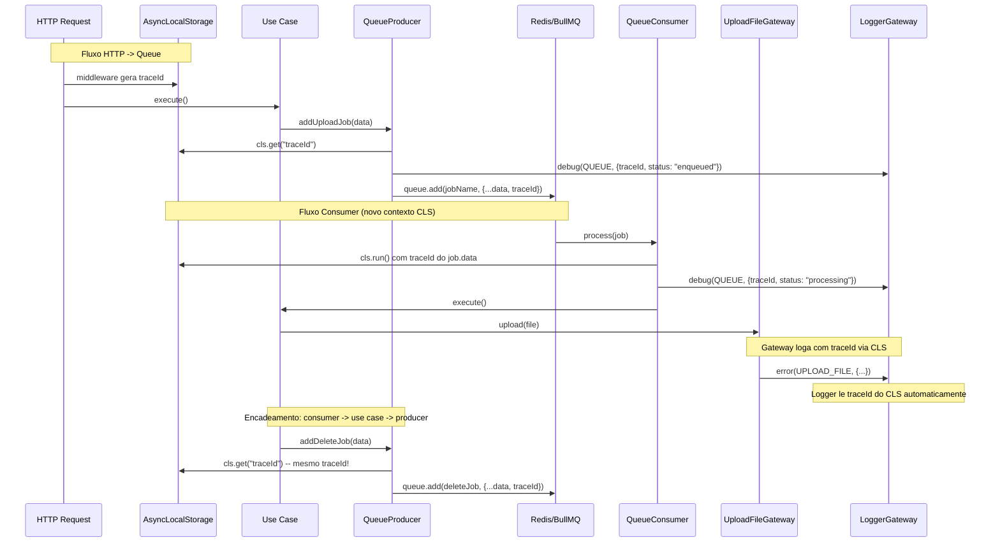

# Integracao Queue + Logger com traceId (via CLS)

## Contexto atual

- **Logger**: Winston com `LogContext` enum tipado. Cada contexto tem seu data type e arquivo de log separado (`logs/<context>.log`). Nenhum traceId ou correlacao existe hoje.
- **Queue**: BullMQ com producer/consumer para upload-file. O consumer nao injeta o logger. O producer nao loga nada.
- **Gateway de upload**: Ja loga erros com `LogContext.UPLOAD_FILE`, mas sem traceId.
- **Middleware HTTP**: Nenhum middleware NestJS existe. Apenas Express `helmet`/`compression`/`cors` em `main.ts`.

## Estrategia: AsyncLocalStorage via nestjs-cls

Usar o pacote `nestjs-cls` para criar um contexto de execucao (CLS) que propaga `traceId` automaticamente pela call stack assincrona. Isso resolve o cenario de encadeamento (consumer -> use case -> outro producer) sem poluir interfaces de dominio.



## Mudancas necessarias

### 1. Instalar e configurar `nestjs-cls`

Instalar o pacote `nestjs-cls`.

Configurar `ClsModule` no [src/app.module.ts](src/app.module.ts), importando como modulo global com middleware HTTP que gera traceId automaticamente por request:

```typescript
import { ClsModule } from 'nestjs-cls';
import crypto from 'crypto';

ClsModule.forRoot({
  global: true,
  middleware: {
    mount: true,
    generateId: true,
    idGenerator: () => crypto.randomUUID(),
  },
})
```

Isso faz com que toda requisicao HTTP automaticamente tenha um traceId no CLS (acessivel via `cls.getId()`).

### 2. Adicionar `LogContext.QUEUE` e `QueueData` ao logger

Em [src/infra/logger/logger.gateway.ts](src/infra/logger/logger.gateway.ts):

- Adicionar `QUEUE = 'queue'` ao enum `LogContext`
- Adicionar `QueueData` ao `LogContextDataMap`:

```typescript
type QueueData = CommomData & {
  queue: string;
  jobName: string;
  jobId?: string;
  status: 'enqueued' | 'processing' | 'completed' | 'failed';
}
```

Isso cria automaticamente o arquivo `logs/queue.log` no Winston (ja que itera `Object.values(LogContext)`).

### 3. Adicionar `traceId` ao `CommomData`

Em [src/infra/logger/logger.gateway.ts](src/infra/logger/logger.gateway.ts), adicionar `traceId?: string` ao tipo `CommomData`. Isso permite que **qualquer** log context carregue traceId.

```typescript
type CommomData = {
  accountId?: string;
  traceId?: string;
  error?: any;
  adapter?: string;
}
```

### 4. Integrar logger Winston com CLS

Em [src/infra/logger/adapters/winston/logger-winston.gateway.ts](src/infra/logger/adapters/winston/logger-winston.gateway.ts):

- Injetar `ClsService`
- Nos metodos `debug` e `error`, ler `traceId` do CLS (via `cls.getId()`) e anexar automaticamente ao `data`:

```typescript
import { ClsService } from 'nestjs-cls';

@Injectable()
export class LoggerWinstonAdapterGateway implements ILoggerGateway {
  constructor(private readonly cls: ClsService) {}

  public debug(context: LogContext, data: any): void {
    const traceId = this.cls.isActive() ? this.cls.getId() : undefined;
    this.logger.log('debug', { context, data: { ...data, traceId } });
  }

  public error(context: LogContext, data: any): void {
    const traceId = this.cls.isActive() ? this.cls.getId() : undefined;
    this.logger.log('error', { context, data: { ...data, traceId } });
  }
}
```

Com isso, **todo log da aplicacao** automaticamente inclui o traceId quando o CLS esta ativo, sem precisar mudar nenhum call site existente (HTTP filter, cache gateway, upload gateway, etc.).

### 5. Adicionar `traceId` aos job DTOs

Adicionar campo `traceId: string` em cada DTO para serializar o traceId no Redis junto com o payload do job:

- [src/app/upload-file/application/queue/jobs/upload-file-job.dto.ts](src/app/upload-file/application/queue/jobs/upload-file-job.dto.ts)
- [src/app/upload-file/application/queue/jobs/delete-file-job.dto.ts](src/app/upload-file/application/queue/jobs/delete-file-job.dto.ts)

### 6. Producer: ler traceId do CLS e logar

Em [src/app/upload-file/infra/driven/queue/bullmq/upload-file-queue-bullmq.producer.ts](src/app/upload-file/infra/driven/queue/bullmq/upload-file-queue-bullmq.producer.ts):

- Injetar `ClsService` e `ILoggerGateway`
- Ler traceId do CLS: se existir, reutilizar (cenario de encadeamento); se nao, gerar novo via `crypto.randomUUID()`
- Anexar traceId ao DTO antes de enfileirar
- Logar com `LogContext.QUEUE` e status `enqueued`

```typescript
public async addUploadJob(data: UploadFileJobDto): Promise<void> {
  const traceId = this.cls.isActive()
    ? (this.cls.getId() ?? crypto.randomUUID())
    : crypto.randomUUID();
  data.traceId = traceId;

  this.logger.debug(LogContext.QUEUE, {
    traceId,
    queue: QueueName.UploadFile,
    jobName: JobName.UploadFile,
    status: 'enqueued',
  });

  await this.queue.add(JobName.UploadFile, data);
}
```

### 7. Consumer: abrir contexto CLS e logar ciclo de vida

Em [src/app/upload-file/infra/drivers/queue/upload-file-bullmq.consumer.ts](src/app/upload-file/infra/drivers/queue/upload-file-bullmq.consumer.ts):

- Injetar `ClsService` e `ILoggerGateway`
- Envolver todo o `process()` em `cls.run()`, setando o traceId do job.data como ID do CLS
- Logar `processing` no inicio, `completed` no sucesso, `failed` no erro
- Todo codigo downstream (use cases, gateways, outros producers) herda o traceId automaticamente

```typescript
public async process(job: Job<UploadFileJobDto | DeleteFileJobDto>): Promise<void> {
  return this.cls.run(async () => {
    const traceId = (job.data as any).traceId ?? crypto.randomUUID();
    this.cls.set('CLS_ID', traceId);

    this.logger.debug(LogContext.QUEUE, {
      queue: QueueName.UploadFile,
      jobName: job.name,
      jobId: job.id,
      status: 'processing',
    });

    try {
      switch (job.name) {
        case JobName.UploadFile:
          await this.uploadFileGateway.upload(
            createMulterFileFromUploadJobDto(job.data as UploadFileJobDto),
          );
          break;
        case JobName.DeleteFile:
          await this.uploadFileGateway.delete(
            (job.data as DeleteFileJobDto).fileKey,
          );
          break;
        default:
          throw new AppException(`Unknown job name: ${job.name}`);
      }

      this.logger.debug(LogContext.QUEUE, {
        queue: QueueName.UploadFile,
        jobName: job.name,
        jobId: job.id,
        status: 'completed',
      });
    } catch (error) {
      this.logger.error(LogContext.QUEUE, {
        queue: QueueName.UploadFile,
        jobName: job.name,
        jobId: job.id,
        status: 'failed',
        error,
      });
      throw error;
    }
  });
}
```

### 8. Fake producer: gerar traceId

Em [src/app/upload-file/infra/driven/queue/fake/upload-file-queue-fake.producer.ts](src/app/upload-file/infra/driven/queue/fake/upload-file-queue-fake.producer.ts):

- Gerar traceId e anexar ao DTO para manter consistencia nos testes

## Arquivos impactados (resumo)

- `package.json` -- Adicionar `nestjs-cls`
- [src/app.module.ts](src/app.module.ts) -- Importar `ClsModule.forRoot(...)`
- [src/infra/logger/logger.gateway.ts](src/infra/logger/logger.gateway.ts) -- `LogContext.QUEUE`, `QueueData`, `traceId` em `CommomData`
- [src/infra/logger/adapters/winston/logger-winston.gateway.ts](src/infra/logger/adapters/winston/logger-winston.gateway.ts) -- Injetar `ClsService`, anexar traceId automaticamente
- [src/app/upload-file/application/queue/jobs/upload-file-job.dto.ts](src/app/upload-file/application/queue/jobs/upload-file-job.dto.ts) -- Adicionar `traceId: string`
- [src/app/upload-file/application/queue/jobs/delete-file-job.dto.ts](src/app/upload-file/application/queue/jobs/delete-file-job.dto.ts) -- Adicionar `traceId: string`
- [src/app/upload-file/infra/driven/queue/bullmq/upload-file-queue-bullmq.producer.ts](src/app/upload-file/infra/driven/queue/bullmq/upload-file-queue-bullmq.producer.ts) -- Injetar CLS + logger, ler/gerar traceId, logar
- [src/app/upload-file/infra/driven/queue/fake/upload-file-queue-fake.producer.ts](src/app/upload-file/infra/driven/queue/fake/upload-file-queue-fake.producer.ts) -- Gerar traceId
- [src/app/upload-file/infra/drivers/queue/upload-file-bullmq.consumer.ts](src/app/upload-file/infra/drivers/queue/upload-file-bullmq.consumer.ts) -- Injetar CLS + logger, cls.run(), logar ciclo de vida

## Beneficio: propagacao automatica

Com essa abordagem, **sem nenhuma mudanca adicional**, todos os logs existentes que ja usam o logger (HTTP exception filter, cache gateway, upload S3 gateway, CEP/CNPJ gateways) passam automaticamente a incluir `traceId` quando executados dentro de um contexto CLS ativo. Nenhum call site existente precisa ser alterado.