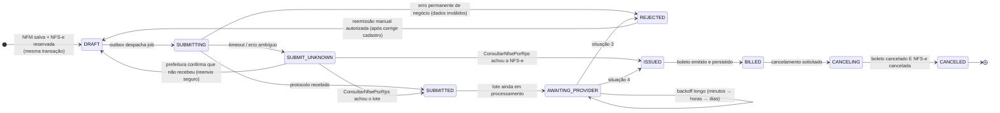
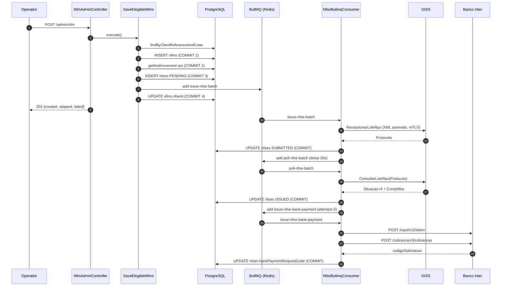
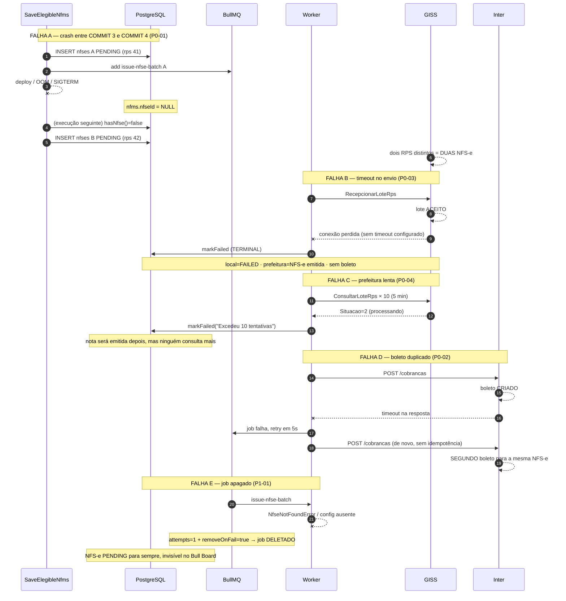

# Auditoria de resiliência — fluxo de emissão de NFM (NFS-e + boleto)

> Data: 2026-09-01 · Branch analisada: `fix/nfm-flow` (HEAD `84d5fd36`)
> Escopo: `src/app/tax-invoice/nfm`, `src/app/tax-invoice/nfse`, `src/app/bank-payment`,
> `src/infra/nfs-generation` (GISS), `src/infra/bank-payment` (Inter), `src/infra/queue`, `prisma/schema`.
> Nenhum código foi alterado. Toda afirmação sobre o comportamento atual cita `arquivo:linha`.

---

## 1. Sumário executivo

O fluxo funciona no caminho feliz e falha de forma perigosa em quase todos os outros. Três
propriedades explicam o risco:

1. **Não existe fronteira transacional entre o efeito externo e o estado local.** A NFS-e é criada,
   o número de RPS é consumido e o job é enfileirado (`issue-nfse.service.ts:84-124`) três `await`
   antes de a NFM ser vinculada à NFS-e (`save-elegible-nfms.service.ts:100`). Um crash ou deploy
   nessa janela faz a próxima execução emitir **uma segunda NFS-e** para o mesmo serviço.
2. **Erro transitório é tratado como erro permanente.** Qualquer exceção do GISS — timeout, 429,
   TLS, 5xx — marca a nota como `FAILED` terminal (`process-issue-nfse-batch.service.ts:112`), e a
   janela total de consulta do lote é de ~5 minutos (`process-poll-nfse-batch.service.ts:17-18`).
   Uma prefeitura fora do ar por horas produz notas `FAILED` localmente que **existem** no GISS.
3. **Nenhuma chamada HTTP tem timeout** (`nfs-generation.module.ts:18`,
   `bank-payment-inter.module.ts:11`), não há chave de idempotência no Inter
   (`inter-cobranca.client.ts:42-63`) e o job de boleto tem `attempts: 5`
   (`nfse-queue-bullmq.producer.ts:26-29`): um timeout depois de o boleto ter sido criado gera
   **até cinco cobranças duplicadas** no cliente final.

Somam-se: cancelar a NFM **não cancela o boleto** (`cancel-nfm.service.ts:15-30`), não existe rota
para reemitir o RPS de uma NFM (`nfm-admin.controller.ts:30-91`), `removeOnFail: true` apaga o job
que falhou sem deixar rastro (`nfse-queue.module.ts:33`), não há job de reconciliação nem
scheduler algum, e o certificado digital A1 de produção está versionado no repositório
(`resources/files/nfs-generation/giss/DPA_TEC_EQUIPAMENTOS_DE_PONTO_LTDA_02099923000178.pfx`).

**Prioridade:** timeouts + `removeOnFail` + idempotência do boleto + cancelamento em cascata
eliminam a maior parte do risco financeiro com esforço pequeno. A reconciliação com o GISS
(consulta por RPS) é o item grande e o único que fecha o risco fiscal de verdade.

---

## 2. Fluxo atual mapeado

### 2.1 Ponta a ponta, com limites transacionais

Único gatilho: `POST /admin/nfm` → `NfmAdminController.saveElegible()`
(`src/app/tax-invoice/nfm/infra/drivers/http/admin/nfm-admin.controller.ts:62`).
**Não há scheduler**: nenhum `@Cron`, `ScheduleModule` ou job repetível no `src/`
(busca sem resultado). A tabela `NfmCronRun` (`prisma/schema/nfm.prisma:22`) registra o resultado
de uma execução que hoje é sempre manual.

| # | Passo | Arquivo:linha | Tipo |
|---|-------|---------------|------|
| 1 | `SaveElegibleNfms.execute()` | `save-elegible-nfms.service.ts:30` | entrada |
| 2 | `FindElegibleClients.execute()` — filtra `dueDateDay: today`, `generateNf: true` | `find-elegible-clients.service.ts:18-26` | leitura |
| 3 | Loop por elegível (sequencial, sem limite) | `save-elegible-nfms.service.ts:44` | — |
| 4 | `nfmRepository.findByClientReferenceAndCnae(...)` | `save-elegible-nfms.service.ts:59` | leitura |
| 5 | `if (existing?.hasNfse()) skip` — **dedup baseado só na presença do vínculo, não no status** | `save-elegible-nfms.service.ts:66` | decisão |
| 6 | `nfmRepository.save(created)` | `save-elegible-nfms.service.ts:86` → `nfm-prisma.repository.ts:51` | **COMMIT 1** |
| 7 | `rpsSequenceRepository.getAndIncrement(companyId)` | `issue-nfse.service.ts:84` → `nfse-rps-sequence-prisma.repository.ts:10-16` | **COMMIT 2 — consome número de RPS** |
| 8 | `nfseRepository.save(entity)` — status `PENDING` | `issue-nfse.service.ts:122` → `nfse-prisma.repository.ts:35` | **COMMIT 3** |
| 9 | `queueProducer.addIssueBatchJob({ nfseId })` | `issue-nfse.service.ts:124` → `nfse-queue-bullmq.producer.ts:18` | **efeito externo (Redis)** |
| 10 | `nfseRepository.findById(issued.id)` | `save-elegible-nfms.service.ts:94` | leitura |
| 11 | `nfm.linkNfse(nfse)` + `nfmRepository.edit(nfm)` | `save-elegible-nfms.service.ts:99-100` | **COMMIT 4 — fecha a janela de duplicidade** |
| 12 | `nfmCronRunDao.save(result)` | `save-elegible-nfms.service.ts:112` | **COMMIT 5** |

Worker (`NfseBullmqConsumer.process`, `nfse-bullmq.consumer.ts:25`; `@Processor(QueueName.Nfse)`
sem opções → concorrência default 1, sem `limiter`):

| # | Passo | Arquivo:linha | Tipo |
|---|-------|---------------|------|
| 13 | `ProcessIssueNfseBatch.execute` | `process-issue-nfse-batch.service.ts:27` | job `issue-nfse-batch` |
| 14 | `nfsGenerationGateway.issueBatch(...)` → `RecepcionarLoteRps` | `process-issue-nfse-batch.service.ts:50` → `giss-soap-client.ts:77` | **CHAMADA EXTERNA GISS** |
| 15 | catch → `markFailed` + `edit` | `process-issue-nfse-batch.service.ts:112-113` | **COMMIT (terminal)** |
| 16 | `markSubmitted(batchProtocol)` + `edit` | `process-issue-nfse-batch.service.ts:117-118` | **COMMIT** |
| 17 | `addPollBatchJob(delay 30s)` | `process-issue-nfse-batch.service.ts:120-123` | efeito externo (Redis) |
| 18 | `ProcessPollNfseBatch.execute` | `process-poll-nfse-batch.service.ts:28` | job `poll-nfse-batch` |
| 19 | `nfsGenerationGateway.getBatchStatus(...)` → `ConsultarLoteRps` | `process-poll-nfse-batch.service.ts:49` | **CHAMADA EXTERNA GISS** |
| 20 | `Success` → `markIssued` + `edit` | `process-poll-nfse-batch.service.ts:74-75` | **COMMIT** |
| 21 | `addIssueBankPaymentJob({ nfseId })` | `process-poll-nfse-batch.service.ts:76` | efeito externo (Redis) |
| 22 | `Error` → `markFailed` + `edit` | `process-poll-nfse-batch.service.ts:82-83` | **COMMIT (terminal)** |
| 23 | `NotReceived`/`Pending` → `rescheduleOrFail` (máx. 10 × 30s) | `process-poll-nfse-batch.service.ts:88-104` | — |
| 24 | `ProcessIssueNfseBankPayment.execute` | `process-issue-nfse-bank-payment.service.ts:25` | job `issue-nfse-bank-payment` |
| 25 | `issueBankPayment.execute(...)` → `POST /cobranca/v3/cobrancas` | `process-issue-nfse-bank-payment.service.ts:72` → `inter-cobranca.client.ts:46,151` | **CHAMADA EXTERNA INTER** |
| 26 | `linkBankPayment(provider, requestCode)` + `edit` | `process-issue-nfse-bank-payment.service.ts:74-75` | **COMMIT — fecha a janela de duplicidade** |

Caminhos laterais que escrevem nas mesmas entidades:

- **Retry manual do boleto:** `POST /admin/bank-payment/nfm/:id`
  (`bank-payment-admin.controller.ts:65`) → `IssueBankPaymentByNfmId.execute`
  (`issue-bank-payment-by-nfm-id.service.ts:17`) → **chama `ProcessIssueNfseBankPayment` síncrono
  dentro da requisição HTTP**, sem fila e sem timeout.
- **Cancelamento:** `POST /admin/nfm/:id/cancel` (`nfm-admin.controller.ts:76`) → `CancelNfm.execute`
  (`cancel-nfm.service.ts:15`) → `CancelNfse.execute` (`cancel-nfse.service.ts:19`) →
  `cancelNfse` no GISS (:37) → `markCanceled` + `edit` (:46-47). **Não toca no boleto.**
- **Edição de NFM emitida:** não localizado (não existe rota de edição).
- **Importação em lote / reprocessamento:** não localizado.
- **Webhook de baixa do boleto:** não localizado (nenhum controller de webhook em todo o `src/`).

### 2.2 Modelo de dados — o vínculo NFM → RPS → NFS-e → boleto

```
nfms (prisma/schema/nfm.prisma)
  id
  clientId, referenceMonth, referenceYear, cnaeNbsIndopId  ── @@unique (linha 18)
  nfseId Int? @unique (linha 10)  ─────────────┐  único vínculo NFM→NFS-e
  totalValueInCents (linha 8)                  │  congelado na 1ª execução
  data Json (linha 11) = snapshot do NfmDto    │
  (NÃO EXISTE coluna de status)                │
                                               │
nfses (prisma/schema/nfse.prisma)  ◄───────────┘
  id
  rpsNumber, rpsSeries + companyId ── @@unique (linha 23)   ← chave natural do RPS na prefeitura
  status String (linha 7)            ← String livre, sem enum/check no banco
  batchProtocol String? (linha 8)    ← protocolo do lote GISS
  nfseNumber, verificationCode, issuedAt (linhas 9-11)      ← identidade da NFS-e
  errorMessage (linha 12)
  canceledAt, cancelReasonCode (linhas 13-14)
  bankPaymentProvider, bankPaymentRequestCode (linhas 15-16) ← vínculo NFS-e→boleto
  data Json (linha 17) = NfseIssueSnapshot (issue-nfse.service.ts:28-46)
  (sem coluna de versão / lock otimista; sem índice em status ou updatedAt)

nfse_rps_sequences (prisma/schema/nfse.prisma:27)
  companyId @id, nextId   ← incremento atômico em SQL bruto
```

Campos que **não existem** e são necessários para operar: status/estado da NFM, timestamp da
última tentativa, contador de tentativas, mensagem de erro do boleto, chave de idempotência,
correlation id, e qualquer registro de payload/resposta externa.

### 2.3 Máquina de estados real da NFS-e

A NFM não tem estado próprio — seu único estado é `nfseId` nulo ou não nulo. Todo o ciclo de vida
vive em `Nfse.status` (`nfse-status.enum.ts`), com as transições implementadas em
`nfse.entity.ts:59-96`.


Buracos concretos da máquina de estados:

- `isTerminal()` (`nfse.entity.ts:51`) = `ISSUED || FAILED`. **`CANCELED` não é terminal**, logo
  `canPoll()` (:55) aceita uma nota cancelada com protocolo e um poll atrasado pode chamar
  `markIssued` (:70, cujo guard só bloqueia `ISSUED`) → nota volta para `ISSUED` com `canceledAt`
  preenchido.
- `markSubmitted`/`markProcessing`/`markFailed` só verificam `ensureNotIssued` (:108) —
  `FAILED → SUBMITTED` é permitido pela entidade.
- Não existe estado para "enviado, resultado desconhecido", que é exatamente o estado em que o
  sistema fica após um timeout.
- `status` é `String` no banco (`nfse.prisma:7`), sem enum nem check constraint.

### 2.4 Máquina de estados necessária



Diferenças que importam: `SUBMIT_UNKNOWN` (hoje inexistente — vira `FAILED`),
`AWAITING_PROVIDER` sem prazo curto (hoje `PROCESSING` com teto de 5 min),
`REJECTED` separado de falha de infraestrutura (hoje ambos são `FAILED`),
`BILLED` explícito (hoje "ISSUED com `bankPaymentRequestCode` não nulo", sem alarme quando fica nulo),
e `REJECTED → DRAFT` como transição autorizada (hoje só via `UPDATE` no banco).

### 2.5 Sequência — caminho feliz



### 2.6 Sequência — caminhos de falha



---

## 3. Achados

## 3.1 P0 — Crítico (risco fiscal ou financeiro concreto)

### [P0-01] Segunda NFS-e emitida quando o processo morre entre a criação da NFS-e e o vínculo com a NFM

- **Onde:** `src/app/tax-invoice/nfm/application/usecases/save-elegible-nfms/save-elegible-nfms.service.ts:66`, `:86`, `:92`, `:99-100`
- **O que acontece hoje:** o critério de deduplicação é a presença do vínculo, e o vínculo é o
  **último** passo:

  ```ts
  if (existing?.hasNfse()) { result.skipped += 1; continue; }   // :66
  // ...
  const id = await this.nfmRepository.save(created);            // :86  COMMIT 1
  // ...
  const issued = await this.issueNfse.execute(issueInput);      // :92  COMMIT 2+3 + job na fila
  const nfse = await this.nfseRepository.findById(issued.id);   // :94
  nfm.linkNfse(nfse);                                           // :99
  await this.nfmRepository.edit(nfm);                           // :100 COMMIT 4
  ```

  Entre `:92` e `:100` a NFS-e já existe, o número de RPS já foi consumido
  (`issue-nfse.service.ts:84`) e o job já está no Redis (`issue-nfse.service.ts:124`), mas a NFM
  ainda tem `nfseId = NULL` (`nfm-prisma.repository.ts:75`).
- **Cenário de falha:**
  1. `POST /admin/nfm`. NFM 500 é criada. `IssueNfse` cria a NFS-e #A com RPS 41 e enfileira o job.
  2. Deploy/`SIGTERM`/OOM antes da linha `:100`.
  3. O worker processa o job #A normalmente: RPS 41 vai ao GISS, vira NFS-e 12345.
  4. O operador roda `POST /admin/nfm` de novo no mesmo dia. `findByClientReferenceAndCnae`
     encontra a NFM 500, `hasNfse()` é `false`, o fluxo entra no ramo `existing` (`:72-74`) e chama
     `IssueNfse` outra vez → NFS-e #B com RPS 42 → NFS-e 12346.
  5. `@@unique([companyId, rpsSeries, rpsNumber])` (`nfse.prisma:23`) não protege: os RPS são
     diferentes, então o GISS aceita os dois como serviços distintos.
- **Impacto:** fiscal — NFS-e duplicada, ISS pago em duplicidade, cancelamento junto à prefeitura
  (prazo limitado por município). Financeiro em cascata: cada NFS-e `ISSUED` enfileira o próprio
  job de boleto (`process-poll-nfse-batch.service.ts:76`) → **cobrança duplicada** no cliente.
- **Correção proposta:** tornar o vínculo atômico com a criação. Envolver
  `getAndIncrement` + `INSERT nfses` + `UPDATE nfms.nfseId` num único `prisma.$transaction`, e só
  então enfileirar o job (padrão outbox: gravar a intenção na transação e despachar depois do
  commit). Alternativa mais barata e quase tão boa: inverter a ordem — criar a NFS-e `DRAFT`,
  vincular à NFM na mesma transação, e enfileirar por último.
- **Esforço:** M

### [P0-02] Retry do job de boleto emite cobrança duplicada no Inter (sem chave de idempotência)

- **Onde:** `src/app/tax-invoice/nfse/application/usecases/process-issue-nfse-bank-payment/process-issue-nfse-bank-payment.service.ts:72-75`; `src/app/tax-invoice/nfse/infra/driven/queue/bullmq/nfse-queue-bullmq.producer.ts:26-29`; `src/infra/bank-payment/adapters/inter/cobranca/inter-cobranca.client.ts:42-63`
- **O que acontece hoje:**

  ```ts
  const result = await this.issueBankPayment.execute(issueInput);   // :72  cria o boleto no Inter
  nfse.linkBankPayment(result.provider, result.requestCode);        // :74
  await this.nfseRepository.edit(nfse);                             // :75  só aqui persiste
  ```

  O job é registrado com `attempts: 5` e backoff exponencial
  (`nfse-queue-bullmq.producer.ts:27-28`). O `POST /cobrancas`
  (`inter-cobranca.client.ts:46`) não envia nenhum cabeçalho de idempotência, e nada consulta o
  Inter antes de emitir. O único identificador enviado é `seuNumero = String(nfseId).slice(0,15)`
  (`nfse-to-issue-bank-payment.mapper.ts:37`), que a API trata como campo livre.
  A guarda `nfse.hasBankPayment()` (`:33`) só é verdadeira **depois** de `:75`.
- **Cenário de falha:**
  1. O Inter recebe o `POST`, cria o boleto e começa a responder.
  2. A conexão cai (ou simplesmente demora — não há timeout, ver P0-05). Axios lança;
     `request()` mapeia para `ExternalApiError` (`inter-cobranca.client.ts:186`).
  3. O job falha. BullMQ reagenda em 5s. `hasBankPayment()` continua `false`.
  4. Segundo `POST` → segundo boleto para a mesma NFS-e. Repete-se até 5 vezes.
  5. O mesmo acontece se o worker morrer entre `:72` e `:75`: o BullMQ reentrega o job "stalled".
- **Impacto:** financeiro direto — até 5 cobranças para o mesmo serviço, com Pix e código de barras
  válidos. Recuperação exige cancelar boletos um a um pelo `POST /admin/bank-payment/:codigo/cancel`
  depois de descobrir quais existem (não há consulta por NFS-e).
- **Correção proposta:** três camadas, nesta ordem:
  1. Persistir a intenção **antes** da chamada: nova coluna
     `bankPaymentIdempotencyKey` (por exemplo `nfse-{id}`) e `bankPaymentRequestedAt`, gravadas
     antes de `:72`.
  2. Em qualquer tentativa com `job.attemptsMade > 0`, consultar o Inter antes de emitir —
     `InterCobrancaClient.list` (`inter-cobranca.client.ts:80`) já aceita filtro por período, e o
     mapper já lê `seuNumero` (`inter-cobranca.mapper.ts:117`); basta procurar pelo `seuNumero` da
     NFS-e antes de reemitir.
  3. Enviar cabeçalho de idempotência se a API do Inter suportar (verificar na documentação —
     ver §9, pergunta em aberto).
- **Esforço:** M

### [P0-03] Timeout ou erro transitório no envio do RPS marca a nota como FAILED terminal sem consultar o GISS

- **Onde:** `src/app/tax-invoice/nfse/application/usecases/process-issue-nfse-batch/process-issue-nfse-batch.service.ts:105-115`
- **O que acontece hoje:**

  ```ts
  catch (error: any) {
    this.logger.error(LogContext.NFS_GENERATION, { adapter: 'nfse', action: 'processIssueNfseBatch', error });
    nfse.markFailed(error?.message ?? 'Erro desconhecido ao enviar lote ao provedor de NFS-e');
    await this.nfseRepository.edit(nfse);
    return;
  }
  ```

  `markFailed` leva a `FAILED`, que `isTerminal()` (`nfse.entity.ts:51`) considera definitivo:
  `canPoll()` passa a retornar `false` e nada mais acontece. O `catch` não distingue timeout de
  rede, 429, TLS, 5xx ou XML rejeitado — o gateway já converteu tudo em `ExternalApiError`
  (`nfs-generation-giss.gateway.ts:56`). O protocolo não existe (a resposta se perdeu), então nem
  `ConsultarLoteRps` é possível; e `ConsultarNfsePorRps` — a consulta pela chave natural
  (número + série do RPS + prestador) — **não está implementada** (`nfs-generation.gateway.ts`,
  não localizado).
- **Cenário de falha:**
  1. `RecepcionarLoteRps` chega ao GISS, que persiste o lote e emite a NFS-e.
  2. A resposta se perde (RST, proxy, timeout).
  3. Local: `FAILED`. Prefeitura: NFS-e emitida com o RPS 41.
  4. A NFM continua com `nfseId` preenchido → `hasNfse()` é `true` → toda execução futura pula
     (`save-elegible-nfms.service.ts:66`).
  5. Resultado: existe uma NFS-e no GISS que o sistema desconhece, sem boleto e sem receita.
- **Impacto:** fiscal (obrigação tributária invisível, que aparece no cruzamento da prefeitura) +
  financeiro (serviço prestado e não cobrado). Magnitude: uma nota por ocorrência, silenciosa.
- **Correção proposta:**
  1. Classificar o erro antes de decidir: `NfsProviderConfigError` e rejeições de schema são
     permanentes (`REJECTED`); timeout, `ECONNRESET`, 5xx e 429 são ambíguos → novo estado
     `SUBMIT_UNKNOWN`, nunca `FAILED`.
  2. Implementar `ConsultarNfsePorRps` no `INfsGenerationGateway` e um job de reconciliação que
     consulta pela chave natural (rpsNumber + rpsSeries + prestador) antes de qualquer decisão.
     Essa chave é a idempotência real com a prefeitura: reenviar o **mesmo** RPS é seguro (o GISS
     rejeita duplicidade); criar um RPS **novo** é que duplica a nota.
- **Esforço:** G

### [P0-04] Janela de consulta do lote é de 5 minutos: prefeitura lenta produz nota FAILED que existe no GISS

- **Onde:** `src/app/tax-invoice/nfse/application/usecases/process-poll-nfse-batch/process-poll-nfse-batch.service.ts:17-18`, `:62`, `:88`, `:91-96`
- **O que acontece hoje:** `MAX_ATTEMPTS = 10` e `POLL_DELAY_MS = 30_000`, com o primeiro poll em
  +30s (`process-issue-nfse-batch.service.ts:17`). A janela total é de ~5 minutos. Esgotada,
  `rescheduleOrFail` chama `markFailed` (`:93`) — inclusive quando a causa foi o **próprio GISS
  estar fora do ar** (`:62`, o `catch` de `getBatchStatus`) ou o lote ainda estar na situação 2
  (processando, `:88`).
- **Cenário de falha:**
  1. Lote aceito às 09:00, protocolo gravado, status `SUBMITTED`.
  2. O GISS entra em manutenção às 09:01.
  3. 09:00:30 → 09:05:00: dez consultas falham. Na décima, `markFailed("Erro ao consultar status
     do lote no Giss")`.
  4. 14:00: o GISS volta e processa o lote — a NFS-e é emitida normalmente.
  5. O sistema nunca fica sabendo. `canPoll()` é `false`, não há job, não há rota de reconsulta.
- **Impacto:** fiscal + financeiro, em lote — numa indisponibilidade de 10 minutos, **todas** as
  notas do fechamento do dia viram `FAILED` com a NFS-e emitida do outro lado.
- **Correção proposta:**
  1. Nunca marcar `FAILED` quando existe `batchProtocol` e a situação nunca foi `Error`. Usar
     `AWAITING_PROVIDER`.
  2. Backoff escalonado em vez de 30s fixo: 30s, 1min, 5min, 15min, 1h, 6h, 24h — mantendo a
     nota viva por dias.
  3. Separar "esgotou tentativas de curto prazo" (passa para o job diário de reconciliação) de
     "GISS rejeitou o lote" (situação 3 → `REJECTED`).
- **Esforço:** M

### [P0-05] Nenhuma chamada HTTP ao GISS ou ao Inter tem timeout

- **Onde:** `src/infra/nfs-generation/nfs-generation.module.ts:18`; `src/infra/bank-payment/adapters/inter/bank-payment-inter.module.ts:11`; usos em `giss-soap-client.ts:77`, `inter-cobranca.client.ts:151`, `inter-oauth.client.ts:86`
- **O que acontece hoje:** `HttpModule` é importado sem configuração em ambos os módulos, então o
  axios usa `timeout: 0` (sem limite). Nenhuma das três chamadas passa `timeout` ou `signal` no
  request. Agravante: `.env.production` e `.env.development` definem `INTER_HTTP_TIMEOUT_MS`, mas
  **nenhum código lê essa variável** (busca sem resultado; `config.service.ts:126-145` não expõe
  getter correspondente, e a variável nem consta do `.env.example`) — é configuração morta que
  sugere uma proteção inexistente.
- **Cenário de falha:** o GISS aceita a conexão TCP e não responde (comportamento comum em
  sobrecarga). O worker fica bloqueado no `await` indefinidamente. Como o `@Processor`
  (`nfse-bullmq.consumer.ts:14`) não define concorrência, o BullMQ usa 1 — **a fila inteira de
  NFS-e para**. Nenhuma nota nova é emitida, nenhum poll roda, nenhum boleto é gerado, e nada
  alerta.
- **Impacto:** operacional e financeiro — parada total da emissão, sem sinal. Também é a condição
  que dispara P0-02 (timeout depois de o boleto ter sido criado).
- **Correção proposta:** `HttpModule.register({ timeout: 30_000 })` no `nfs-generation.module.ts`
  (envio de lote) e `{ timeout: 15_000 }` no `bank-payment-inter.module.ts`; timeout menor
  (~10s) por chamada no poll e no OAuth via `signal: AbortSignal.timeout(...)`. Ler
  `INTER_HTTP_TIMEOUT_MS` no `ConfigService` ou remover a variável.
- **Esforço:** P

### [P0-06] Cancelar a NFM não cancela o boleto

- **Onde:** `src/app/tax-invoice/nfm/application/usecases/cancel-nfm/cancel-nfm.service.ts:15-30`
- **O que acontece hoje:**

  ```ts
  nfm.ensureCanCancel();
  const result = await this.cancelNfse.execute(nfm.props.nfse!.props.id, input);
  return { id: nfmId, status: result.status, canceledAt: result.canceledAt };
  ```

  Nada lê `nfse.props.bankPaymentRequestCode`. `CancelBankPayment`
  (`cancel-bank-payment.service.ts:13`) existe e funciona, mas só é alcançável pela rota manual
  `POST /admin/bank-payment/:codigoSolicitacao/cancel` (`bank-payment-admin.controller.ts:126`) —
  que exige que alguém saiba o código.
- **Cenário de falha:**
  1. NFS-e emitida, boleto gerado, cliente recebeu.
  2. O serviço não foi prestado; o operador cancela: `POST /admin/nfm/500/cancel` com
     `cancelReasonCode: 2`.
  3. `CancelNfse` cancela a nota no GISS e grava `CANCELED` (`cancel-nfse.service.ts:46-47`).
  4. O boleto continua ativo, vence, entra em cobrança, o cliente paga.
  5. Devolução manual + conciliação bancária + nota fiscal cancelada com pagamento recebido.
- **Impacto:** financeiro e reputacional. Também vale o inverso: se o cancelamento no GISS falhar
  (`cancelNfse` lança), nada é cancelado — comportamento correto, mas hoje é coincidência, não
  desenho.
- **Correção proposta:** cancelar na ordem **boleto primeiro, nota depois** (cancelar cobrança é
  reversível — basta reemitir; cancelar NFS-e não é). Concretamente: em `CancelNfm`, se
  `bankPaymentRequestCode` existir, chamar `CancelBankPayment` antes de `CancelNfse`; se o
  cancelamento do boleto falhar, abortar sem tocar na nota. Enfileirar o cancelamento do boleto
  como job com retry caso se prefira desacoplar — mas então a NFM precisa de um estado
  `CANCELING`.
- **Esforço:** M

### [P0-07] Certificado digital A1 de produção versionado no repositório

- **Onde:** `resources/files/nfs-generation/giss/DPA_TEC_EQUIPAMENTOS_DE_PONTO_LTDA_02099923000178.pfx` (rastreado pelo git); referenciado como `certFilePath` em `prisma/seeds/find-elegible-clients-nfm.ts:50,465,477` e `prisma/seeds/nfse-curl-manual-test.ts:16-18,99,111`
- **O que acontece hoje:** o PKCS#12 do CNPJ 02.099.923/0001-78 está no repositório e é gravado em
  `nfs_provider_configs.certFilePath` pelas seeds. A senha está corretamente fora do repositório,
  em `GISS_CERT_PASSWORD` (`giss-pfx-loader.ts:12`, com `.env.*` no `.gitignore:41-43`) — mas um
  arquivo PKCS#12 é atacável offline por força bruta, sem limite de tentativas e sem deixar rastro.
  A chave privada do Inter (`resources/files/bank-payment/inter/Sandbox_InterAPI_Chave.key`) também
  está versionada; é sandbox, mas o padrão se repetirá em produção.
- **Cenário de falha:** qualquer pessoa com acesso de leitura ao repositório (ou a um clone, um
  fork, um backup, um laptop) obtém o material criptográfico. Com a senha quebrada, emite NFS-e em
  nome da empresa.
- **Impacto:** segurança — emissão fraudulenta de notas fiscais em nome da empresa.
- **Correção proposta:** remover do índice e do histórico (`git filter-repo`), **rotacionar o
  certificado junto à AC** (a exposição já ocorreu, remover não desfaz), e passar a entregar o
  arquivo por volume montado ou secret manager, com `certFilePath` apontando para fora da árvore
  do projeto. Mesmo tratamento para a chave do Inter.
- **Esforço:** M

---

## 3.2 P1 — Alto (perda de dados ou operação travada exigindo intervenção manual)

### [P1-01] `removeOnFail: true` apaga o job que falhou: não há dead letter queue nem rastro

- **Onde:** `src/app/tax-invoice/nfse/application/queue/nfse-queue.module.ts:31-34`; `src/app/tax-invoice/nfse/infra/driven/queue/bullmq/nfse-queue-bullmq.producer.ts:18`, `:22`
- **O que acontece hoje:**

  ```ts
  defaultJobOptions: { removeOnComplete: true, removeOnFail: true },   // :31-34
  ```

  e os dois primeiros jobs do fluxo não definem `attempts`:

  ```ts
  await this.queue.add(JobName.IssueNfseBatch, data);                            // :18 → 1 tentativa
  await this.queue.add(JobName.PollNfseBatch, data, { delay: options?.delayMs }); // :22 → 1 tentativa
  ```

  Qualquer exceção que escape do use case — `NfseNotFoundError`
  (`process-issue-nfse-batch.service.ts:30`), falha de `findCompanyNfsConfigByCompanyId` (`:36`),
  erro de conexão com o banco, falha ao gravar (`:113`, `:118`) — falha o job, que é **apagado**.
- **Cenário de falha:** a configuração fiscal da empresa é editada e fica momentaneamente
  inconsistente. Dez jobs de `issue-nfse-batch` estouram em `:36`, os dez são deletados, e dez
  NFS-e ficam em `PENDING` para sempre. O Bull Board (`queue.module.ts:41`) não mostra nada, porque
  o job não existe mais.
- **Impacto:** operacional — perda silenciosa. Só uma consulta SQL direta encontra as notas presas.
- **Correção proposta:** `removeOnFail: { age: 2_592_000 }` (30 dias) ou `false`; `attempts: 5` com
  backoff exponencial + jitter para `IssueNfseBatch` e `PollNfseBatch`; uma fila `nfse-dlq` que
  recebe o job após esgotar as tentativas, com painel no Bull Board.
- **Esforço:** P

### [P1-02] NFS-e presa em PENDING / SUBMITTED / PROCESSING não tem quem a resgate

- **Onde:** `issue-nfse.service.ts:122-124`; `process-issue-nfse-batch.service.ts:117-123`; `process-poll-nfse-batch.service.ts:74-76`; ausência de scheduler em todo o `src/`
- **O que acontece hoje:** há três janelas em que o estado é gravado e o job seguinte é enfileirado
  em seguida, sem atomicidade:

  | Commit | Enfileiramento | Se falhar no meio |
  |---|---|---|
  | `INSERT nfses PENDING` (`issue-nfse.service.ts:122`) | `addIssueBatchJob` (`:124`) | NFS-e `PENDING` órfã |
  | `markSubmitted` + `edit` (`process-issue-nfse-batch.service.ts:117-118`) | `addPollBatchJob` (`:120`) | `SUBMITTED` com protocolo e sem poll |
  | `markIssued` + `edit` (`process-poll-nfse-batch.service.ts:74-75`) | `addIssueBankPaymentJob` (`:76`) | `ISSUED` sem boleto |

  Nenhum job varre estados não terminais. Não existe `@Cron`, `ScheduleModule` nem job repetível
  (busca sem resultado no `src/`); o plano interno
  `.cursor/plans/nfm_queue_issuance_d1604f07.plan.md:95` confirma que o agendamento foi deixado
  para depois.
- **Cenário de falha:** Redis reinicia entre o commit e o `add`. A nota fica num estado
  intermediário permanente. Como `Nfm.hasNfse()` é `true`, o `POST /admin/nfm` pula para sempre.
- **Impacto:** operacional — nota presa sem diagnóstico e sem saída automática.
- **Correção proposta:** tabela outbox escrita na mesma transação do estado + um job repetível
  (a cada 5 min) que busca `nfses` em estado não terminal com `updatedAt < now() - interval` e
  reenfileira o job correspondente. Requer índice `(status, updatedAt)` em `nfses` — hoje
  inexistente (`prisma/schema/nfse.prisma` só tem `@@unique([companyId, rpsSeries, rpsNumber])`).
- **Esforço:** M

### [P1-03] Falha na emissão do boleto é engolida: o job termina com sucesso e a NFS-e fica sem cobrança

- **Onde:** `src/app/tax-invoice/nfse/application/usecases/process-issue-nfse-bank-payment/process-issue-nfse-bank-payment.service.ts:30-35`, `:40-52`, `:54-70`
- **O que acontece hoje:** três caminhos retornam `null` silenciosamente:

  ```ts
  if (!nfse.isIssued()) { return null; }                 // :30-32
  if (nfse.hasBankPayment()) { return null; }            // :33-35
  // fallback de configuração de faturamento falhou:
  catch (error) { this.logger.error(...); return null; } // :44-51
  // mapper rejeitou (valor inválido, cidade ausente, vencimento impossível):
  catch (error) { this.logger.error(...); return null; } // :63-70
  ```

  `return null` resolve a promise → o job **completa com sucesso** → `removeOnComplete: true`
  (`nfse-queue.module.ts:32`) apaga o job. Não há coluna para registrar o motivo:
  `prisma/schema/nfse.prisma` tem `errorMessage`, mas ele é usado pelo fluxo do GISS
  (`nfse.entity.ts:81`), não pelo do boleto.
- **Cenário de falha:** o cliente não tem `client_invoice_config`. O fallback
  (`:80-100`) lança `AppException`, o `catch` de `:44` loga e retorna `null`. A NFS-e fica `ISSUED`
  sem boleto, indefinidamente. Nada alerta, nada reprocessa, e a listagem `GET /admin/nfm` não tem
  filtro por status (`find-generated-nfms.dto.ts` só aceita `page`, `size`, `dateStart`, `dateEnd`).
- **Impacto:** financeiro — receita não faturada, descoberta (se descoberta) no fechamento.
- **Correção proposta:** distinguir permanente de transitório e **falhar o job** nos dois casos:
  erro permanente → DLQ com motivo; erro transitório → retry. Persistir `bankPaymentErrorMessage` e
  `bankPaymentFailedAt` em `nfses` (alteração de schema) para que o operador consiga listar. Alerta
  "NFS-e `ISSUED` há mais de 1h sem `bankPaymentRequestCode`".
- **Esforço:** M

### [P1-04] Não existe rota para reemitir o RPS de uma NFM

- **Onde:** `src/app/tax-invoice/nfm/infra/drivers/http/admin/nfm-admin.controller.ts:30-91` (rotas existentes: `GET /`, `GET /elegible`, `POST /`, `POST /:id/cancel`, `GET /:id`); rota de reemissão **não localizada**
- **O que acontece hoje:** depois de `nfmRepository.edit(nfm)` (`save-elegible-nfms.service.ts:100`),
  `hasNfse()` (`nfm.entity.ts:35`) retorna `true` **independentemente do status da NFS-e**. A
  verificação em `save-elegible-nfms.service.ts:66` pula a NFM para sempre. Uma NFS-e `FAILED` é um
  beco sem saída: o único caminho é `UPDATE nfms SET nfse_id = NULL WHERE id = ...` no banco.
- **Cenário de falha:** cenário 10 — o GISS rejeita o RPS porque o CNPJ do tomador está irregular
  (erro permanente, situação 3 → `markFailed` em `process-poll-nfse-batch.service.ts:82`). O
  operador corrige o cadastro do cliente. Não há botão, rota ou comando para reemitir.
- **Impacto:** operacional — todo erro permanente de negócio vira cirurgia no banco de produção,
  feita sob pressão de prazo fiscal.
- **Correção proposta:** `POST /admin/nfm/:id/reissue`, com as proteções descritas em §6.
- **Esforço:** M

### [P1-05] Duas requisições concorrentes para a mesma NFM emitem duas NFS-e

- **Onde:** `src/app/tax-invoice/nfm/application/usecases/save-elegible-nfms/save-elegible-nfms.service.ts:59` (leitura) e `:100` (escrita)
- **O que acontece hoje:** entre a leitura e a escrita não há transação, lock, nem controle de
  concorrência otimista (`Nfm` não tem coluna de versão — `prisma/schema/nfm.prisma`). O
  `@@unique([clientId, referenceMonth, referenceYear, cnaeNbsIndopId])` (`nfm.prisma:18`) protege
  apenas a **criação** da linha, não a emissão.
- **Cenário de falha (cenário 7):**
  1. Requisição A: `findByClientReferenceAndCnae` → `null`; `INSERT nfms` commita (`:86`).
  2. Requisição B (duplo clique, retry do cliente, dois operadores):
     `findByClientReferenceAndCnae` agora **encontra** a NFM criada por A, com `nfseId = NULL`.
  3. `hasNfse()` é `false` nas duas → ambas entram no ramo `existing` (`:72-74`) → ambas chamam
     `IssueNfse` → dois RPS, duas NFS-e, dois boletos.
  4. `nfseId @unique` (`nfm.prisma:10`) não impede: cada `edit` grava um valor diferente; a última
     escrita vence e a outra NFS-e vira órfã (emitida, sem NFM).
- **Impacto:** fiscal — NFS-e duplicada. Probabilidade real: a tela de elegíveis termina num botão
  "confirmar", e o throttler default é 100 req/60s (`throttle.module.ts:18`).
- **Correção proposta:** `SELECT ... FOR UPDATE` na linha da NFM dentro da transação de emissão
  (P0-01 já introduz essa transação), ou lock distribuído no Redis com chave
  `nfm:{clientId}:{ref}:{cnae}`, ou uma coluna `nfmId` em `nfses` com índice único parcial
  (`WHERE status <> 'FAILED'`) — que também fecha P0-01 na camada do banco.
- **Esforço:** M

### [P1-06] Todo o fluxo depende de disparo manual no dia exato, sem agendamento nem recuperação

- **Onde:** `nfm-admin.controller.ts:62` (único gatilho); `find-elegible-clients.service.ts:18-26`
- **O que acontece hoje:**

  ```ts
  const today = new Date().getDate();
  const invoices = await this.findAllClientInvoiceConfig.execute({ dueDateDay: today, generateNf: true });
  ```

  O filtro é igualdade exata com o dia do mês. Não há scheduler. A tabela `NfmCronRun`
  (`nfm.prisma:22`) e o nome `NfmCronRunDao` sugerem uma automação que não existe.
- **Cenário de falha:** ninguém aperta o botão no dia 15 (feriado, férias, esquecimento). Todos os
  contratos com `dueDateDay = 15` não são faturados. No dia 16 o filtro não os alcança mais —
  eles só voltarão a aparecer no dia 15 do mês seguinte, e a competência do mês perdido nunca é
  emitida.
- **Impacto:** financeiro — faturamento silenciosamente pulado, sem nenhum sinal.
- **Correção proposta:** job repetível diário no BullMQ (`repeat: { pattern: '0 6 * * *' }`) e
  ampliar a elegibilidade para `dueDateDay <= today` dentro do mês corrente, subtraindo o que já
  tem NFM para a competência (a `@@unique` de `nfm.prisma:18` já garante a idempotência dessa
  varredura).
- **Esforço:** M

### [P1-07] Retry manual do boleto roda síncrono no HTTP e repete a janela de duplicidade

- **Onde:** `src/app/bank-payment/application/usecases/issue-bank-payment-by-nfm-id/issue-bank-payment-by-nfm-id.service.ts:17-33`; `bank-payment-admin.controller.ts:65`
- **O que acontece hoje:** o use case verifica `bankPaymentRequestCode` (`:23`), delega para
  `ProcessIssueNfseBankPayment` (`:27`), que reverifica (`process-issue-nfse-bank-payment.service.ts:33`)
  e chama o Inter **dentro da requisição HTTP**, sem fila, sem retry e sem timeout (P0-05). Entre a
  verificação e o `linkBankPayment` (`:74`) há a mesma janela do P0-02, sem nenhum lock.
- **Cenário de falha:** dois operadores clicam em "gerar boleto" para a mesma NFM ao mesmo tempo, ou
  um operador clica duas vezes porque a primeira requisição está pendurada. Dois boletos.
- **Impacto:** financeiro.
- **Correção proposta:** o mesmo mecanismo de idempotência do P0-02, mais um lock por `nfseId`.
  Considerar transformar a rota em enfileiramento (`202 Accepted`) para herdar o retry da fila.
- **Esforço:** P (depois do P0-02)

---

## 3.3 P2 — Médio (fragilidade operacional, retrabalho, dificuldade de diagnóstico)

### [P2-01] `isTerminal()` não inclui CANCELED: uma nota cancelada pode voltar a ISSUED

- **Onde:** `src/app/tax-invoice/nfse/domain/entities/nfse.entity.ts:51-57`, `:59`, `:70`
- **O que acontece hoje:** `isTerminal()` é `isIssued() || isFailed()`; `canPoll()` é
  `!isTerminal() && !!batchProtocol`. Uma NFS-e `CANCELED` com protocolo passa em `canPoll()`, e
  `markIssued` (`:70`) só bloqueia quando já está `ISSUED` — então um job de poll atrasado que
  ainda esteja no Redis reescreve o status para `ISSUED`, mantendo `canceledAt` preenchido.
  `markSubmitted` (`:59`) e `markProcessing` (`:65`) têm o mesmo guard incompleto.
- **Impacto:** operacional/fiscal — estado incoerente no banco, relatório errado.
- **Correção proposta:** `isTerminal()` deve incluir `CANCELED`; substituir os guards ad-hoc por uma
  tabela de transições permitidas validada num único ponto da entidade.
- **Esforço:** P

### [P2-02] Número de RPS é consumido antes de qualquer garantia de uso: buracos na numeração

- **Onde:** `src/app/tax-invoice/nfse/application/usecases/issue-nfse/issue-nfse.service.ts:84`; `src/app/tax-invoice/nfse/infra/driven/persistence/prisma/nfse-rps-sequence-prisma.repository.ts:10-16`
- **O que acontece hoje:** o `INSERT ... ON CONFLICT DO UPDATE ... RETURNING next_id - 1` é atômico
  e correto — não há reuso nem duplicidade sob concorrência. Mas ele roda 38 linhas antes do
  `nfseRepository.save` (`:122`); qualquer falha entre os dois queima o número, sem registro de
  quem o consumiu.
- **Impacto:** fiscal leve — buracos na numeração de RPS precisam ser justificados à prefeitura em
  fiscalização.
- **Correção proposta:** mover `getAndIncrement` para dentro da transação que insere a NFS-e (o
  rollback devolve o número); e, de todo modo, logar cada número reservado com o `nfseId` que o
  consumiu.
- **Esforço:** P

### [P2-03] Nenhum registro do payload enviado nem da resposta do GISS/Inter

- **Onde:** `src/infra/nfs-generation/adapters/giss/soap/giss-soap-client.ts:77-87`; `nfs-generation-giss.gateway.ts:49-56`; `inter-cobranca.client.ts:151-172`; `nfse-prisma.repository.ts:66`
- **O que acontece hoje:** `nfse.data` guarda apenas o `NfseIssueSnapshot` de entrada
  (`issue-nfse.service.ts:86-112`). O XML assinado enviado, a resposta SOAP e o corpo da resposta do
  Inter nunca são persistidos. O log de erro carrega `error` e `errorMessage`
  (`nfs-generation-giss.gateway.ts:52-54`), não o payload.
- **Impacto:** operacional — uma rejeição do GISS não pode ser diagnosticada depois; toda
  investigação exige reproduzir contra a produção.
- **Correção proposta:** tabela `nfse_attempts` (`nfseId`, `operation`, `requestXml`, `responseXml`,
  `httpStatus`, `durationMs`, `errorClass`, `createdAt`), escrita pelo gateway em toda tentativa,
  com retenção definida (o XML contém dados do tomador).
- **Esforço:** M

### [P2-04] Logs do fluxo não carregam o identificador da nota, e não existe correlation ID

- **Onde:** `process-issue-nfse-batch.service.ts:106-110`; `process-poll-nfse-batch.service.ts:56-61`; `process-issue-nfse-bank-payment.service.ts:45-49`, `:64-68`
- **O que acontece hoje:** o log de falha do envio registra `adapter`, `action` e `error` — sem
  `nfseId` e sem `batchNumber`, embora o tipo `NfsGenerationData` (`logger.gateway.ts:91-97`)
  suporte `batchNumber` e `batchProtocol`. Os logs do boleto também omitem `nfseId`. Não existe
  correlation ID em lugar nenhum do projeto (busca por `correlationId`/`requestId`/`traceId` sem
  resultado).
- **Impacto:** operacional — diante de um pico de erros não se sabe **quais** notas falharam.
- **Correção proposta:** incluir `nfseId`/`nfmId` em todos os logs do fluxo; gerar um
  `correlationId` em `SaveElegibleNfms` e propagá-lo nos DTOs de job
  (`issue-nfse-batch-job.dto.ts`, `poll-nfse-batch-job.dto.ts`,
  `issue-nfse-bank-payment-job.dto.ts`) e no `nfse.data`.
- **Esforço:** P

### [P2-05] Auditoria não registra falhas nem nada do caminho assíncrono

- **Onde:** `src/app/audit/infra/interceptors/audit.interceptor.ts:36-46`
- **O que acontece hoje:** o log é gravado dentro de `tap()` (só no sucesso); o ramo `catchError`
  que registraria as falhas está **comentado** (`:41-45`). Nada do worker é auditado — envio ao
  GISS, consulta, emissão de boleto e cancelamento por job não geram registro.
- **Impacto:** operacional — não há trilha de quem disparou o quê quando algo deu errado.
- **Correção proposta:** reativar o ramo de erro; registrar eventos de domínio para as transições
  assíncronas (quem/quando/qual resultado).
- **Esforço:** P

### [P2-06] Divergência de valores entre NFM, NFS-e e boleto quando a NFM é reaproveitada

- **Onde:** `save-elegible-nfms.service.ts:72-74`, `:82`; `nfm-to-issue-nfse.mapper.ts:36`; `nfse-to-issue-bank-payment.mapper.ts:25`
- **O que acontece hoje:** ao reaproveitar uma NFM existente (`:72-74`), o
  `totalValueInCents` gravado na primeira execução (`:82`) é mantido, enquanto a NFS-e é emitida
  com o valor **recalculado a partir dos itens atuais** (`nfm-to-issue-nfse.mapper.ts:36`). O boleto
  usa `snapshot.input.service.servicesValue` (`nfse-to-issue-bank-payment.mapper.ts:25`), ou seja,
  segue a NFS-e. Resultado: `nfms.totalValueInCents` pode divergir da NFS-e e do boleto.
  `nfm.edit` (`nfm-prisma.repository.ts:69-78`) só atualiza `nfseId`, então a divergência é
  permanente.
- **Impacto:** operacional — relatório de NFM não bate com a nota nem com a cobrança.
- **Correção proposta:** atualizar `totalValueInCents` e `data` da NFM na mesma transação do
  vínculo; ampliar `INfmRepository.edit` para persistir esses campos.
- **Esforço:** P

### [P2-07] Erro 429 do Inter é classificado como erro permanente de negócio

- **Onde:** `src/infra/bank-payment/adapters/inter/cobranca/inter-cobranca.client.ts:174-186`
- **O que acontece hoje:**

  ```ts
  if (status && status >= 400 && status < 500) {
    const message = this.extractInterErrorMessage(error.response?.data) ?? '...';
    throw new BankPaymentRequestError(message);
  }
  ```

  Toda a faixa 4xx vira a mesma classe. 429 (rate limit) e 408 são transitórios e pedem backoff
  respeitando `Retry-After`; 400/422 são permanentes e não deveriam consumir 5 tentativas
  (`nfse-queue-bullmq.producer.ts:27`). O cabeçalho `Retry-After` não é lido em lugar nenhum.
  O GISS é ainda mais grosseiro: 429 vira `ExternalApiError`
  (`nfs-generation-giss.gateway.ts:56`) e, no consumidor, `FAILED` terminal (P0-03).
- **Impacto:** operacional — no pico de fechamento, rate limit vira nota `FAILED` no GISS e retries
  inúteis no Inter.
- **Correção proposta:** classificar por classe: `TransientProviderError` (408, 425, 429, 5xx,
  timeouts, `ECONNRESET`) com backoff que respeita `Retry-After`; `PermanentProviderError` (400,
  401, 403, 422) que vai direto para a DLQ sem retry.
- **Esforço:** P

### [P2-08] Sem circuit breaker e sem degradação graciosa

- **Onde:** ausência de breaker em todo o `src/` (busca sem resultado); `nfse-bullmq.consumer.ts:14` (`@Processor` sem `concurrency` nem `limiter`)
- **O que acontece hoje:** com o GISS fora do ar, cada job paga o custo completo (conexão TLS,
  parse do PFX, espera sem timeout) antes de falhar. A concorrência 1 evita estouro de conexões,
  mas transforma qualquer lentidão em fila parada (P0-05).
- **Impacto:** operacional — indisponibilidade do provedor vira indisponibilidade do sistema.
- **Correção proposta:** breaker no gateway do GISS (abre após N falhas consecutivas → `queue.pause()`
  em vez de consumir tentativas; meia-abertura após X minutos com uma sonda) e `limiter` no
  `@Processor` para respeitar limites do provedor. Continuar **aceitando** NFMs enquanto isso: o
  `POST /admin/nfm` só grava e enfileira, então já funciona com o GISS fora — desde que P0-04 pare
  de marcar `FAILED`.
- **Esforço:** M

### [P2-09] Nenhum alerta, e a consulta operacional não enxerga o que está preso

- **Onde:** `nfm-prisma.dao.ts:52`; `find-generated-nfms.dto.ts` (só `page`, `size`, `dateStart`, `dateEnd`); `queue.module.ts:41-54`
- **O que acontece hoje:** `GET /admin/nfm` filtra `{ nfseId: { not: null } }` e não oferece filtro
  por status da NFS-e. Não existe rota que liste "NFS-e `FAILED`", "NFS-e presa há mais de N horas"
  ou "NFS-e `ISSUED` sem boleto". O Bull Board mostra só jobs vivos — e P1-01 apaga os que falharam.
  Hoje, descobrir o que está preso significa `psql`.
- **Impacto:** operacional — o tempo até detectar um incidente é indeterminado.
- **Correção proposta:** filtro `status` e `hasBankPayment` em `GET /admin/nfm`; métricas e alertas
  conforme §5.4.
- **Esforço:** M

### [P2-10] Expiração do certificado só é descoberta quando a emissão quebra

- **Onde:** `src/infra/nfs-generation/adapters/giss/signing/giss-pfx-loader.ts:25-48`; `src/infra/bank-payment/adapters/inter/oauth/inter-cert.loader.ts:10-35`
- **O que acontece hoje:** o `GissPfxLoader` já tem os objetos `forge.pki.Certificate` em mãos
  (`:31-33`) e monta a cadeia (`:64-83`), mas **nunca lê `cert.validity.notAfter`**. O
  `InterCertLoader` só faz `readFileSync`. Um certificado vencido aparece como falha de handshake
  TLS dentro do `issueBatch`, vira `ExternalApiError` genérico
  (`nfs-generation-giss.gateway.ts:56`) e, pelo P0-03, marca `FAILED` **todas** as notas do dia.
  Para o Inter, o token OAuth em si está bem resolvido: cache com margem de 60s e coalescência de
  requisições concorrentes (`inter-oauth.client.ts:21`, `:44-54`, `:61`).
- **Impacto:** operacional e fiscal — vencimento de certificado é evento previsível que hoje causa
  incidente com perda de notas.
- **Correção proposta:** validar `notAfter` no carregamento e recusar com erro explícito; expor a
  data num healthcheck (`GET /health/certificates`); alertar em D-30, D-15 e D-7.
- **Esforço:** P

---

## 3.4 P3 — Baixo (qualidade, manutenibilidade, testes)

### [P3-01] Não há teste que atravesse o fluxo ponta a ponta

- **Onde:** `save-elegible-nfms.service.spec.ts`, `issue-nfse.service.spec.ts`,
  `process-issue-nfse-batch.service.spec.ts`, `process-poll-nfse-batch.service.spec.ts`,
  `process-issue-nfse-bank-payment.service.spec.ts`
- **O que acontece hoje:** a cobertura por use case é boa — o poll tem 14 casos, incluindo
  reagendamento, esgotamento de tentativas e sucesso sem notas. Mas **todos** os testes mockam as
  portas e param na fronteira do use case. Nenhum teste atravessa a fila, e nenhum exercita:
  crash entre dois commits (P0-01), concorrência (P1-05), timeout ambíguo (P0-03), duplicidade de
  boleto (P0-02) ou cancelamento em cascata (P0-06). Os `.integration.spec.ts` existentes testam a
  camada HTTP/DI, não o fluxo distribuído.
- **Correção proposta:** um teste de integração com Redis e Postgres reais que rode
  `SaveElegibleNfms` → worker → gateways fake, com injeção de falha em cada ponto de commit.
- **Esforço:** M

### [P3-02] PFX é relido e reparseado a cada chamada; um `https.Agent` novo por requisição

- **Onde:** `nfs-generation-giss.gateway.ts:28`, `:62`, `:97` (três `GissPfxLoader.load` por
  operação); `giss-soap-client.ts:68`; `inter-cobranca.client.ts:203`
- **O que acontece hoje:** cada operação lê o arquivo do disco e roda `pkcs12FromAsn1` (custoso), e
  cria um `Agent` novo — sem keep-alive, sem reuso de conexão TLS. O Inter ao menos cacheia o
  material do certificado em memória (`inter-cobranca.client.ts:210-218`).
- **Correção proposta:** cachear `GissCertMaterial` por `certFilePath` com invalidação por `mtime`;
  um `Agent` singleton com `keepAlive: true` por provedor.
- **Esforço:** P

### [P3-03] Variáveis de ambiente mortas sugerem proteções inexistentes

- **Onde:** `.env.production` e `.env.development` definem `INTER_HTTP_TIMEOUT_MS` e
  `INVOICE_RETRY_DUE_DATE_DAYS`; nenhuma das duas é lida por código algum (busca sem resultado) e
  nenhuma consta do `.env.example`.
- **Correção proposta:** implementar (o timeout é o P0-05) ou remover, e alinhar o `.env.example`.
- **Esforço:** P

### [P3-04] O laço inteiro roda dentro da requisição HTTP

- **Onde:** `save-elegible-nfms.service.ts:44-115`
- **O que acontece hoje:** o laço é sequencial, sem limite de itens, com várias consultas ao banco
  por iteração, e o `nfmCronRunDao.save` (`:112`) só acontece no fim. Com muitos elegíveis a
  requisição pode estourar o timeout do proxy — e, se o processo cair no meio, não fica registro
  nenhum da execução parcial.
- **Correção proposta:** transformar em job (`202 Accepted` + consulta de progresso), ou ao menos
  gravar o `NfmCronRun` incrementalmente.
- **Esforço:** M

---

## 4. Matriz de cenários adversariais

| # | Cenário | Comportamento hoje (código) | Comportamento desejado | Achado |
|---|---------|------------------------------|------------------------|--------|
| 1 | RPS enviado, prefeitura offline por 3 dias | Após ~5 min (10 × 30s), `markFailed` (`process-poll-nfse-batch.service.ts:88,93`). A nota é emitida no GISS depois e ninguém consulta mais. | `AWAITING_PROVIDER` com backoff até dias; job diário de reconciliação; alerta de nota parada. | P0-04 |
| 2 | Timeout na chamada ao GISS; a nota pode ter sido criada | `catch` genérico → `markFailed` terminal (`process-issue-nfse-batch.service.ts:112`). Não reenvia (a NFM fica com `nfseId`), e também não consulta. Divergência silenciosa. | `SUBMIT_UNKNOWN` + `ConsultarNfsePorRps` pela chave natural antes de decidir. Reenvio só do **mesmo** RPS. | P0-03 |
| 3 | GISS responde sucesso, processo morre antes de persistir o número | Job `poll-nfse-batch` tem `attempts: 1` (`nfse-queue-bullmq.producer.ts:22`) e `removeOnFail: true`: o job some. Nota fica `SUBMITTED`/`PROCESSING` para sempre. (Se o worker for morto — job "stalled" —, o BullMQ reentrega uma vez pelo default e o poll é idempotente.) | Retry com DLQ + varredura de estados não terminais que reenfileira o poll. | P1-01, P1-02 |
| 4 | NFS-e emitida, criação do boleto falha | Se lançar: 5 tentativas e o job é apagado (`removeOnFail`). Se cair nos `catch` de `:44`/`:63`: `return null`, job **completa com sucesso** e a nota fica `ISSUED` sem boleto, sem registro. Retry manual existe (`POST /admin/bank-payment/nfm/:id`) mas ninguém é avisado. | Erro permanente → DLQ com motivo persistido; transitório → retry; alerta "ISSUED sem boleto há > 1h". | P1-03, P1-01 |
| 5 | Boleto criado no Inter, falha ao persistir o ID | `linkBankPayment` + `edit` (`:74-75`) acontecem depois da chamada; se o `edit` falhar, o job falha e retenta → **segundo boleto**. | Gravar a chave de idempotência antes da chamada; na retentativa, consultar o Inter antes de emitir. | P0-02 |
| 6 | Retry cego após falha ambígua gera segunda NFS-e | Não ocorre pelo retry do job (o job reusa o mesmo `nfseId` e o mesmo RPS — o GISS rejeita duplicidade). **Ocorre** pela reexecução de `POST /admin/nfm` quando o vínculo não foi gravado (`save-elegible-nfms.service.ts:100`), porque aí um RPS novo é reservado. | Vínculo atômico com a criação da NFS-e; reemissão sempre reaproveita o RPS já reservado. | P0-01 |
| 7 | Duas requisições simultâneas para a mesma NFM | Sem lock entre `:59` e `:100`: as duas veem `hasNfse() === false` e emitem. Duas NFS-e, dois boletos, uma NFS-e órfã. | Lock pessimista na linha da NFM ou índice único parcial `nfses(nfmId) WHERE status <> 'FAILED'`. | P1-05 |
| 8 | Certificado expirado ou token OAuth inválido | Certificado: falha de handshake → `ExternalApiError` → `markFailed` em todas as notas do lote; nada valida `notAfter` (`giss-pfx-loader.ts:25-48`). OAuth do Inter: bem tratado — cache com margem de 60s e coalescência (`inter-oauth.client.ts:21,44-54,61`); credencial inválida → `ExternalApiError` → retry do job. | Validar `notAfter` no load; healthcheck e alerta em D-30/D-15/D-7; falha de credencial não deve marcar nota como `FAILED`. | P2-10, P0-03 |
| 9 | Rate limit (429) no pico de fechamento | GISS: 429 → `ExternalApiError` → `markFailed` terminal. Inter: 429 → `BankPaymentRequestError` (4xx) → 5 retries sem ler `Retry-After`. | Classificar 429 como transitório, respeitar `Retry-After`, abrir breaker e pausar a fila. | P2-07, P2-08, P0-03 |
| 10 | GISS rejeita o RPS por cadastro do tomador (permanente) | Situação 3 → `markFailed` com as mensagens concatenadas (`process-poll-nfse-batch.service.ts:81-83`). Correto marcar como falha — mas **não há como reemitir** depois de corrigir o cadastro. | Estado `REJECTED` distinto de falha de infra + rota `POST /admin/nfm/:id/reissue`. | P1-04 |
| 11 | Deploy ou restart com processos em voo | HTTP: perde-se o que estava entre os commits → P0-01. Worker: job "stalled" é reentregue uma vez (default do BullMQ, não configurado no projeto) → reprocessamento seguro do GISS (mesmo RPS), **inseguro do Inter** (boleto duplicado). | `app.enableShutdownHooks()` + drain do worker; idempotência no Inter; outbox para o trecho HTTP. | P0-01, P0-02 |
| 12 | NFM cancelada depois da NFS-e e do boleto | `CancelNfm` cancela **só** a NFS-e (`cancel-nfm.service.ts:23`). O boleto continua ativo e cobrável. | Cancelar o boleto primeiro (reversível), a nota depois (irreversível); abortar se o boleto não cancelar. | P0-06 |
| 13 | 500 NFMs pendentes, prefeitura volta ao ar | Não há 500 pendentes: elas já viraram `FAILED` na janela de 5 min (P0-04). Se houvesse, seriam processadas em série (concorrência 1, `nfse-bullmq.consumer.ts:14`) sem rate limit e sem timeout — uma nota lenta trava a fila inteira. | Notas sobrevivem em `AWAITING_PROVIDER`; ao voltar, reconciliação em lote com `limiter` e concorrência ajustada. | P0-04, P0-05, P2-08 |
| 14 | Prefeitura devolve NFS-e com número diferente ou fora de ordem | `markIssued(issuedNote.nfseNumber, ...)` usa `issuedNotes?.[0]` (`process-poll-nfse-batch.service.ts:67,74`) **sem conferir se o `rpsNumber` da nota devolvida é o da NFS-e local**, embora `NfsIssuedNoteDto` traga `rpsNumber` e `rpsSeries` (`nfs-batch-status.dto.ts:16-22`). Num lote com mais de um RPS, o número errado seria gravado. Hoje o lote sempre tem um RPS (`process-issue-nfse-batch.service.ts:53`), então o risco está latente. | Casar `issuedNotes` por `rpsNumber` + `rpsSeries`; se não houver correspondência, não marcar `ISSUED` e escalar. | P2-01 (mesma família: guardas frouxas de estado) |
| 15 | O boleto vence antes de a NFS-e ser emitida | Possível: o vencimento é calculado a partir de `dueDateDay`/`dueMonth` da competência (`invoice-calendar-due-date.vo.ts:64-107`), não da data de emissão — para `dueDateType = DEADLINE` usa `issuedAt + deadlineDays` (`:52-62`), que é seguro; para vencimento fixo, uma nota emitida com atraso pode gerar boleto com data no passado, que o Inter rejeita (4xx) → `BankPaymentRequestError` → 5 retries inúteis → nota `ISSUED` sem boleto. | Piso no vencimento (`max(vencimentoCalculado, hoje + N dias úteis)`) e erro de negócio explícito quando o piso for aplicado. | P1-03, P2-07 |

---

## 5. Arquitetura alvo

### 5.1 Princípios

1. **Nada de efeito externo dentro de transação, nada de estado local sem transação.** Toda escrita
   que precede uma chamada externa vai numa transação junto com a intenção (outbox). O despacho do
   job acontece depois do commit.
2. **A chave natural manda.** GISS: `(prestador, rpsSeries, rpsNumber)`. Inter: `seuNumero` +
   verificação prévia. Reenviar a mesma chave é seguro; criar chave nova é o que duplica.
3. **Erro ambíguo nunca é erro final.** Só o provedor pode afirmar que a nota não existe.
4. **Todo estado não terminal tem um dono.** Se existe um estado intermediário, existe um job que o
   varre.

### 5.2 Alterações de schema

```prisma
model Nfse {
  // ... campos atuais
  nfmId                     Int?      // vínculo explícito e consultável
  attemptCount              Int       @default(0)
  lastAttemptAt             DateTime?
  nextAttemptAt             DateTime?
  correlationId             String?
  bankPaymentIdempotencyKey String?   @unique   // "nfse-{id}"
  bankPaymentRequestedAt    DateTime?
  bankPaymentErrorMessage   String?
  bankPaymentFailedAt       DateTime?

  @@index([status, updatedAt])       // varredura de presos
  @@index([status, nextAttemptAt])   // agendamento da reconciliação
  @@index([nfmId])
}

model NfseAttempt {                  // P2-03 — trilha de diagnóstico
  id           Int      @id @default(autoincrement())
  nfseId       Int
  operation    String   // RECEPCIONAR_LOTE | CONSULTAR_LOTE | CONSULTAR_POR_RPS | CANCELAR | INTER_ISSUE
  requestBody  String?  @db.Text
  responseBody String?  @db.Text
  httpStatus   Int?
  errorClass   String?
  durationMs   Int?
  createdAt    DateTime @default(now())

  @@index([nfseId, createdAt])
}

model NfseOutbox {                   // P0-01, P1-02
  id          Int      @id @default(autoincrement())
  nfseId      Int
  jobName     String
  payload     Json
  availableAt DateTime @default(now())
  dispatchedAt DateTime?
  createdAt   DateTime @default(now())

  @@index([dispatchedAt, availableAt])
}
```

E o índice único parcial que resolve P0-01/P1-05 na camada do banco (via migration SQL, pois o
Prisma não expressa índices parciais):

```sql
CREATE UNIQUE INDEX nfses_one_active_per_nfm
  ON nfses (nfm_id)
  WHERE status NOT IN ('FAILED', 'REJECTED');
```

### 5.3 Política de idempotência e retry

| Chamada | Chave de idempotência | Retry | Backoff | Limite |
|---|---|---|---|---|
| `RecepcionarLoteRps` | `(prestador, rpsSeries, rpsNumber)` — reenviar o **mesmo** RPS | sim, para erro transitório | exponencial + jitter, 30s → 30min | 8 tentativas, depois `SUBMIT_UNKNOWN` |
| `ConsultarLoteRps` | protocolo (idempotente por natureza) | sim | 30s, 1min, 5min, 15min, 1h, 6h, 24h | 30 dias, depois escala para humano |
| `ConsultarNfsePorRps` (a implementar) | chave natural do RPS | sim | igual ao acima | usado pela reconciliação |
| `CancelarNfse` | `nfseNumber` (o GISS rejeita cancelamento repetido) | sim | exponencial | 5 |
| `POST /cobrancas` (Inter) | `bankPaymentIdempotencyKey` + consulta prévia por `seuNumero` em toda retentativa | sim | exponencial, 5s base | 5, depois DLQ |
| `POST /cobrancas/{id}/cancelar` | `requestCode` | sim | exponencial | 5 |

### 5.4 Observabilidade

Métricas: `nfse_status_total{status}`, `nfse_stuck_total{status}` (não terminal com
`updatedAt` acima do limiar), `nfse_issued_without_bank_payment_total`,
`nfse_provider_call_duration_seconds{provider,operation}`,
`nfse_provider_errors_total{provider,class}`, `nfse_queue_depth{job}`.

Alertas: fila acima de N por mais de M minutos; qualquer NFS-e em estado não terminal há mais de 2h;
qualquer NFS-e `ISSUED` sem `bankPaymentRequestCode` há mais de 1h; divergência entre a contagem de
`ISSUED` e a de boletos no dia; breaker aberto; certificado a menos de 30 dias do vencimento; DLQ
não vazia.

---

## 6. Ferramentas de remediação manual

Todas sob `@RequiredRoles(AccountRole.ADMIN)` (padrão já usado em `nfm-admin.controller.ts:20`),
com claim própria, registro em auditoria com `accountId` e `reason` obrigatório no corpo.

| Ferramenta | Contrato | Proteções necessárias |
|---|---|---|
| **Reenviar RPS de uma NFM** | `POST /admin/nfm/:id/reissue` → `202 { nfseId, rpsNumber, status }` | Só quando a NFS-e estiver `REJECTED` ou `SUBMIT_UNKNOWN` **e** a reconciliação tiver confirmado que a nota não existe no GISS. Reaproveita o RPS já reservado (nunca reserva um novo). Bloqueia se o status for `ISSUED`/`CANCELED`. Exige `reason` e confirmação explícita (`confirm: true`). |
| **Consultar status no GISS** | `GET /admin/nfm/:id/provider-status` → `200 { situation, protocol, issuedNotes, errors, consultedAt }` | Somente leitura, sem efeito colateral no banco. Rate limit próprio (o GISS pune consulta em excesso). Resposta bruta gravada em `NfseAttempt`. |
| **Reconciliar uma NFS-e** | `POST /admin/nfm/:id/reconcile` → `200 { previousStatus, newStatus, source }` | Consulta o GISS pela chave natural e **corrige o estado local**, inclusive tirando de `FAILED` para `ISSUED`. Nunca inventa dados: só grava o que o provedor devolveu. Exige `reason`. |
| **Gerar boleto faltante** | já existe: `POST /admin/bank-payment/nfm/:id` (`bank-payment-admin.controller.ts:65`) | Adicionar lock por `nfseId` e a consulta prévia ao Inter por `seuNumero` (P0-02/P1-07); transformar em `202` enfileirado para herdar o retry. |
| **Cancelar em cascata** | `POST /admin/nfm/:id/cancel` (existente, `nfm-admin.controller.ts:76`) | Passar a cancelar o boleto **antes** da NFS-e e abortar se o boleto não cancelar (P0-06). Devolver no corpo o que foi cancelado em cada sistema. |
| **Forçar transição de estado** | `POST /admin/nfse/:id/force-status` `{ status, reason, evidence }` → `200` | Última instância. Só um conjunto pequeno de transições permitidas (nunca `→ ISSUED` sem `nfseNumber` e `verificationCode` informados). `reason` e `evidence` (protocolo, print, número do chamado) obrigatórios, gravados em auditoria. Claim exclusiva, separada de `NFM_WRITE`. |
| **Listar presas** | `GET /admin/nfm?status=&stuckForHours=&missingBankPayment=` | Extensão de `FindGeneratedNfmsQueryDto`; leitura pura. É a consulta que hoje só existe como SQL manual. |
| **Reprocessar DLQ** | `POST /admin/queues/nfse/dlq/:jobId/retry` | Reenfileira um job da DLQ; bloqueia se a NFS-e já estiver terminal. |

Comando de CLI equivalente para os dois primeiros (`npm run nfse:status -- --nfm 500`,
`npm run nfse:reconcile -- --nfm 500 --dry-run`), útil quando a API estiver indisponível. O
`--dry-run` deve ser o padrão.

---

## 7. Runbook

### 7.1 GISS fora do ar

1. **Confirmar**: `GET /admin/nfm/:id/provider-status` numa nota conhecida, ou `curl` direto no
   endpoint `https://ws-{municipioSlug}.giss.com.br/service-ws/nf/nfse-ws`
   (`giss-soap-client.ts:75`).
2. **Conter**: pausar a fila `nfse` no Bull Board (`/admin/queues`, credenciais em
   `QUEUE_DASHBOARD_USERNAME`/`PASSWORD`). Isso impede que as notas queimem tentativas.
   *Enquanto P0-04 não estiver corrigido, esta é a única ação que evita perder notas em massa.*
3. **Continuar aceitando**: `POST /admin/nfm` pode continuar sendo usado — ele só grava e enfileira.
4. **Ao voltar**: retomar a fila. Rodar a reconciliação em todas as notas não terminais.
5. **Verificar**: contagem de `ISSUED` do dia = contagem de boletos do dia.

### 7.2 Inter fora do ar

1. **Confirmar**: `GET /admin/bank-payment/{codigo}` numa cobrança conhecida.
2. As NFS-e continuam sendo emitidas normalmente — o boleto é um job separado
   (`process-poll-nfse-batch.service.ts:76`). O impacto é só a cobrança.
3. **Conter**: com `attempts: 5` e backoff de 5s, as tentativas se esgotam em poucos minutos e (hoje)
   o job é apagado. Pausar a fila se a indisponibilidade for longa.
4. **Ao voltar**: listar NFS-e `ISSUED` sem `bankPaymentRequestCode` e rodar
   `POST /admin/bank-payment/nfm/:id` para cada uma.
5. **Cuidado**: confirmar no Inter (`GET /cobrancas` filtrando por período e `seuNumero`) que a
   cobrança não foi criada antes de reemitir — enquanto P0-02 não estiver corrigido, essa
   verificação é **manual e obrigatória**.

### 7.3 Nota presa

1. **Identificar o estado** — hoje, via SQL:
   ```sql
   SELECT n.id AS nfm_id, f.id AS nfse_id, f.status, f.rps_number, f.rps_series,
          f.batch_protocol, f.nfse_number, f.error_message,
          f.bank_payment_request_code, f.updated_at
   FROM nfms n JOIN nfses f ON f.id = n.nfse_id
   WHERE f.status NOT IN ('ISSUED','CANCELED')
      OR (f.status = 'ISSUED' AND f.bank_payment_request_code IS NULL)
   ORDER BY f.updated_at;
   ```
2. **Decidir pelo estado**:

   | Estado | Significado | Ação |
   |---|---|---|
   | `PENDING`, sem job na fila | o job foi apagado (P1-01) ou o Redis caiu | reenfileirar `issue-nfse-batch` para o `nfseId` |
   | `SUBMITTED`/`PROCESSING`, com protocolo | poll perdido ou esgotado | consultar o GISS pelo protocolo e corrigir o estado |
   | `FAILED` com `error_message` de rede/timeout | **provavelmente a nota existe no GISS** | consultar por RPS **antes** de qualquer coisa; nunca reemitir às cegas |
   | `FAILED` com mensagem de negócio (situação 3) | rejeição legítima | corrigir o cadastro e reemitir com o mesmo RPS |
   | `ISSUED` sem `bank_payment_request_code` | boleto não gerado | conferir no Inter por `seuNumero`; se não existir, `POST /admin/bank-payment/nfm/:id` |
   | `CANCELED` com boleto ativo | cascata incompleta (P0-06) | cancelar o boleto manualmente |

3. **Regra de ouro**: antes de qualquer reemissão, **consultar a prefeitura**. O único erro
   irreversível deste fluxo é emitir uma nota que já existe.

---

## 8. Plano de implementação

### Onda 1 — parar o sangramento (dias, sem alteração de schema)

| Item | Achado | Esforço | Por quê primeiro |
|---|---|---|---|
| Timeouts em `HttpModule` (GISS e Inter) | P0-05 | P | Uma linha por módulo; destrava a causa de metade dos outros problemas. |
| `removeOnFail` com retenção + `attempts` nos jobs de lote e poll | P1-01 | P | Uma configuração; passa a existir rastro. |
| Ampliar a janela de poll (backoff escalonado, sem `FAILED` com protocolo) | P0-04 | M | Impede que uma indisponibilidade curta destrua o fechamento. |
| Cancelamento em cascata do boleto | P0-06 | M | Independente do resto; risco financeiro imediato. |
| Remover certificados do repositório + rotacionar | P0-07 | M | Independente; quanto antes, menor a exposição. |
| `nfseId`/`correlationId` nos logs; `isTerminal()` incluir `CANCELED` | P2-04, P2-01 | P | Barato e habilita o diagnóstico das ondas seguintes. |

### Onda 2 — impedir a duplicidade (depende da Onda 1)

| Item | Achado | Esforço | Depende de |
|---|---|---|---|
| Migration: `nfmId`, chave de idempotência, índices, `NfseAttempt` | — | M | — |
| Transação única para NFM + RPS + NFS-e + vínculo, com outbox | P0-01 | M | migration |
| Índice único parcial `nfses(nfm_id) WHERE status NOT IN (...)` + lock na linha da NFM | P1-05 | M | migration, P0-01 |
| Idempotência do boleto (chave gravada antes, consulta prévia na retentativa) | P0-02, P1-07 | M | migration |
| Classificação transitório × permanente nos dois provedores | P2-07 | P | — |
| Persistir tentativas em `NfseAttempt` | P2-03 | M | migration |

### Onda 3 — recuperação automática (depende da Onda 2)

| Item | Achado | Esforço | Depende de |
|---|---|---|---|
| `ConsultarNfsePorRps` no gateway do GISS | P0-03 | G | — |
| Estado `SUBMIT_UNKNOWN` + job de reconciliação | P0-03 | G | `ConsultarNfsePorRps`, migration |
| Varredura de estados não terminais (outbox sweeper) | P1-02 | M | outbox, índices |
| Rota de reemissão + rota de reconciliação | P1-04 | M | reconciliação |
| Falha do boleto deixa de ser engolida (DLQ + motivo persistido) | P1-03 | M | migration |

### Onda 4 — operação sustentável

| Item | Achado | Esforço |
|---|---|---|
| Scheduler diário + elegibilidade `dueDateDay <= today` | P1-06 | M |
| Circuit breaker + `limiter` na fila | P2-08 | M |
| Métricas e alertas (§5.4) | P2-09 | M |
| Validação de `notAfter` + healthcheck de certificados | P2-10 | P |
| Filtros operacionais em `GET /admin/nfm` | P2-09 | P |
| Teste de integração ponta a ponta com injeção de falhas | P3-01 | M |
| Auditoria de erros e do caminho assíncrono | P2-05 | P |

**Maior redução de risco pelo menor esforço:** os quatro primeiros itens da Onda 1
(timeouts, `removeOnFail`, janela de poll, cascata do cancelamento). Juntos custam poucos dias e
eliminam a perda em massa de notas numa indisponibilidade, a cobrança de nota cancelada e o
travamento indefinido da fila.

---

## 9. Suposições e perguntas em aberto

### Suposições

1. **Defaults do BullMQ.** O projeto não configura `attempts`, `maxStalledCount`, `stalledInterval`
   nem `concurrency` (`nfse-queue-bullmq.producer.ts:18,22`; `nfse-bullmq.consumer.ts:14`). A
   análise assume os defaults da biblioteca: 1 tentativa, `maxStalledCount: 1`, `stalledInterval`
   de 30s, concorrência 1. Se algum deles for alterado por variável de ambiente fora do repositório,
   as conclusões sobre reentrega de job "stalled" (cenários 3 e 11) mudam.
2. **Comportamento do `seuNumero` no Inter.** Assumi que a API de cobrança v3 aceita `seuNumero`
   repetido e cria uma segunda cobrança. Se o Inter deduplicar por esse campo, o P0-02 cai de
   crítico para médio. Não há documentação do Inter no repositório para confirmar.
3. **Semântica das situações do GISS.** O mapa `1=NotReceived, 2=Pending, 3=Error, 4=Success`
   (`giss-batch-status.mapper.ts:12-17`) foi tomado como correto conforme o XSD citado nos
   comentários do próprio código.
4. **`ConsultarNfsePorRps` está disponível no GISS de Mauá.** A operação é padrão ABRASF 2.04, mas o
   WSDL real (citado em `giss-soap-client.ts:33-35`) não foi inspecionado nesta auditoria — o
   `GissOperation` (`:8-12`) só declara `RecepcionarLoteRps`, `ConsultarLoteRps` e `CancelarNfse`.
   Toda a Onda 3 depende dessa operação existir.
5. **Um RPS por lote.** `process-issue-nfse-batch.service.ts:53` sempre envia um único RPS, o que
   torna o cenário 14 latente e não ativo hoje.

### Perguntas em aberto

1. Qual é o prazo legal de cancelamento de NFS-e no município de Mauá? Ele define quanto tempo a
   operação tem para detectar uma nota duplicada — e portanto qual limiar de alerta é aceitável.
2. O GISS rejeita explicitamente um RPS já enviado (mesmo número + série + prestador)? Toda a
   estratégia de reenvio seguro depende disso. Se ele aceitar e emitir uma segunda nota, o reenvio
   precisa ser sempre precedido de consulta.
3. Qual o volume real por fechamento (dezenas ou centenas de NFMs por dia)? Isso decide se
   concorrência 1 é aceitável e qual `limiter` configurar.
4. A API do Inter oferece cabeçalho de idempotência? Se sim, é a correção mais barata do P0-02.
5. O certificado A1 versionado é o mesmo usado em produção hoje, e qual a data de vencimento? Isso
   define a urgência da rotação (P0-07) e o prazo do alerta (P2-10).
6. Existe algum processo externo (planilha, ERP, conciliação manual) que hoje compensa a ausência do
   webhook de baixa do boleto? A resposta muda a prioridade de implementá-lo.
7. Quem é acionado hoje quando uma nota falha? Não encontrei nenhum canal de alerta no código — se
   a resposta for "ninguém, até o cliente reclamar", os alertas da §5.4 sobem de prioridade.
