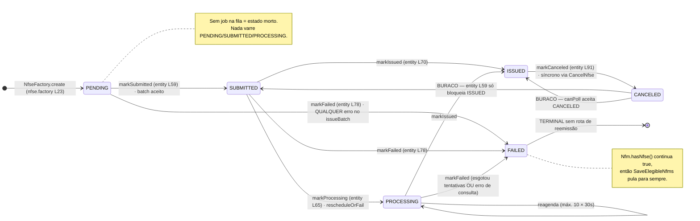
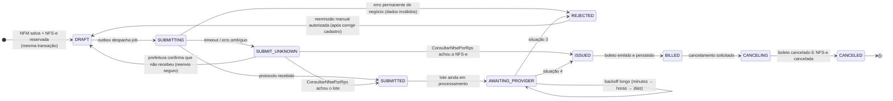
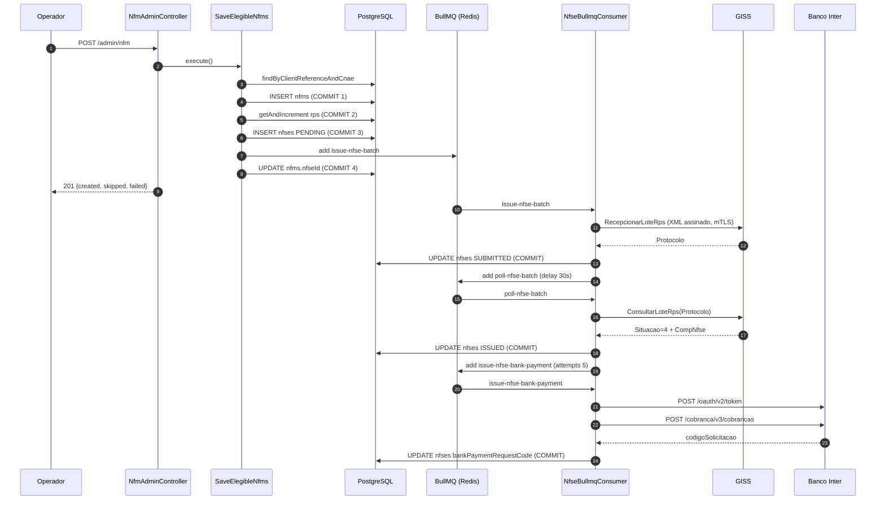
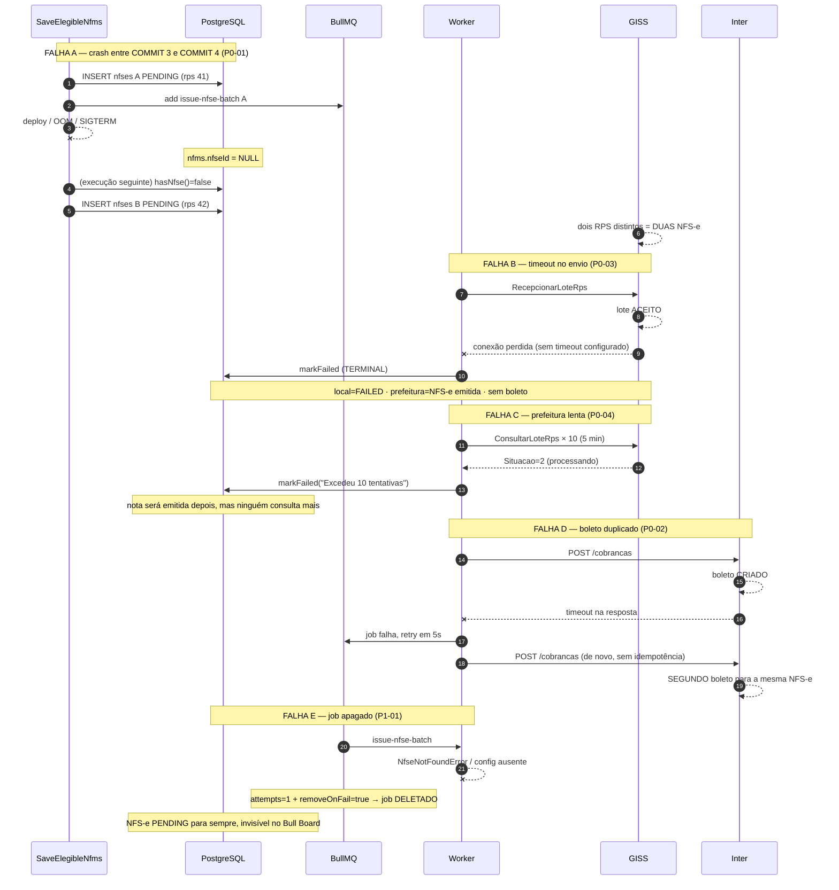

# Auditoria de resiliência — fluxo de emissão de NFM (NFS-e + boleto)

> Data: 2026-09-01 · Branch analisada: `fix/nfm-flow` (HEAD `84d5fd36`)
> Escopo: `src/app/tax-invoice/nfm`, `src/app/tax-invoice/nfse`, `src/app/bank-payment`,
> `src/infra/nfs-generation` (GISS), `src/infra/bank-payment` (Inter), `src/infra/queue`, `prisma/schema`.
> Nenhum código foi alterado. Toda afirmação sobre o comportamento atual cita `arquivo:linha`.
>
> **Revisão 2026-09-01:** as sete perguntas em aberto foram respondidas pela operação e a auditoria
> foi atualizada — ver §9. As mudanças de maior alcance: o Inter tem idempotência implícita de 30
> minutos e nenhum cabeçalho (R4), o que reescreve o P0-02 e adiciona o P1-08; o GISS passa a ser
> tratado como capaz de aceitar RPS repetido (R2), o que torna a consulta prévia obrigatória em todo
> reenvio; e não existe canal de alerta algum (R7), o que traz os alertas para a Onda 1.
>
> **Rodada 2 (mesma data):** pesquisa em `gissonline_docs/` fechou as pendências do GISS —
> `ConsultarNfsePorRps` e mais seis operações existem no WSDL (a Onda 3 cai de G para M), o lote
> aceita 50 RPS em vez de 1, `E10` documenta a rejeição de RPS repetido, e a recusa por duplicidade
> do Inter entrega o `codigoSolicitacao` da cobrança órfã. Ver §9, RR1–RR5.
>
> **Rodada 3 (mesma data):** os XSD oficiais confirmaram que `RecepcionarLoteRpsSincrono` está
> disponível — o laço de consulta sai do caminho feliz, ao custo de concentrar a ambiguidade num
> timeout sem protocolo —, que `E10` pode chegar tanto na recepção quanto na consulta do lote (e os
> dois caminhos hoje o tratam ao contrário), e que os alertas `A*` vêm num elemento
> `ListaMensagemAlertaRetorno` que o parser nunca lê. A recusa por duplicidade do Inter é HTTP 400.
> Ver §9, RRR1–RRR4. A rejeição de RPS repetido pelo GISS foi confirmada na prática.
>
> **Rodada 4 (mesma data):** o último item aberto foi fechado com teste ao vivo contra produção —
> não existe limite de período em `ConsultarNfseServicoPrestado` (testado até 6.087 dias), o gargalo
> é a página de 50, a consulta devolve **todas** as notas do prestador (a conciliação tem de casar
> por RPS, não por contagem), o fim da paginação vem como erro `E212`, e **toda consulta exige
> XMLDSig apesar do XSD dizer o contrário**. Ver §9, RRR2 e RRRR1, e
> `gissonline_docs/consultar-servico-prestado-postman.md` §7.

---

## 1. Sumário executivo

O fluxo funciona no caminho feliz e falha de forma perigosa em quase todos os outros. Três
propriedades explicam o risco:

1. **Não existe fronteira transacional entre o efeito externo e o estado local.** A NFS-e é criada,
   o número de RPS é consumido e o job é enfileirado (`issue-nfse.service.ts:84-124`) três `await`
   antes de a NFM ser vinculada à NFS-e (`save-elegible-nfms.service.ts:100`). Um crash ou deploy
   nessa janela faz a próxima execução emitir **uma segunda NFS-e** para o mesmo serviço.
2. **Erro transitório é tratado como erro permanente.** Qualquer exceção do GISS — timeout, 429,
   TLS, 5xx — marca a nota como `FAILED` terminal (`process-issue-nfse-batch.service.ts:112`), e a
   janela total de consulta do lote é de ~5 minutos (`process-poll-nfse-batch.service.ts:17-18`).
   Uma prefeitura fora do ar por horas produz notas `FAILED` localmente que **existem** no GISS.
3. **Nenhuma chamada HTTP tem timeout** (`nfs-generation.module.ts:18`,
   `bank-payment-inter.module.ts:11`) e nada consulta o Inter antes de emitir
   (`inter-cobranca.client.ts:42-63`). O Inter não oferece cabeçalho de idempotência: só uma chave
   implícita de 30 minutos, montada a partir de `seuNumero` + `valorNominal` + `dataVencimento` +
   `cpfCnpj` do pagador (§9, R4). Dentro dessa janela, a recusa por duplicidade mata o job **depois**
   de o boleto existir e deixa uma cobrança viva sem vínculo local; fora dela — retry manual, DLQ,
   varredura, retomada da fila — a duplicidade é real.

Somam-se: cancelar a NFM **não cancela o boleto** (`cancel-nfm.service.ts:15-30`), não existe rota
para reemitir o RPS de uma NFM (`nfm-admin.controller.ts:30-91`), `removeOnFail: true` apaga o job
que falhou sem deixar rastro (`nfse-queue.module.ts:33`), não há job de reconciliação nem
scheduler algum, e o certificado digital A1 de produção está versionado no repositório
(`resources/files/nfs-generation/giss/DPA_TEC_EQUIPAMENTOS_DE_PONTO_LTDA_02099923000178.pfx`).

**Prioridade:** timeouts + `removeOnFail` + idempotência do boleto + cancelamento em cascata
eliminam a maior parte do risco financeiro com esforço pequeno. Entra junto um canal de alerta por
SMTP: hoje não existe nenhum (§9, R7), e sem ele toda correção continua dependendo de alguém olhar.
A reconciliação com o GISS (consulta por RPS) é o item grande e o único que fecha o risco fiscal de
verdade — e, pela decisão registrada em R2, ela deixa de ser só reconciliação: passa a ser
pré-requisito de qualquer reenvio.

---

## 2. Fluxo atual mapeado

### 2.1 Ponta a ponta, com limites transacionais

Único gatilho: `POST /admin/nfm` → `NfmAdminController.saveElegible()`
(`src/app/tax-invoice/nfm/infra/drivers/http/admin/nfm-admin.controller.ts:62`).
**Não há scheduler**: nenhum `@Cron`, `ScheduleModule` ou job repetível no `src/`
(busca sem resultado). A tabela `NfmCronRun` (`prisma/schema/nfm.prisma:22`) registra o resultado
de uma execução que hoje é sempre manual.

| # | Passo | Arquivo:linha | Tipo |
|---|-------|---------------|------|
| 1 | `SaveElegibleNfms.execute()` | `save-elegible-nfms.service.ts:30` | entrada |
| 2 | `FindElegibleClients.execute()` — filtra `dueDateDay: today`, `generateNf: true` | `find-elegible-clients.service.ts:18-26` | leitura |
| 3 | Loop por elegível (sequencial, sem limite) | `save-elegible-nfms.service.ts:44` | — |
| 4 | `nfmRepository.findByClientReferenceAndCnae(...)` | `save-elegible-nfms.service.ts:59` | leitura |
| 5 | `if (existing?.hasNfse()) skip` — **dedup baseado só na presença do vínculo, não no status** | `save-elegible-nfms.service.ts:66` | decisão |
| 6 | `nfmRepository.save(created)` | `save-elegible-nfms.service.ts:86` → `nfm-prisma.repository.ts:51` | **COMMIT 1** |
| 7 | `rpsSequenceRepository.getAndIncrement(companyId)` | `issue-nfse.service.ts:84` → `nfse-rps-sequence-prisma.repository.ts:10-16` | **COMMIT 2 — consome número de RPS** |
| 8 | `nfseRepository.save(entity)` — status `PENDING` | `issue-nfse.service.ts:122` → `nfse-prisma.repository.ts:35` | **COMMIT 3** |
| 9 | `queueProducer.addIssueBatchJob({ nfseId })` | `issue-nfse.service.ts:124` → `nfse-queue-bullmq.producer.ts:18` | **efeito externo (Redis)** |
| 10 | `nfseRepository.findById(issued.id)` | `save-elegible-nfms.service.ts:94` | leitura |
| 11 | `nfm.linkNfse(nfse)` + `nfmRepository.edit(nfm)` | `save-elegible-nfms.service.ts:99-100` | **COMMIT 4 — fecha a janela de duplicidade** |
| 12 | `nfmCronRunDao.save(result)` | `save-elegible-nfms.service.ts:112` | **COMMIT 5** |

Worker (`NfseBullmqConsumer.process`, `nfse-bullmq.consumer.ts:25`; `@Processor(QueueName.Nfse)`
sem opções → concorrência default 1, sem `limiter`):

| # | Passo | Arquivo:linha | Tipo |
|---|-------|---------------|------|
| 13 | `ProcessIssueNfseBatch.execute` | `process-issue-nfse-batch.service.ts:27` | job `issue-nfse-batch` |
| 14 | `nfsGenerationGateway.issueBatch(...)` → `RecepcionarLoteRps` | `process-issue-nfse-batch.service.ts:50` → `giss-soap-client.ts:77` | **CHAMADA EXTERNA GISS** |
| 15 | catch → `markFailed` + `edit` | `process-issue-nfse-batch.service.ts:112-113` | **COMMIT (terminal)** |
| 16 | `markSubmitted(batchProtocol)` + `edit` | `process-issue-nfse-batch.service.ts:117-118` | **COMMIT** |
| 17 | `addPollBatchJob(delay 30s)` | `process-issue-nfse-batch.service.ts:120-123` | efeito externo (Redis) |
| 18 | `ProcessPollNfseBatch.execute` | `process-poll-nfse-batch.service.ts:28` | job `poll-nfse-batch` |
| 19 | `nfsGenerationGateway.getBatchStatus(...)` → `ConsultarLoteRps` | `process-poll-nfse-batch.service.ts:49` | **CHAMADA EXTERNA GISS** |
| 20 | `Success` → `markIssued` + `edit` | `process-poll-nfse-batch.service.ts:74-75` | **COMMIT** |
| 21 | `addIssueBankPaymentJob({ nfseId })` | `process-poll-nfse-batch.service.ts:76` | efeito externo (Redis) |
| 22 | `Error` → `markFailed` + `edit` | `process-poll-nfse-batch.service.ts:82-83` | **COMMIT (terminal)** |
| 23 | `NotReceived`/`Pending` → `rescheduleOrFail` (máx. 10 × 30s) | `process-poll-nfse-batch.service.ts:88-104` | — |
| 24 | `ProcessIssueNfseBankPayment.execute` | `process-issue-nfse-bank-payment.service.ts:25` | job `issue-nfse-bank-payment` |
| 25 | `issueBankPayment.execute(...)` → `POST /cobranca/v3/cobrancas` | `process-issue-nfse-bank-payment.service.ts:72` → `inter-cobranca.client.ts:46,151` | **CHAMADA EXTERNA INTER** |
| 26 | `linkBankPayment(provider, requestCode)` + `edit` | `process-issue-nfse-bank-payment.service.ts:74-75` | **COMMIT — fecha a janela de duplicidade** |

Caminhos laterais que escrevem nas mesmas entidades:

- **Retry manual do boleto:** `POST /admin/bank-payment/nfm/:id`
  (`bank-payment-admin.controller.ts:65`) → `IssueBankPaymentByNfmId.execute`
  (`issue-bank-payment-by-nfm-id.service.ts:17`) → **chama `ProcessIssueNfseBankPayment` síncrono
  dentro da requisição HTTP**, sem fila e sem timeout.
- **Cancelamento:** `POST /admin/nfm/:id/cancel` (`nfm-admin.controller.ts:76`) → `CancelNfm.execute`
  (`cancel-nfm.service.ts:15`) → `CancelNfse.execute` (`cancel-nfse.service.ts:19`) →
  `cancelNfse` no GISS (:37) → `markCanceled` + `edit` (:46-47). **Não toca no boleto.**
- **Edição de NFM emitida:** não localizado (não existe rota de edição).
- **Importação em lote / reprocessamento:** não localizado.
- **Webhook de baixa do boleto:** não localizado (nenhum controller de webhook em todo o `src/`).

### 2.2 Modelo de dados — o vínculo NFM → RPS → NFS-e → boleto

```
nfms (prisma/schema/nfm.prisma)
  id
  clientId, referenceMonth, referenceYear, cnaeNbsIndopId  ── @@unique (linha 18)
  nfseId Int? @unique (linha 10)  ─────────────┐  único vínculo NFM→NFS-e
  totalValueInCents (linha 8)                  │  congelado na 1ª execução
  data Json (linha 11) = snapshot do NfmDto    │
  (NÃO EXISTE coluna de status)                │
                                               │
nfses (prisma/schema/nfse.prisma)  ◄───────────┘
  id
  rpsNumber, rpsSeries + companyId ── @@unique (linha 23)   ← chave natural do RPS na prefeitura
  status String (linha 7)            ← String livre, sem enum/check no banco
  batchProtocol String? (linha 8)    ← protocolo do lote GISS
  nfseNumber, verificationCode, issuedAt (linhas 9-11)      ← identidade da NFS-e
  errorMessage (linha 12)
  canceledAt, cancelReasonCode (linhas 13-14)
  bankPaymentProvider, bankPaymentRequestCode (linhas 15-16) ← vínculo NFS-e→boleto
  data Json (linha 17) = NfseIssueSnapshot (issue-nfse.service.ts:28-46)
  (sem coluna de versão / lock otimista; sem índice em status ou updatedAt)

nfse_rps_sequences (prisma/schema/nfse.prisma:27)
  companyId @id, nextId   ← incremento atômico em SQL bruto
```

Campos que **não existem** e são necessários para operar: status/estado da NFM, timestamp da
última tentativa, contador de tentativas, mensagem de erro do boleto, chave de idempotência,
correlation id, e qualquer registro de payload/resposta externa.

### 2.3 Máquina de estados real da NFS-e

A NFM não tem estado próprio — seu único estado é `nfseId` nulo ou não nulo. Todo o ciclo de vida
vive em `Nfse.status` (`nfse-status.enum.ts`), com as transições implementadas em
`nfse.entity.ts:59-96`.



Buracos concretos da máquina de estados:

- `isTerminal()` (`nfse.entity.ts:51`) = `ISSUED || FAILED`. **`CANCELED` não é terminal**, logo
  `canPoll()` (:55) aceita uma nota cancelada com protocolo e um poll atrasado pode chamar
  `markIssued` (:70, cujo guard só bloqueia `ISSUED`) → nota volta para `ISSUED` com `canceledAt`
  preenchido.
- `markSubmitted`/`markProcessing`/`markFailed` só verificam `ensureNotIssued` (:108) —
  `FAILED → SUBMITTED` é permitido pela entidade.
- Não existe estado para "enviado, resultado desconhecido", que é exatamente o estado em que o
  sistema fica após um timeout.
- `status` é `String` no banco (`nfse.prisma:7`), sem enum nem check constraint.

### 2.4 Máquina de estados necessária



Diferenças que importam: `SUBMIT_UNKNOWN` (hoje inexistente — vira `FAILED`),
`AWAITING_PROVIDER` sem prazo curto (hoje `PROCESSING` com teto de 5 min),
`REJECTED` separado de falha de infraestrutura (hoje ambos são `FAILED`),
`BILLED` explícito (hoje "ISSUED com `bankPaymentRequestCode` não nulo", sem alarme quando fica nulo),
e `REJECTED → DRAFT` como transição autorizada (hoje só via `UPDATE` no banco).

### 2.5 Sequência — caminho feliz



### 2.6 Sequência — caminhos de falha



---

## 3. Achados

## 3.1 P0 — Crítico (risco fiscal ou financeiro concreto)

### [P0-01] Segunda NFS-e emitida quando o processo morre entre a criação da NFS-e e o vínculo com a NFM

- **Onde:** `src/app/tax-invoice/nfm/application/usecases/save-elegible-nfms/save-elegible-nfms.service.ts:66`, `:86`, `:92`, `:99-100`
- **O que acontece hoje:** o critério de deduplicação é a presença do vínculo, e o vínculo é o
  **último** passo:

  ```ts
  if (existing?.hasNfse()) { result.skipped += 1; continue; }   // :66
  // ...
  const id = await this.nfmRepository.save(created);            // :86  COMMIT 1
  // ...
  const issued = await this.issueNfse.execute(issueInput);      // :92  COMMIT 2+3 + job na fila
  const nfse = await this.nfseRepository.findById(issued.id);   // :94
  nfm.linkNfse(nfse);                                           // :99
  await this.nfmRepository.edit(nfm);                           // :100 COMMIT 4
  ```

  Entre `:92` e `:100` a NFS-e já existe, o número de RPS já foi consumido
  (`issue-nfse.service.ts:84`) e o job já está no Redis (`issue-nfse.service.ts:124`), mas a NFM
  ainda tem `nfseId = NULL` (`nfm-prisma.repository.ts:75`).
- **Cenário de falha:**
  1. `POST /admin/nfm`. NFM 500 é criada. `IssueNfse` cria a NFS-e #A com RPS 41 e enfileira o job.
  2. Deploy/`SIGTERM`/OOM antes da linha `:100`.
  3. O worker processa o job #A normalmente: RPS 41 vai ao GISS, vira NFS-e 12345.
  4. O operador roda `POST /admin/nfm` de novo no mesmo dia. `findByClientReferenceAndCnae`
     encontra a NFM 500, `hasNfse()` é `false`, o fluxo entra no ramo `existing` (`:72-74`) e chama
     `IssueNfse` outra vez → NFS-e #B com RPS 42 → NFS-e 12346.
  5. `@@unique([companyId, rpsSeries, rpsNumber])` (`nfse.prisma:23`) não protege: os RPS são
     diferentes, então o GISS aceita os dois como serviços distintos.
- **Impacto:** fiscal — NFS-e duplicada, ISS pago em duplicidade, cancelamento junto à prefeitura
  (prazo limitado por município). Financeiro em cascata: cada NFS-e `ISSUED` enfileira o próprio
  job de boleto (`process-poll-nfse-batch.service.ts:76`) → **cobrança duplicada** no cliente.
- **Correção proposta:** tornar o vínculo atômico com a criação. Envolver
  `getAndIncrement` + `INSERT nfses` + `UPDATE nfms.nfseId` num único `prisma.$transaction`, e só
  então enfileirar o job (padrão outbox: gravar a intenção na transação e despachar depois do
  commit). Alternativa mais barata e quase tão boa: inverter a ordem — criar a NFS-e `DRAFT`,
  vincular à NFM na mesma transação, e enfileirar por último.
- **Esforço:** M

### [P0-02] Emissão do boleto não é idempotente do lado local: cobrança órfã dentro de 30 min, duplicada fora

- **Onde:** `src/app/tax-invoice/nfse/application/usecases/process-issue-nfse-bank-payment/process-issue-nfse-bank-payment.service.ts:72-75`; `src/app/tax-invoice/nfse/infra/driven/queue/bullmq/nfse-queue-bullmq.producer.ts:26-29`; `src/infra/bank-payment/adapters/inter/cobranca/inter-cobranca.client.ts:42-63`
- **O que acontece hoje:**

  ```ts
  const result = await this.issueBankPayment.execute(issueInput);   // :72  cria o boleto no Inter
  nfse.linkBankPayment(result.provider, result.requestCode);        // :74
  await this.nfseRepository.edit(nfse);                             // :75  só aqui persiste
  ```

  O job é registrado com `attempts: 5` e backoff exponencial de base 5s
  (`nfse-queue-bullmq.producer.ts:27-28`) — as tentativas caem em 5s, 10s, 20s e 40s, ~75 s no
  total. O `POST /cobrancas` (`inter-cobranca.client.ts:46`) não envia cabeçalho de idempotência
  (a API não tem um, §9 R4) e nada consulta o Inter antes de emitir. A guarda
  `nfse.hasBankPayment()` (`:33`) só é verdadeira **depois** de `:75`.

  O Inter aplica um controle de duplicidade próprio: `seuNumero` + `valorNominal` +
  `dataVencimento` + `cpfCnpj` do pagador formam uma chave implícita com TTL de **30 minutos**
  (OpenAPI da API Cobrança Bolepix v3, descrição de `POST /cobrancas`). Toda a escada de retry do
  job cabe dentro dessa janela — o que muda o modo de falha, mas não o elimina.
- **Cenário de falha A — cobrança órfã (dentro dos 30 min):**
  1. O Inter recebe o `POST`, cria o boleto e começa a responder.
  2. A conexão cai (ou simplesmente demora — não há timeout, ver P0-05). Axios lança;
     `request()` mapeia para `ExternalApiError` (`inter-cobranca.client.ts:186`).
  3. O job falha. BullMQ reagenda em 5s. `hasBankPayment()` continua `false`.
  4. Segundo `POST`, payload idêntico → o Inter **recusa** por duplicidade. A recusa é 4xx, que
     `inter-cobranca.client.ts:179-182` mapeia para `BankPaymentRequestError` — erro permanente de
     negócio (P2-07). O job morre; `linkBankPayment` (`:74`) nunca roda.
  5. Resultado: o boleto **existe** no Inter, cobrável, sem nenhum vínculo local. A NFS-e fica
     `ISSUED` sem `bankPaymentRequestCode` — indistinguível de P1-03, mas com uma cobrança viva
     solta que ninguém sabe que existe.
- **Cenário de falha B — duplicidade real (chave instável ou fora dos 30 min):** a proteção do Inter
  só vale enquanto os quatro campos forem idênticos, e eles não são estáveis:
  - `issuedAt: nfse.props.issuedAt ?? new Date()`
    (`process-issue-nfse-bank-payment.service.ts:58`) — com `issuedAt` nulo, cada tentativa usa um
    instante diferente e, para `dueDateType = DEADLINE` (`invoice-calendar-due-date.vo.ts:52-62`),
    uma retentativa que cruza a meia-noite em `America/Sao_Paulo` muda o `dataVencimento`;
  - sem `bankPayment` no snapshot, o fallback deriva `referenceMonth`/`referenceYear` de
    `DateTime.now()` (`process-issue-nfse-bank-payment.service.ts:83,90-91`) e, para vencimento
    fixo (`invoice-calendar-due-date.vo.ts:64-107`), uma retentativa na virada do mês muda o
    vencimento;
  - P2-06 (NFM reaproveitada com valor divergente) muda `valorNominal`.

  Fora dos 30 minutos não há proteção nenhuma, e é onde estão os caminhos de recuperação: retry
  manual `POST /admin/bank-payment/nfm/:id` (P1-07), reprocessamento de DLQ, varredura do outbox e
  retomada da fila depois de indisponibilidade longa (§7.2). O mesmo vale para o worker morto entre
  `:72` e `:75`, se a reentrega do job "stalled" acontecer depois da janela.
- **Impacto:** financeiro direto. No cenário A, uma cobrança emitida e invisível para o sistema — o
  cliente recebe um boleto que a operação não sabe que existe. No cenário B, duas cobranças para o
  mesmo serviço, com Pix e código de barras válidos. Recuperação exige cancelar boletos um a um pelo
  `POST /admin/bank-payment/:codigo/cancel` depois de descobrir quais existem — e hoje **não há como
  descobrir**: `toListQueryParams` (`inter-cobranca.mapper.ts:73-99`) não monta filtro por
  `seuNumero`.
- **Correção proposta:** quatro camadas, nesta ordem:
  1. Persistir a intenção **antes** da chamada: nova coluna `bankPaymentIdempotencyKey` (por
     exemplo `nfse-{id}`) e `bankPaymentRequestedAt`, gravadas antes de `:72`. É guarda local — o
     Inter não aceita esse valor como cabeçalho.
  2. **Congelar o payload.** Gravar `dataVencimento` e `valorNominal` calculados na primeira
     tentativa e reusá-los em todas as seguintes, em vez de recalcular a partir de `new Date()` /
     `DateTime.now()`. Sem isso, a proteção de 30 min do Inter é um acaso, não uma garantia.
  3. Consulta prévia por `seuNumero` em toda tentativa com `job.attemptsMade > 0` **e** em todo
     caminho manual. Exige acrescentar o filtro: `ListBankPaymentInputDto` não tem o campo e
     `toListQueryParams` (`inter-cobranca.mapper.ts:73-99`) não o monta, embora a API aceite
     `seuNumero` como query param. `dataInicial`/`dataFinal` são obrigatórios e filtram por
     `dataVencimento` por padrão (`filtrarDataPor` = `VENCIMENTO`) — usar a data que está prestes a
     ser enviada.
  4. Tratar a recusa por duplicidade como **sinal**, não como erro permanente. A resposta do Inter
     traz o `codigoSolicitacao` da cobrança que já existe (§9, RR3) — extraí-lo do `detail`,
     confirmar com `GET /cobrancas/{codigoSolicitacao}` (`inter-cobranca.client.ts:65`) comparando
     `seuNumero`/`valorNominal`/`dataVencimento`, vincular e completar o job com sucesso. É o que
     fecha o cenário A, e não depende do item 3.
  5. Corrigir a precedência de `extractInterErrorMessage` (`inter-cobranca.client.ts:220-242`):
     hoje `title` ("Requisição inválida") vence `detail`, e o `detail` é justamente onde vem o
     identificador da cobrança. Preservar os dois — o corpo inteiro vai para `NfseAttempt`
     (P2-03).
- **Esforço:** M

### [P0-03] Timeout ou erro transitório no envio do RPS marca a nota como FAILED terminal sem consultar o GISS

> **Nota da rodada 3:** o mesmo caminho engole a rejeição de negócio da recepção. Quando o GISS
> devolve `ListaMensagemRetorno` em vez de `Protocolo` (ramo previsto em
> `enviar-lote-rps-resposta-v2_04.xsd`), `giss-issue-batch.mapper.ts:248-254` lê **apenas a
> primeira** mensagem, monta uma string e lança `Error` genérico — que vira `ExternalApiError` e
> `FAILED`. Para o código `E10` ("RPS já informado") isso é o oposto do correto: a nota existe.
> Ver §9, RRR3.

- **Onde:** `src/app/tax-invoice/nfse/application/usecases/process-issue-nfse-batch/process-issue-nfse-batch.service.ts:105-115`
- **O que acontece hoje:**

  ```ts
  catch (error: any) {
    this.logger.error(LogContext.NFS_GENERATION, { adapter: 'nfse', action: 'processIssueNfseBatch', error });
    nfse.markFailed(error?.message ?? 'Erro desconhecido ao enviar lote ao provedor de NFS-e');
    await this.nfseRepository.edit(nfse);
    return;
  }
  ```

  `markFailed` leva a `FAILED`, que `isTerminal()` (`nfse.entity.ts:51`) considera definitivo:
  `canPoll()` passa a retornar `false` e nada mais acontece. O `catch` não distingue timeout de
  rede, 429, TLS, 5xx ou XML rejeitado — o gateway já converteu tudo em `ExternalApiError`
  (`nfs-generation-giss.gateway.ts:56`). O protocolo não existe (a resposta se perdeu), então nem
  `ConsultarLoteRps` é possível; e `ConsultarNfsePorRps` — a consulta pela chave natural
  (número + série do RPS + prestador) — **não está implementada** (`nfs-generation.gateway.ts`,
  não localizado).
- **Cenário de falha:**
  1. `RecepcionarLoteRps` chega ao GISS, que persiste o lote e emite a NFS-e.
  2. A resposta se perde (RST, proxy, timeout).
  3. Local: `FAILED`. Prefeitura: NFS-e emitida com o RPS 41.
  4. A NFM continua com `nfseId` preenchido → `hasNfse()` é `true` → toda execução futura pula
     (`save-elegible-nfms.service.ts:66`).
  5. Resultado: existe uma NFS-e no GISS que o sistema desconhece, sem boleto e sem receita.
- **Impacto:** fiscal (obrigação tributária invisível, que aparece no cruzamento da prefeitura) +
  financeiro (serviço prestado e não cobrado). Magnitude: uma nota por ocorrência, silenciosa.
- **Correção proposta:**
  1. Classificar o erro antes de decidir: `NfsProviderConfigError` e rejeições de schema são
     permanentes (`REJECTED`); timeout, `ECONNRESET`, 5xx e 429 são ambíguos → novo estado
     `SUBMIT_UNKNOWN`, nunca `FAILED`.
  2. Implementar `ConsultarNfsePorRps` no `INfsGenerationGateway` e um job de reconciliação que
     consulta pela chave natural (rpsNumber + rpsSeries + prestador) antes de qualquer decisão.
     Essa chave é a idempotência real com a prefeitura: reenviar o **mesmo** RPS é seguro (o GISS
     rejeita duplicidade); criar um RPS **novo** é que duplica a nota.
- **Esforço:** G

### [P0-04] Janela de consulta do lote é de 5 minutos: prefeitura lenta produz nota FAILED que existe no GISS

> **Nota da rodada 3:** ampliar a janela (Onda 1) trata o sintoma. A correção estrutural é
> `RecepcionarLoteRpsSincrono` (§9, RRR1), que devolve a NFS-e na própria resposta do envio e
> elimina o laço de consulta do caminho feliz. Ela troca este achado por um risco diferente e mais
> concentrado — timeout numa chamada síncrona não deixa protocolo —, então só entra depois de
> timeouts e de `ConsultarNfsePorRps`. A janela ampliada continua valendo para o caminho
> assíncrono, que segue existindo como fallback.

- **Onde:** `src/app/tax-invoice/nfse/application/usecases/process-poll-nfse-batch/process-poll-nfse-batch.service.ts:17-18`, `:62`, `:88`, `:91-96`
- **O que acontece hoje:** `MAX_ATTEMPTS = 10` e `POLL_DELAY_MS = 30_000`, com o primeiro poll em
  +30s (`process-issue-nfse-batch.service.ts:17`). A janela total é de ~5 minutos. Esgotada,
  `rescheduleOrFail` chama `markFailed` (`:93`) — inclusive quando a causa foi o **próprio GISS
  estar fora do ar** (`:62`, o `catch` de `getBatchStatus`) ou o lote ainda estar na situação 2
  (processando, `:88`).
- **Cenário de falha:**
  1. Lote aceito às 09:00, protocolo gravado, status `SUBMITTED`.
  2. O GISS entra em manutenção às 09:01.
  3. 09:00:30 → 09:05:00: dez consultas falham. Na décima, `markFailed("Erro ao consultar status
     do lote no Giss")`.
  4. 14:00: o GISS volta e processa o lote — a NFS-e é emitida normalmente.
  5. O sistema nunca fica sabendo. `canPoll()` é `false`, não há job, não há rota de reconsulta.
- **Impacto:** fiscal + financeiro, em lote — numa indisponibilidade de 10 minutos, **todas** as
  notas do fechamento do dia viram `FAILED` com a NFS-e emitida do outro lado.
- **Correção proposta:**
  1. Nunca marcar `FAILED` quando existe `batchProtocol` e a situação nunca foi `Error`. Usar
     `AWAITING_PROVIDER`.
  2. Backoff escalonado em vez de 30s fixo: 30s, 1min, 5min, 15min, 1h, 6h, 24h — mantendo a
     nota viva por dias.
  3. Separar "esgotou tentativas de curto prazo" (passa para o job diário de reconciliação) de
     "GISS rejeitou o lote" (situação 3 → `REJECTED`).
- **Esforço:** M

### [P0-05] Nenhuma chamada HTTP ao GISS ou ao Inter tem timeout

- **Onde:** `src/infra/nfs-generation/nfs-generation.module.ts:18`; `src/infra/bank-payment/adapters/inter/bank-payment-inter.module.ts:11`; usos em `giss-soap-client.ts:77`, `inter-cobranca.client.ts:151`, `inter-oauth.client.ts:86`
- **O que acontece hoje:** `HttpModule` é importado sem configuração em ambos os módulos, então o
  axios usa `timeout: 0` (sem limite). Nenhuma das três chamadas passa `timeout` ou `signal` no
  request. Agravante: `.env.production` e `.env.development` definem `INTER_HTTP_TIMEOUT_MS`, mas
  **nenhum código lê essa variável** (busca sem resultado; `config.service.ts:126-145` não expõe
  getter correspondente, e a variável nem consta do `.env.example`) — é configuração morta que
  sugere uma proteção inexistente.
- **Cenário de falha:** o GISS aceita a conexão TCP e não responde (comportamento comum em
  sobrecarga). O worker fica bloqueado no `await` indefinidamente. Como o `@Processor`
  (`nfse-bullmq.consumer.ts:14`) não define concorrência, o BullMQ usa 1 — **a fila inteira de
  NFS-e para**. Nenhuma nota nova é emitida, nenhum poll roda, nenhum boleto é gerado, e nada
  alerta.
- **Impacto:** operacional e financeiro — parada total da emissão, sem sinal. Também é a condição
  que dispara P0-02 (timeout depois de o boleto ter sido criado).
- **Correção proposta:** `HttpModule.register({ timeout: 30_000 })` no `nfs-generation.module.ts`
  (envio de lote) e `{ timeout: 15_000 }` no `bank-payment-inter.module.ts`; timeout menor
  (~10s) por chamada no poll e no OAuth via `signal: AbortSignal.timeout(...)`. Ler
  `INTER_HTTP_TIMEOUT_MS` no `ConfigService` ou remover a variável.
- **Esforço:** P

### [P0-06] Cancelar a NFM não cancela o boleto

- **Onde:** `src/app/tax-invoice/nfm/application/usecases/cancel-nfm/cancel-nfm.service.ts:15-30`
- **O que acontece hoje:**

  ```ts
  nfm.ensureCanCancel();
  const result = await this.cancelNfse.execute(nfm.props.nfse!.props.id, input);
  return { id: nfmId, status: result.status, canceledAt: result.canceledAt };
  ```

  Nada lê `nfse.props.bankPaymentRequestCode`. `CancelBankPayment`
  (`cancel-bank-payment.service.ts:13`) existe e funciona, mas só é alcançável pela rota manual
  `POST /admin/bank-payment/:codigoSolicitacao/cancel` (`bank-payment-admin.controller.ts:126`) —
  que exige que alguém saiba o código.
- **Cenário de falha:**
  1. NFS-e emitida, boleto gerado, cliente recebeu.
  2. O serviço não foi prestado; o operador cancela: `POST /admin/nfm/500/cancel` com
     `cancelReasonCode: 2`.
  3. `CancelNfse` cancela a nota no GISS e grava `CANCELED` (`cancel-nfse.service.ts:46-47`).
  4. O boleto continua ativo, vence, entra em cobrança, o cliente paga.
  5. Devolução manual + conciliação bancária + nota fiscal cancelada com pagamento recebido.
- **Impacto:** financeiro e reputacional. Também vale o inverso: se o cancelamento no GISS falhar
  (`cancelNfse` lança), nada é cancelado — comportamento correto, mas hoje é coincidência, não
  desenho.
- **Correção proposta:** cancelar na ordem **boleto primeiro, nota depois** (cancelar cobrança é
  reversível — basta reemitir; cancelar NFS-e não é). Concretamente: em `CancelNfm`, se
  `bankPaymentRequestCode` existir, chamar `CancelBankPayment` antes de `CancelNfse`; se o
  cancelamento do boleto falhar, abortar sem tocar na nota. Enfileirar o cancelamento do boleto
  como job com retry caso se prefira desacoplar — mas então a NFM precisa de um estado
  `CANCELING`.
- **Esforço:** M

### [P0-07] Certificado digital A1 de produção versionado no repositório

- **Onde:** `resources/files/nfs-generation/giss/DPA_TEC_EQUIPAMENTOS_DE_PONTO_LTDA_02099923000178.pfx` (rastreado pelo git); referenciado como `certFilePath` em `prisma/seeds/find-elegible-clients-nfm.ts:50,465,477` e `prisma/seeds/nfse-curl-manual-test.ts:16-18,99,111`
- **O que acontece hoje:** o PKCS#12 do CNPJ 02.099.923/0001-78 está no repositório e é gravado em
  `nfs_provider_configs.certFilePath` pelas seeds. A senha está corretamente fora do repositório,
  em `GISS_CERT_PASSWORD` (`giss-pfx-loader.ts:12`, com `.env.*` no `.gitignore:41-43`) — mas um
  arquivo PKCS#12 é atacável offline por força bruta, sem limite de tentativas e sem deixar rastro.
  A chave privada do Inter (`resources/files/bank-payment/inter/Sandbox_InterAPI_Chave.key`) também
  está versionada; é de teste, e **o certificado de produção do Inter ainda não foi emitido**
  (§9, RR1). Essa metade do achado ainda pode ser evitada em vez de remediada: não há o que
  rotacionar, só o que não repetir.
- **Cenário de falha:** qualquer pessoa com acesso de leitura ao repositório (ou a um clone, um
  fork, um backup, um laptop) obtém o material criptográfico. Com a senha quebrada, emite NFS-e em
  nome da empresa.
- **Impacto:** segurança — emissão fraudulenta de notas fiscais em nome da empresa.
- **Correção proposta:** para o A1 do GISS, remover do índice e do histórico (`git filter-repo`) e
  **rotacionar o certificado junto à AC** — a exposição já ocorreu, remover não desfaz. Para o
  Inter, definir agora o caminho de entrega do certificado de produção que ainda vai ser emitido:
  volume montado ou secret manager, `INTER_CERT_PATH`/`INTER_KEY_PATH` apontando para fora da
  árvore do projeto, nunca commitado. Em ambos os casos, `certFilePath` sai do repositório.
- **Esforço:** M
- **Status:** ✅ resolvido. Remoção do índice e caminho por env entregues na Onda 1 (2026-09-02);
  rotação do A1 junto à AC e purge do histórico executados em 2026-09-03. Ver
  `docs/runbook-certificados.md`.

---

## 3.2 P1 — Alto (perda de dados ou operação travada exigindo intervenção manual)

### [P1-01] `removeOnFail: true` apaga o job que falhou: não há dead letter queue nem rastro

- **Onde:** `src/app/tax-invoice/nfse/application/queue/nfse-queue.module.ts:31-34`; `src/app/tax-invoice/nfse/infra/driven/queue/bullmq/nfse-queue-bullmq.producer.ts:18`, `:22`
- **O que acontece hoje:**

  ```ts
  defaultJobOptions: { removeOnComplete: true, removeOnFail: true },   // :31-34
  ```

  e os dois primeiros jobs do fluxo não definem `attempts`:

  ```ts
  await this.queue.add(JobName.IssueNfseBatch, data);                            // :18 → 1 tentativa
  await this.queue.add(JobName.PollNfseBatch, data, { delay: options?.delayMs }); // :22 → 1 tentativa
  ```

  Qualquer exceção que escape do use case — `NfseNotFoundError`
  (`process-issue-nfse-batch.service.ts:30`), falha de `findCompanyNfsConfigByCompanyId` (`:36`),
  erro de conexão com o banco, falha ao gravar (`:113`, `:118`) — falha o job, que é **apagado**.
- **Cenário de falha:** a configuração fiscal da empresa é editada e fica momentaneamente
  inconsistente. Dez jobs de `issue-nfse-batch` estouram em `:36`, os dez são deletados, e dez
  NFS-e ficam em `PENDING` para sempre. O Bull Board (`queue.module.ts:41`) não mostra nada, porque
  o job não existe mais.
- **Impacto:** operacional — perda silenciosa. Só uma consulta SQL direta encontra as notas presas.
- **Correção proposta:** `removeOnFail: { age: 2_592_000 }` (30 dias) ou `false`; `attempts: 5` com
  backoff exponencial + jitter para `IssueNfseBatch` e `PollNfseBatch`; uma fila `nfse-dlq` que
  recebe o job após esgotar as tentativas, com painel no Bull Board.
- **Esforço:** P

### [P1-02] NFS-e presa em PENDING / SUBMITTED / PROCESSING não tem quem a resgate

- **Onde:** `issue-nfse.service.ts:122-124`; `process-issue-nfse-batch.service.ts:117-123`; `process-poll-nfse-batch.service.ts:74-76`; ausência de scheduler em todo o `src/`
- **O que acontece hoje:** há três janelas em que o estado é gravado e o job seguinte é enfileirado
  em seguida, sem atomicidade:

  | Commit | Enfileiramento | Se falhar no meio |
  |---|---|---|
  | `INSERT nfses PENDING` (`issue-nfse.service.ts:122`) | `addIssueBatchJob` (`:124`) | NFS-e `PENDING` órfã |
  | `markSubmitted` + `edit` (`process-issue-nfse-batch.service.ts:117-118`) | `addPollBatchJob` (`:120`) | `SUBMITTED` com protocolo e sem poll |
  | `markIssued` + `edit` (`process-poll-nfse-batch.service.ts:74-75`) | `addIssueBankPaymentJob` (`:76`) | `ISSUED` sem boleto |

  Nenhum job varre estados não terminais. Não existe `@Cron`, `ScheduleModule` nem job repetível
  (busca sem resultado no `src/`); o plano interno
  `.cursor/plans/nfm_queue_issuance_d1604f07.plan.md:95` confirma que o agendamento foi deixado
  para depois.
- **Cenário de falha:** Redis reinicia entre o commit e o `add`. A nota fica num estado
  intermediário permanente. Como `Nfm.hasNfse()` é `true`, o `POST /admin/nfm` pula para sempre.
- **Impacto:** operacional — nota presa sem diagnóstico e sem saída automática.
- **Correção proposta:** tabela outbox escrita na mesma transação do estado + um job repetível
  (a cada 5 min) que busca `nfses` em estado não terminal com `updatedAt < now() - interval` e
  reenfileira o job correspondente. Requer índice `(status, updatedAt)` em `nfses` — hoje
  inexistente (`prisma/schema/nfse.prisma` só tem `@@unique([companyId, rpsSeries, rpsNumber])`).
- **Esforço:** M

### [P1-03] Falha na emissão do boleto é engolida: o job termina com sucesso e a NFS-e fica sem cobrança

- **Onde:** `src/app/tax-invoice/nfse/application/usecases/process-issue-nfse-bank-payment/process-issue-nfse-bank-payment.service.ts:30-35`, `:40-52`, `:54-70`
- **O que acontece hoje:** três caminhos retornam `null` silenciosamente:

  ```ts
  if (!nfse.isIssued()) { return null; }                 // :30-32
  if (nfse.hasBankPayment()) { return null; }            // :33-35
  // fallback de configuração de faturamento falhou:
  catch (error) { this.logger.error(...); return null; } // :44-51
  // mapper rejeitou (valor inválido, cidade ausente, vencimento impossível):
  catch (error) { this.logger.error(...); return null; } // :63-70
  ```

  `return null` resolve a promise → o job **completa com sucesso** → `removeOnComplete: true`
  (`nfse-queue.module.ts:32`) apaga o job. Não há coluna para registrar o motivo:
  `prisma/schema/nfse.prisma` tem `errorMessage`, mas ele é usado pelo fluxo do GISS
  (`nfse.entity.ts:81`), não pelo do boleto.
- **Cenário de falha:** o cliente não tem `client_invoice_config`. O fallback
  (`:80-100`) lança `AppException`, o `catch` de `:44` loga e retorna `null`. A NFS-e fica `ISSUED`
  sem boleto, indefinidamente. Nada alerta, nada reprocessa, e a listagem `GET /admin/nfm` não tem
  filtro por status (`find-generated-nfms.dto.ts` só aceita `page`, `size`, `dateStart`, `dateEnd`).
- **Impacto:** financeiro — receita não faturada, descoberta (se descoberta) no fechamento.
- **Correção proposta:** distinguir permanente de transitório e **falhar o job** nos dois casos:
  erro permanente → DLQ com motivo; erro transitório → retry. Persistir `bankPaymentErrorMessage` e
  `bankPaymentFailedAt` em `nfses` (alteração de schema) para que o operador consiga listar. Alerta
  "NFS-e `ISSUED` há mais de 1h sem `bankPaymentRequestCode`".
- **Esforço:** M

### [P1-04] Não existe rota para reemitir o RPS de uma NFM

- **Onde:** `src/app/tax-invoice/nfm/infra/drivers/http/admin/nfm-admin.controller.ts:30-91` (rotas existentes: `GET /`, `GET /elegible`, `POST /`, `POST /:id/cancel`, `GET /:id`); rota de reemissão **não localizada**
- **O que acontece hoje:** depois de `nfmRepository.edit(nfm)` (`save-elegible-nfms.service.ts:100`),
  `hasNfse()` (`nfm.entity.ts:35`) retorna `true` **independentemente do status da NFS-e**. A
  verificação em `save-elegible-nfms.service.ts:66` pula a NFM para sempre. Uma NFS-e `FAILED` é um
  beco sem saída: o único caminho é `UPDATE nfms SET nfse_id = NULL WHERE id = ...` no banco.
- **Cenário de falha:** cenário 10 — o GISS rejeita o RPS porque o CNPJ do tomador está irregular
  (erro permanente, situação 3 → `markFailed` em `process-poll-nfse-batch.service.ts:82`). O
  operador corrige o cadastro do cliente. Não há botão, rota ou comando para reemitir.
- **Impacto:** operacional — todo erro permanente de negócio vira cirurgia no banco de produção,
  feita sob pressão de prazo fiscal.
- **Correção proposta:** `POST /admin/nfm/:id/reissue`, com as proteções descritas em §6.
- **Esforço:** M

### [P1-05] Duas requisições concorrentes para a mesma NFM emitem duas NFS-e

- **Onde:** `src/app/tax-invoice/nfm/application/usecases/save-elegible-nfms/save-elegible-nfms.service.ts:59` (leitura) e `:100` (escrita)
- **O que acontece hoje:** entre a leitura e a escrita não há transação, lock, nem controle de
  concorrência otimista (`Nfm` não tem coluna de versão — `prisma/schema/nfm.prisma`). O
  `@@unique([clientId, referenceMonth, referenceYear, cnaeNbsIndopId])` (`nfm.prisma:18`) protege
  apenas a **criação** da linha, não a emissão.
- **Cenário de falha (cenário 7):**
  1. Requisição A: `findByClientReferenceAndCnae` → `null`; `INSERT nfms` commita (`:86`).
  2. Requisição B (duplo clique, retry do cliente, dois operadores):
     `findByClientReferenceAndCnae` agora **encontra** a NFM criada por A, com `nfseId = NULL`.
  3. `hasNfse()` é `false` nas duas → ambas entram no ramo `existing` (`:72-74`) → ambas chamam
     `IssueNfse` → dois RPS, duas NFS-e, dois boletos.
  4. `nfseId @unique` (`nfm.prisma:10`) não impede: cada `edit` grava um valor diferente; a última
     escrita vence e a outra NFS-e vira órfã (emitida, sem NFM).
- **Impacto:** fiscal — NFS-e duplicada. Probabilidade real: a tela de elegíveis termina num botão
  "confirmar", e o throttler default é 100 req/60s (`throttle.module.ts:18`).
- **Correção proposta:** `SELECT ... FOR UPDATE` na linha da NFM dentro da transação de emissão
  (P0-01 já introduz essa transação), ou lock distribuído no Redis com chave
  `nfm:{clientId}:{ref}:{cnae}`, ou uma coluna `nfmId` em `nfses` com índice único parcial
  (`WHERE status <> 'FAILED'`) — que também fecha P0-01 na camada do banco.
- **Esforço:** M

### [P1-06] Todo o fluxo depende de disparo manual no dia exato, sem agendamento nem recuperação

- **Onde:** `nfm-admin.controller.ts:62` (único gatilho); `find-elegible-clients.service.ts:18-26`
- **O que acontece hoje:**

  ```ts
  const today = new Date().getDate();
  const invoices = await this.findAllClientInvoiceConfig.execute({ dueDateDay: today, generateNf: true });
  ```

  O filtro é igualdade exata com o dia do mês. Não há scheduler. A tabela `NfmCronRun`
  (`nfm.prisma:22`) e o nome `NfmCronRunDao` sugerem uma automação que não existe.
- **Cenário de falha:** ninguém aperta o botão no dia 15 (feriado, férias, esquecimento). Todos os
  contratos com `dueDateDay = 15` não são faturados. No dia 16 o filtro não os alcança mais —
  eles só voltarão a aparecer no dia 15 do mês seguinte, e a competência do mês perdido nunca é
  emitida.
- **Impacto:** financeiro — faturamento silenciosamente pulado, sem nenhum sinal.
- **Correção proposta:** job repetível diário no BullMQ (`repeat: { pattern: '0 6 * * *' }`) e
  ampliar a elegibilidade para `dueDateDay <= today` dentro do mês corrente, subtraindo o que já
  tem NFM para a competência (a `@@unique` de `nfm.prisma:18` já garante a idempotência dessa
  varredura).
- **Esforço:** M

### [P1-07] Retry manual do boleto roda síncrono no HTTP e repete a janela de duplicidade

- **Onde:** `src/app/bank-payment/application/usecases/issue-bank-payment-by-nfm-id/issue-bank-payment-by-nfm-id.service.ts:17-33`; `bank-payment-admin.controller.ts:65`
- **O que acontece hoje:** o use case verifica `bankPaymentRequestCode` (`:23`), delega para
  `ProcessIssueNfseBankPayment` (`:27`), que reverifica (`process-issue-nfse-bank-payment.service.ts:33`)
  e chama o Inter **dentro da requisição HTTP**, sem fila, sem retry e sem timeout (P0-05). Entre a
  verificação e o `linkBankPayment` (`:74`) há a mesma janela do P0-02, sem nenhum lock.
- **Cenário de falha:** dois operadores clicam em "gerar boleto" para a mesma NFM ao mesmo tempo, ou
  um operador clica duas vezes porque a primeira requisição está pendurada. Dois cliques em
  segundos caem na janela de duplicidade do Inter (§9 R4) e viram a cobrança órfã do cenário A do
  P0-02; um retry manual horas depois da falha original — que é o uso normal desta rota — está
  **fora** da janela e produz o segundo boleto de verdade.
- **Impacto:** financeiro.
- **Correção proposta:** o mesmo mecanismo de idempotência do P0-02, mais um lock por `nfseId`.
  Considerar transformar a rota em enfileiramento (`202 Accepted`) para herdar o retry da fila.
- **Esforço:** P (depois do P0-02)

### [P1-08] `POST /cobrancas` é assíncrono e o sucesso da emissão nunca é confirmado

- **Onde:** `src/infra/bank-payment/adapters/inter/cobranca/inter-cobranca.client.ts:42-63`; `src/infra/bank-payment/adapters/inter/cobranca/inter-cobranca.mapper.ts:32-45`
- **O que acontece hoje:** a API Cobrança Bolepix v3 descreve `POST /cobrancas` como emissão
  **assíncrona**: a resposta traz apenas `codigoSolicitacao` e a cobrança é produzida depois, com o
  resultado chegando por webhook ou por `GET /cobrancas/{codigoSolicitacao}`. O código trata a
  presença de `codigoSolicitacao` como emissão bem-sucedida (`:51-58`), grava
  `linkBankPayment` e encerra. O mapa de status já prevê `FALHA` e `FALHA_EMISSAO`
  (`inter-cobranca.mapper.ts:43-44`), mas **nada nunca lê a situação depois da emissão**, e não há
  receptor de webhook no projeto (nenhuma ocorrência de "webhook" em `src/`).
- **Cenário de falha:** o Inter aceita a solicitação, devolve `codigoSolicitacao`, e a produção da
  cobrança falha (dados do pagador recusados, vencimento inválido, indisponibilidade interna). A
  NFS-e fica `ISSUED` com `bankPaymentRequestCode` preenchido — aparentemente saudável, inclusive
  para as consultas de conciliação propostas em §5.4 — e o cliente nunca recebe boleto.
- **Impacto:** financeiro e silencioso: a inadimplência aparece como se fosse do cliente. Agravado
  por §9 R6 — não existe nenhum processo externo que perceba a falta.
- **Correção proposta:** registrar o webhook de cobrança (`PUT /cobrancas/webhook`) e tratar a
  mudança de situação; enquanto ele não existir, uma varredura ativa: para toda NFS-e com
  `bankPaymentRequestCode` gravado há mais de N minutos e situação ainda não confirmada, chamar
  `GET /cobrancas/{codigoSolicitacao}` (`inter-cobranca.client.ts:65`, já implementado) e persistir
  a situação. `FALHA_EMISSAO` vira alerta e reemissão, não silêncio.
- **Esforço:** M

---

## 3.3 P2 — Médio (fragilidade operacional, retrabalho, dificuldade de diagnóstico)

### [P2-01] `isTerminal()` não inclui CANCELED: uma nota cancelada pode voltar a ISSUED

- **Onde:** `src/app/tax-invoice/nfse/domain/entities/nfse.entity.ts:51-57`, `:59`, `:70`
- **O que acontece hoje:** `isTerminal()` é `isIssued() || isFailed()`; `canPoll()` é
  `!isTerminal() && !!batchProtocol`. Uma NFS-e `CANCELED` com protocolo passa em `canPoll()`, e
  `markIssued` (`:70`) só bloqueia quando já está `ISSUED` — então um job de poll atrasado que
  ainda esteja no Redis reescreve o status para `ISSUED`, mantendo `canceledAt` preenchido.
  `markSubmitted` (`:59`) e `markProcessing` (`:65`) têm o mesmo guard incompleto.
- **Impacto:** operacional/fiscal — estado incoerente no banco, relatório errado.
- **Correção proposta:** `isTerminal()` deve incluir `CANCELED`; substituir os guards ad-hoc por uma
  tabela de transições permitidas validada num único ponto da entidade.
- **Esforço:** P
- **Status:** ✅ resolvido, em duas etapas.

  A Onda 1 incluiu `CANCELED` em `isTerminal()`. Só que `isTerminal()` tinha um consumidor único
  (`canPoll()`), e os `mark*` continuavam com `ensureNotIssued()`, que só barra `ISSUED` — o
  invariante passou a existir no caminho do poll e a não existir em mais nenhum. A revisão de
  2026-09-03 fechou a segunda metade:

  - `ensureNotIssued()` virou `ensureMutable()` e barra `ISSUED` **e** `CANCELED`, dentro da
    entidade, para os cinco `mark*`. `FAILED` e `AWAITING_PROVIDER` continuam mutáveis de propósito
    — a §2.4 prevê `REJECTED → DRAFT` depois de corrigir o cadastro e `AWAITING_PROVIDER → ISSUED`
    quando a consulta ao provedor confirmar a nota.
  - `ProcessIssueNfseBatch` deixou de guardar por `isIssued()` e passou a guardar por
    `Nfse.canSubmitToProvider()` (`PENDING` sem protocolo). Era o buraco de verdade: um job
    reentregue pelo BullMQ — worker morto entre o `issueBatch` e o `edit` — encontrava a nota em
    `SUBMITTED` ou `AWAITING_PROVIDER` e **reenviava o mesmo RPS**, reenvio cego que o R2 proíbe.
    Até aqui só o `E10` continha esse caminho; agora ele não é percorrido.

  Ainda não é a "tabela de transições permitidas" da correção proposta — é o guard único na
  entidade, que era o que faltava para a Onda 3 não ter que reimplementar a regra em cada chamador
  novo (rota de reemissão, job de reconciliação).

### [P2-02] Número de RPS é consumido antes de qualquer garantia de uso: buracos na numeração

- **Onde:** `src/app/tax-invoice/nfse/application/usecases/issue-nfse/issue-nfse.service.ts:84`; `src/app/tax-invoice/nfse/infra/driven/persistence/prisma/nfse-rps-sequence-prisma.repository.ts:10-16`
- **O que acontece hoje:** o `INSERT ... ON CONFLICT DO UPDATE ... RETURNING next_id - 1` é atômico
  e correto — não há reuso nem duplicidade sob concorrência. Mas ele roda 38 linhas antes do
  `nfseRepository.save` (`:122`); qualquer falha entre os dois queima o número, sem registro de
  quem o consumiu.
- **Impacto:** fiscal leve — buracos na numeração de RPS precisam ser justificados à prefeitura em
  fiscalização.
- **Correção proposta:** mover `getAndIncrement` para dentro da transação que insere a NFS-e (o
  rollback devolve o número); e, de todo modo, logar cada número reservado com o `nfseId` que o
  consumiu.
- **Esforço:** P

### [P2-03] Nenhum registro do payload enviado nem da resposta do GISS/Inter

- **Onde:** `src/infra/nfs-generation/adapters/giss/soap/giss-soap-client.ts:77-87`; `nfs-generation-giss.gateway.ts:49-56`; `inter-cobranca.client.ts:151-172`; `nfse-prisma.repository.ts:66`
- **O que acontece hoje:** `nfse.data` guarda apenas o `NfseIssueSnapshot` de entrada
  (`issue-nfse.service.ts:86-112`). O XML assinado enviado, a resposta SOAP e o corpo da resposta do
  Inter nunca são persistidos. O log de erro carrega `error` e `errorMessage`
  (`nfs-generation-giss.gateway.ts:52-54`), não o payload.
- **Impacto:** operacional — uma rejeição do GISS não pode ser diagnosticada depois; toda
  investigação exige reproduzir contra a produção.
- **Correção proposta:** tabela `nfse_attempts` (`nfseId`, `operation`, `requestXml`, `responseXml`,
  `httpStatus`, `durationMs`, `errorClass`, `createdAt`), escrita pelo gateway em toda tentativa,
  com retenção definida (o XML contém dados do tomador).
- **Esforço:** M
- **Status:** ✅ resolvido na Onda 2, com uma ressalva. A tabela existe e é escrita pelos dois
  adapters (`IProviderAttemptRecorder`, gravação que nunca lança). **A retenção não entrou** — por
  decisão da operação, os corpos são guardados inteiros e não há job de purga. Fica registrado como
  dívida: `nfse_attempts` cresce sem limite e carrega dados do tomador.

### [P2-04] Logs do fluxo não carregam o identificador da nota, e não existe correlation ID

- **Onde:** `process-issue-nfse-batch.service.ts:106-110`; `process-poll-nfse-batch.service.ts:56-61`; `process-issue-nfse-bank-payment.service.ts:45-49`, `:64-68`
- **O que acontece hoje:** o log de falha do envio registra `adapter`, `action` e `error` — sem
  `nfseId` e sem `batchNumber`, embora o tipo `NfsGenerationData` (`logger.gateway.ts:91-97`)
  suporte `batchNumber` e `batchProtocol`. Os logs do boleto também omitem `nfseId`. Não existe
  correlation ID em lugar nenhum do projeto (busca por `correlationId`/`requestId`/`traceId` sem
  resultado).
- **Impacto:** operacional — diante de um pico de erros não se sabe **quais** notas falharam.
- **Correção proposta:** incluir `nfseId`/`nfmId` em todos os logs do fluxo; gerar um
  `correlationId` em `SaveElegibleNfms` e propagá-lo nos DTOs de job
  (`issue-nfse-batch-job.dto.ts`, `poll-nfse-batch-job.dto.ts`,
  `issue-nfse-bank-payment-job.dto.ts`) e no `nfse.data`.
- **Esforço:** P

### [P2-05] Auditoria não registra falhas nem nada do caminho assíncrono

- **Onde:** `src/app/audit/infra/interceptors/audit.interceptor.ts:36-46`
- **O que acontece hoje:** o log é gravado dentro de `tap()` (só no sucesso); o ramo `catchError`
  que registraria as falhas está **comentado** (`:41-45`). Nada do worker é auditado — envio ao
  GISS, consulta, emissão de boleto e cancelamento por job não geram registro.
- **Impacto:** operacional — não há trilha de quem disparou o quê quando algo deu errado.
- **Correção proposta:** reativar o ramo de erro; registrar eventos de domínio para as transições
  assíncronas (quem/quando/qual resultado).
- **Esforço:** P

### [P2-06] Divergência de valores entre NFM, NFS-e e boleto quando a NFM é reaproveitada

- **Onde:** `save-elegible-nfms.service.ts:72-74`, `:82`; `nfm-to-issue-nfse.mapper.ts:36`; `nfse-to-issue-bank-payment.mapper.ts:25`
- **O que acontece hoje:** ao reaproveitar uma NFM existente (`:72-74`), o
  `totalValueInCents` gravado na primeira execução (`:82`) é mantido, enquanto a NFS-e é emitida
  com o valor **recalculado a partir dos itens atuais** (`nfm-to-issue-nfse.mapper.ts:36`). O boleto
  usa `snapshot.input.service.servicesValue` (`nfse-to-issue-bank-payment.mapper.ts:25`), ou seja,
  segue a NFS-e. Resultado: `nfms.totalValueInCents` pode divergir da NFS-e e do boleto.
  `nfm.edit` (`nfm-prisma.repository.ts:69-78`) só atualiza `nfseId`, então a divergência é
  permanente.
- **Impacto:** operacional — relatório de NFM não bate com a nota nem com a cobrança.
- **Correção proposta:** atualizar `totalValueInCents` e `data` da NFM na mesma transação do
  vínculo; ampliar `INfmRepository.edit` para persistir esses campos.
- **Esforço:** P

### [P2-07] Erro 429 do Inter é classificado como erro permanente de negócio

- **Onde:** `src/infra/bank-payment/adapters/inter/cobranca/inter-cobranca.client.ts:174-186`
- **O que acontece hoje:**

  ```ts
  if (status && status >= 400 && status < 500) {
    const message = this.extractInterErrorMessage(error.response?.data) ?? '...';
    throw new BankPaymentRequestError(message);
  }
  ```

  Toda a faixa 4xx vira a mesma classe. 429 (rate limit) e 408 são transitórios e pedem backoff
  respeitando `Retry-After`; 400/422 são permanentes e não deveriam consumir 5 tentativas
  (`nfse-queue-bullmq.producer.ts:27`). O cabeçalho `Retry-After` não é lido em lugar nenhum.
  O GISS é ainda mais grosseiro: 429 vira `ExternalApiError`
  (`nfs-generation-giss.gateway.ts:56`) e, no consumidor, `FAILED` terminal (P0-03).
- **Impacto:** operacional — no pico de fechamento, rate limit vira nota `FAILED` no GISS e retries
  inúteis no Inter.
- **Correção proposta:** classificar por classe: `TransientProviderError` (408, 425, 429, 5xx,
  timeouts, `ECONNRESET`) com backoff que respeita `Retry-After`; `PermanentProviderError` (400,
  401, 403, 422) que vai direto para a DLQ sem retry.

  **Ressalva da rodada 3 (§9, RRR4):** `400` não é uma classe única no Inter. Do mesmo status saem
  uma validação de payload — permanente, sem cobrança criada — e a recusa por duplicidade, em que a
  cobrança **existe** e o caminho certo é vincular, não descartar. A terceira classe é
  `AlreadyExistsError`, e a distinção está no corpo, não no status: por isso a precedência de
  `extractInterErrorMessage` (`:220-242`) precisa ser corrigida antes, para que o `detail` chegue ao
  classificador.
- **Esforço:** P

### [P2-08] Sem circuit breaker e sem degradação graciosa

- **Onde:** ausência de breaker em todo o `src/` (busca sem resultado); `nfse-bullmq.consumer.ts:14` (`@Processor` sem `concurrency` nem `limiter`)
- **O que acontece hoje:** com o GISS fora do ar, cada job paga o custo completo (conexão TLS,
  parse do PFX, espera sem timeout) antes de falhar. A concorrência 1 evita estouro de conexões,
  mas transforma qualquer lentidão em fila parada (P0-05).
- **Impacto:** operacional — indisponibilidade do provedor vira indisponibilidade do sistema.
- **Correção proposta:** breaker no gateway do GISS (abre após N falhas consecutivas → `queue.pause()`
  em vez de consumir tentativas; meia-abertura após X minutos com uma sonda) e `limiter` no
  `@Processor` para respeitar limites do provedor. Continuar **aceitando** NFMs enquanto isso: o
  `POST /admin/nfm` só grava e enfileira, então já funciona com o GISS fora — desde que P0-04 pare
  de marcar `FAILED`.
- **Esforço:** M

### [P2-09] Nenhum alerta, e a consulta operacional não enxerga o que está preso

- **Onde:** `nfm-prisma.dao.ts:52`; `find-generated-nfms.dto.ts` (só `page`, `size`, `dateStart`, `dateEnd`); `queue.module.ts:41-54`
- **O que acontece hoje:** `GET /admin/nfm` filtra `{ nfseId: { not: null } }` e não oferece filtro
  por status da NFS-e. Não existe rota que liste "NFS-e `FAILED`", "NFS-e presa há mais de N horas"
  ou "NFS-e `ISSUED` sem boleto". O Bull Board mostra só jobs vivos — e P1-01 apaga os que falharam.
  Hoje, descobrir o que está preso significa `psql`.
- **Impacto:** operacional — o tempo até detectar um incidente é indeterminado.
- **Correção proposta:** filtro `status` e `hasBankPayment` em `GET /admin/nfm`; métricas e alertas
  conforme §5.4.
- **Esforço:** M

### [P2-11] Alertas do GISS (`A01`–`A30`) chegam com a nota emitida e são descartados

- **Onde:** `src/app/tax-invoice/nfse/application/usecases/process-poll-nfse-batch/process-poll-nfse-batch.service.ts:66-78`; `src/infra/nfs-generation/adapters/giss/mappers/giss-batch-status.mapper.ts:59-73`
- **O que acontece hoje:** pelo XSD oficial
  (`consultar-lote-rps-resposta-v2_04.xsd`), o ramo de sucesso do `ConsultarLoteRpsResposta` é
  `ListaNfse` contendo `CompNfse` 1-N **mais um `ListaMensagemAlertaRetorno` opcional** — elemento
  próprio, distinto de `ListaMensagemRetorno` e de `ListaMensagemRetornoLote`. O mapper lê os dois
  últimos (`:59-73`) e **nunca lê `ListaMensagemAlertaRetorno`**: os alertas não são só ignorados
  pelo consumidor, eles nem chegam a ser extraídos do XML. Ainda que fossem, o consumidor só lê
  `errors` no ramo `situation === Error` (`process-poll-nfse-batch.service.ts:80-84`); no ramo de
  sucesso (`:66-77`) a lista é ignorada. Pela tabela oficial
  (`gissonline_docs/Erros_e_Alertas.xlsx`), códigos `A` significam que **a NFS-e foi emitida** com
  uma ressalva. O mesmo elemento aparece em `enviar-lote-rps-sincrono-resposta-v2_04.xsd`, então o
  problema acompanha o modo síncrono (RRR1) se ele for adotado sem correção.
- **Cenário de falha:** a nota é emitida com `A10` ("Inscrição municipal do prestador encontra-se
  paralisada ou cancelada"), `A11` ("falta de elementos de qualificação do prestador"), `A13`
  ("Prazo para a conversão do RPS em NFS-e vencido") ou `A21` ("Opção pelo SIMPLES Nacional não
  consta do cadastro"). Todas exigem ação junto à Prefeitura. O sistema grava `ISSUED` e segue.
  Ninguém fica sabendo até o problema virar autuação ou glosa.
- **Impacto:** fiscal, diferido. É a categoria de erro que não quebra nada hoje e cobra caro depois.
- **Correção proposta:** extrair `ListaMensagemAlertaRetorno` no mapper, persistir as mensagens
  também no ramo de sucesso (campo próprio ou `NfseAttempt`, P2-03) e alertar (§5.4) em qualquer
  nota emitida com ressalva. Distinguir `A` de `E` pelo prefixo do código já é suficiente para a
  triagem.
- **Esforço:** P

### [P2-10] Expiração do certificado só é descoberta quando a emissão quebra

- **Onde:** `src/infra/nfs-generation/adapters/giss/signing/giss-pfx-loader.ts:25-48`; `src/infra/bank-payment/adapters/inter/oauth/inter-cert.loader.ts:10-35`
- **O que acontece hoje:** o `GissPfxLoader` já tem os objetos `forge.pki.Certificate` em mãos
  (`:31-33`) e monta a cadeia (`:64-83`), mas **nunca lê `cert.validity.notAfter`**. O
  `InterCertLoader` só faz `readFileSync`. Um certificado vencido aparece como falha de handshake
  TLS dentro do `issueBatch`, vira `ExternalApiError` genérico
  (`nfs-generation-giss.gateway.ts:56`) e, pelo P0-03, marca `FAILED` **todas** as notas do dia.
  Para o Inter, o token OAuth em si está bem resolvido: cache com margem de 60s e coalescência de
  requisições concorrentes (`inter-oauth.client.ts:21`, `:44-54`, `:61`) — o problema é o
  certificado mTLS, não o token.

  O risco aqui não é hipotético. O certificado do Inter versionado no repositório tem 30 dias de
  validade e vence **em 2026-09-25**, 24 dias depois desta auditoria:

  ```
  resources/files/bank-payment/inter/Sandbox_InterAPI_Certificado.crt
  subject= /C=BR/L=Minas Gerais/CN=DPASIS/OU=6a8edfb9f4ce7316ea4fd31e
  notBefore=Aug 26 13:27:42 2026 GMT
  notAfter=Sep 25 00:00:00 2026 GMT
  ```

  É o certificado de teste (`INTER_API_URL` aponta para `cdpj-sandbox` em `.env.example:53`) e o de
  produção terá validade de 1 ano (§9, RR1), então o alerta D-30/D-15/D-7 serve. O problema é que o
  `InterCertLoader` (`inter-cert.loader.ts:10-35`) não lê `notAfter` em ambiente nenhum: quando o de
  teste vencer, em 24 dias, a falha vai aparecer como handshake TLS quebrado, virar
  `ExternalApiError` (`inter-cobranca.client.ts:186`), o job esgotar as 5 tentativas e sumir
  (P1-01), deixando a NFS-e `ISSUED` sem cobrança e sem registro (P1-03) — em homologação, com
  diagnóstico caro e nenhuma mensagem útil.
- **Impacto:** operacional e fiscal — vencimento de certificado é evento previsível que hoje causa
  incidente com perda de notas.
- **Correção proposta:** validar `notAfter` no carregamento e recusar com erro explícito; expor a
  data num healthcheck (`GET /health/certificates`); alertar em D-30, D-15 e D-7 nos dois
  provedores.
- **Esforço:** P
- **Prioridade revisada:** o item continua P2 pelo tipo de risco, mas tem prazo: a validação de
  `notAfter` deve entrar na Onda 1, antes de 2026-09-25, para que o vencimento do certificado de
  teste apareça como mensagem e não como incidente.

### [P2-12] O alerta se perde em silêncio quando o Redis ou o SMTP falham

> Achado da revisão pós-Onda 1 (2026-09-03). Não existia antes porque não existia canal de alerta;
> nasce junto com o `AlertGateway`. **Pendente da Onda 1** — sem isso, o canal criado para acabar
> com a dependência de alguém olhar por acaso volta a depender de alguém olhar por acaso.

- **Onde:** `sweep-nfse-alerts.service.ts:93-105`; `cache-redis.gateway.ts:73-92`;
  `alert-smtp.gateway.ts:20-45`
- **O que acontece hoje:** são duas perdas silenciosas independentes, ambas na varredura periódica,
  que é justamente onde ninguém está olhando.

  1. **Redis fora do ar mata o alerta.** `send()` reivindica a janela de digest com
     `cacheGateway.setIfAbsent` **antes** de mandar o e-mail e desiste se não ganhar a chave
     (`sweep-nfse-alerts.service.ts:99-103`). O adapter Redis devolve `false` tanto quando outra
     réplica já reivindicou quanto quando o Redis está fora do ar ou o client é nulo
     (`cache-redis.gateway.ts:76,86-91`) — o `catch` devolve `false` de propósito, para que ninguém
     trate falha de trava como permissão. A decisão está certa para uma trava; está errada para um
     alerta: o chamador não distingue "outra instância já avisou" de "não consegui avisar", e trata
     os dois como sucesso.
  2. **SMTP fora do ar mata o alerta pela janela inteira.** A janela é reivindicada antes do envio,
     e `AlertSmtpAdapterGateway.send` engole a exceção do `sendMail` de propósito
     (`alert-smtp.gateway.ts:37-44`), para que um SMTP fora do ar não derrube a varredura. Só que a
     chave já foi gravada com o TTL da janela: a próxima varredura encontra a chave ocupada e não
     tenta de novo. Um `sendMail` que falha custa uma janela inteira de silêncio — 15 min para
     `NfseStuck` e `NfseIssuedWithoutBankPayment`, **12h** para `NfseAwaitingProvider`, 23h para o
     fechamento diário.
- **Cenário de falha:** o Redis reinicia durante uma indisponibilidade do GISS. As notas se
  acumulam em `AWAITING_PROVIDER`, a varredura roda a cada 15 min, `setIfAbsent` devolve `false` em
  todas, e nenhum e-mail sai. O único rastro é `LogContext.CACHE` com `action: 'setIfAbsent'` — no
  mesmo log que ninguém está lendo, porque o alerta é que deveria trazer a pessoa até ele.
- **Impacto:** operacional — anula o R7 exatamente no incidente em que ele mais importa, porque
  Redis e SMTP tendem a cair junto com o resto.
- **Correção proposta:**
  - Distinguir "não ganhei a janela" de "não consegui verificar". O caminho mais curto sem mudar a
    semântica do `ICacheGateway` é o adapter Redis relançar no `catch` de `setIfAbsent` e o
    `SweepNfseAlerts` decidir: numa falha de trava, **enviar assim mesmo**. Um e-mail duplicado por
    réplica custa incômodo; um e-mail que não sai custa o incidente.
  - Reivindicar a janela **depois** do envio bem-sucedido, não antes. Para isso o `IAlertGateway`
    precisa dizer se entregou — `send(): Promise<boolean>` — em vez de engolir e retornar `void`.
    Continua sem relançar (a varredura não pode cair), mas o chamador passa a saber.
  - Alertar sobre o próprio canal: se o envio falhar N janelas seguidas, é um incidente por si só.
    Depende de métricas (Onda 4); as duas correções acima não dependem de nada.
- **Esforço:** P

---

## 3.4 P3 — Baixo (qualidade, manutenibilidade, testes)

### [P3-01] Não há teste que atravesse o fluxo ponta a ponta

- **Onde:** `save-elegible-nfms.service.spec.ts`, `issue-nfse.service.spec.ts`,
  `process-issue-nfse-batch.service.spec.ts`, `process-poll-nfse-batch.service.spec.ts`,
  `process-issue-nfse-bank-payment.service.spec.ts`
- **O que acontece hoje:** a cobertura por use case é boa — o poll tem 14 casos, incluindo
  reagendamento, esgotamento de tentativas e sucesso sem notas. Mas **todos** os testes mockam as
  portas e param na fronteira do use case. Nenhum teste atravessa a fila, e nenhum exercita:
  crash entre dois commits (P0-01), concorrência (P1-05), timeout ambíguo (P0-03), duplicidade de
  boleto (P0-02) ou cancelamento em cascata (P0-06). Os `.integration.spec.ts` existentes testam a
  camada HTTP/DI, não o fluxo distribuído.
- **Correção proposta:** um teste de integração com Redis e Postgres reais que rode
  `SaveElegibleNfms` → worker → gateways fake, com injeção de falha em cada ponto de commit.
- **Esforço:** M

### [P3-02] PFX é relido e reparseado a cada chamada; um `https.Agent` novo por requisição

- **Onde:** `nfs-generation-giss.gateway.ts:28`, `:62`, `:97` (três `GissPfxLoader.load` por
  operação); `giss-soap-client.ts:68`; `inter-cobranca.client.ts:203`
- **O que acontece hoje:** cada operação lê o arquivo do disco e roda `pkcs12FromAsn1` (custoso), e
  cria um `Agent` novo — sem keep-alive, sem reuso de conexão TLS. O Inter ao menos cacheia o
  material do certificado em memória (`inter-cobranca.client.ts:210-218`).
- **Correção proposta:** cachear `GissCertMaterial` por `certFilePath` com invalidação por `mtime`;
  um `Agent` singleton com `keepAlive: true` por provedor.
- **Esforço:** P

### [P3-03] Variáveis de ambiente mortas sugerem proteções inexistentes

- **Onde:** `.env.production` e `.env.development` definem `INTER_HTTP_TIMEOUT_MS` e
  `INVOICE_RETRY_DUE_DATE_DAYS`; nenhuma das duas é lida por código algum (busca sem resultado) e
  nenhuma consta do `.env.example`.
- **Correção proposta:** implementar (o timeout é o P0-05) ou remover, e alinhar o `.env.example`.
- **Esforço:** P

### [P3-04] O laço inteiro roda dentro da requisição HTTP

- **Onde:** `save-elegible-nfms.service.ts:44-115`
- **O que acontece hoje:** o laço é sequencial, sem limite de itens, com várias consultas ao banco
  por iteração, e o `nfmCronRunDao.save` (`:112`) só acontece no fim. Com muitos elegíveis a
  requisição pode estourar o timeout do proxy — e, se o processo cair no meio, não fica registro
  nenhum da execução parcial.
- **Correção proposta:** transformar em job (`202 Accepted` + consulta de progresso), ou ao menos
  gravar o `NfmCronRun` incrementalmente.
- **Esforço:** M

---

## 4. Matriz de cenários adversariais

| # | Cenário | Comportamento hoje (código) | Comportamento desejado | Achado |
|---|---------|------------------------------|------------------------|--------|
| 1 | RPS enviado, prefeitura offline por 3 dias | Após ~5 min (10 × 30s), `markFailed` (`process-poll-nfse-batch.service.ts:88,93`). A nota é emitida no GISS depois e ninguém consulta mais. | `AWAITING_PROVIDER` com backoff até dias; job diário de reconciliação; alerta de nota parada. | P0-04 |
| 2 | Timeout na chamada ao GISS; a nota pode ter sido criada | `catch` genérico → `markFailed` terminal (`process-issue-nfse-batch.service.ts:112`). Não reenvia (a NFM fica com `nfseId`), e também não consulta. Divergência silenciosa. | `SUBMIT_UNKNOWN` + `ConsultarNfsePorRps` pela chave natural antes de decidir. Reenvio só do **mesmo** RPS. | P0-03 |
| 3 | GISS responde sucesso, processo morre antes de persistir o número | Job `poll-nfse-batch` tem `attempts: 1` (`nfse-queue-bullmq.producer.ts:22`) e `removeOnFail: true`: o job some. Nota fica `SUBMITTED`/`PROCESSING` para sempre. (Se o worker for morto — job "stalled" —, o BullMQ reentrega uma vez pelo default e o poll é idempotente.) | Retry com DLQ + varredura de estados não terminais que reenfileira o poll. | P1-01, P1-02 |
| 4 | NFS-e emitida, criação do boleto falha | Se lançar: 5 tentativas e o job é apagado (`removeOnFail`). Se cair nos `catch` de `:44`/`:63`: `return null`, job **completa com sucesso** e a nota fica `ISSUED` sem boleto, sem registro. Retry manual existe (`POST /admin/bank-payment/nfm/:id`) mas ninguém é avisado. | Erro permanente → DLQ com motivo persistido; transitório → retry; alerta "ISSUED sem boleto há > 1h". | P1-03, P1-01 |
| 5 | Boleto criado no Inter, falha ao persistir o ID | `linkBankPayment` + `edit` (`:74-75`) acontecem depois da chamada; o job retenta em ~75 s, dentro da janela de 30 min do Inter (R4): a segunda chamada é recusada por duplicidade, vira `BankPaymentRequestError` permanente e o job morre → **cobrança órfã, sem vínculo local**. Se o payload variar (`issuedAt` nulo, virada de mês, valor divergente) ou a retentativa ocorrer depois de 30 min → **segundo boleto**. | Congelar o payload; gravar a intenção antes da chamada; consultar por `seuNumero` na retentativa; tratar a recusa por duplicidade como vínculo, não como erro. | P0-02 |
| 6 | Retry cego após falha ambígua gera segunda NFS-e | Pelo retry do job, depende de o GISS rejeitar RPS repetido — o que, por decisão de R2, **não se assume mais**. **Ocorre com certeza** pela reexecução de `POST /admin/nfm` quando o vínculo não foi gravado (`save-elegible-nfms.service.ts:100`), porque aí um RPS novo é reservado. | Vínculo atômico com a criação da NFS-e; reemissão sempre reaproveita o RPS já reservado **e sempre precedida de `ConsultarNfsePorRps`**. | P0-01, P0-03 |
| 7 | Duas requisições simultâneas para a mesma NFM | Sem lock entre `:59` e `:100`: as duas veem `hasNfse() === false` e emitem. Duas NFS-e, dois boletos, uma NFS-e órfã. | Lock pessimista na linha da NFM ou índice único parcial `nfses(nfmId) WHERE status <> 'FAILED'`. | P1-05 |
| 8 | Certificado expirado ou token OAuth inválido | Certificado: falha de handshake → `ExternalApiError` → `markFailed` em todas as notas do lote; nada valida `notAfter` (`giss-pfx-loader.ts:25-48`). OAuth do Inter: bem tratado — cache com margem de 60s e coalescência (`inter-oauth.client.ts:21,44-54,61`); credencial inválida → `ExternalApiError` → retry do job. | Validar `notAfter` no load; healthcheck e alerta em D-30/D-15/D-7; falha de credencial não deve marcar nota como `FAILED`. | P2-10, P0-03 |
| 9 | Rate limit (429) no pico de fechamento | GISS: 429 → `ExternalApiError` → `markFailed` terminal. Inter: 429 → `BankPaymentRequestError` (4xx) → 5 retries sem ler `Retry-After`. | Classificar 429 como transitório, respeitar `Retry-After`, abrir breaker e pausar a fila. | P2-07, P2-08, P0-03 |
| 10 | GISS rejeita o RPS por cadastro do tomador (permanente) | Situação 3 → `markFailed` com as mensagens concatenadas (`process-poll-nfse-batch.service.ts:81-83`). Correto marcar como falha — mas **não há como reemitir** depois de corrigir o cadastro. | Estado `REJECTED` distinto de falha de infra + rota `POST /admin/nfm/:id/reissue`. | P1-04 |
| 11 | Deploy ou restart com processos em voo | HTTP: perde-se o que estava entre os commits → P0-01. Worker: job "stalled" é reentregue uma vez (default do BullMQ, não configurado no projeto). No GISS, o reprocessamento reenvia o mesmo RPS — seguro **apenas se** o provedor rejeitar duplicidade, o que R2 manda não assumir. No Inter, se a reentrega cair depois dos 30 min, é boleto duplicado. | `app.enableShutdownHooks()` + drain do worker; consulta obrigatória antes de reenviar ao GISS; consulta por `seuNumero` antes de reemitir no Inter; outbox para o trecho HTTP. | P0-01, P0-02, P0-03 |
| 12 | NFM cancelada depois da NFS-e e do boleto | `CancelNfm` cancela **só** a NFS-e (`cancel-nfm.service.ts:23`). O boleto continua ativo e cobrável. | Cancelar o boleto primeiro (reversível), a nota depois (irreversível); abortar se o boleto não cancelar. | P0-06 |
| 13 | 500 NFMs pendentes, prefeitura volta ao ar | Não há 500 pendentes: elas já viraram `FAILED` na janela de 5 min (P0-04). Se houvesse, seriam processadas em série (concorrência 1, `nfse-bullmq.consumer.ts:14`) sem rate limit e sem timeout — uma nota lenta trava a fila inteira. No volume real (centenas/dia, R3), o pior caso são ~3.000 `ConsultarLoteRps` concentrados (300 notas × 10 tentativas), em série. | Notas sobrevivem em `AWAITING_PROVIDER`; filas separadas por job com `limiter` e concorrência 4–8 na consulta (R3); reconciliação em lote ao voltar. | P0-04, P0-05, P2-08 |
| 14 | Prefeitura devolve NFS-e com número diferente ou fora de ordem | `markIssued(issuedNote.nfseNumber, ...)` usa `issuedNotes?.[0]` (`process-poll-nfse-batch.service.ts:67,74`) **sem conferir se o `rpsNumber` da nota devolvida é o da NFS-e local**, embora `NfsIssuedNoteDto` traga `rpsNumber` e `rpsSeries` (`nfs-batch-status.dto.ts:16-22`). Num lote com mais de um RPS, o número errado seria gravado. Hoje o lote sempre tem um RPS (`process-issue-nfse-batch.service.ts:53`), então o risco está latente. | Casar `issuedNotes` por `rpsNumber` + `rpsSeries`; se não houver correspondência, não marcar `ISSUED` e escalar. | P2-01 (mesma família: guardas frouxas de estado) |
| 15 | O boleto vence antes de a NFS-e ser emitida | Possível: o vencimento é calculado a partir de `dueDateDay`/`dueMonth` da competência (`invoice-calendar-due-date.vo.ts:64-107`), não da data de emissão — para `dueDateType = DEADLINE` usa `issuedAt + deadlineDays` (`:52-62`), que é seguro; para vencimento fixo, uma nota emitida com atraso pode gerar boleto com data no passado, que o Inter rejeita (4xx) → `BankPaymentRequestError` → 5 retries inúteis → nota `ISSUED` sem boleto. | Piso no vencimento (`max(vencimentoCalculado, hoje + N dias úteis)`) e erro de negócio explícito quando o piso for aplicado. O piso precisa considerar a **hora**: o Inter só aceita vencimento no dia corrente até 19h59 (descrição de `POST /cobrancas`). | P1-03, P2-07 |
| 16 | Inter aceita a solicitação e a produção da cobrança falha | `POST /cobrancas` é assíncrono; o código trata `codigoSolicitacao` como sucesso (`inter-cobranca.client.ts:51-58`) e nunca confirma. A NFS-e fica `ISSUED` + vinculada, e o cliente não recebe boleto. `FALHA_EMISSAO` existe no mapper (`inter-cobranca.mapper.ts:44`) e nunca é lido. | Webhook `PUT /cobrancas/webhook`, ou varredura ativa por `GET /cobrancas/{codigoSolicitacao}` confirmando a situação antes de considerar o ciclo fechado. | P1-08 |

---

## 5. Arquitetura alvo

### 5.1 Princípios

1. **Nada de efeito externo dentro de transação, nada de estado local sem transação.** Toda escrita
   que precede uma chamada externa vai numa transação junto com a intenção (outbox). O despacho do
   job acontece depois do commit.
2. **A chave natural manda, mas só o provedor confirma.** GISS:
   `(prestador, rpsSeries, rpsNumber)`. Inter: `seuNumero` + `valorNominal` + `dataVencimento` +
   `cpfCnpj` (chave implícita de 30 min, §9 R4). Criar chave nova é o que duplica — mas, pela
   decisão de R2, reenviar a mesma chave **não** é presumido seguro: todo reenvio é precedido de
   consulta ao provedor.
3. **Erro ambíguo nunca é erro final.** Só o provedor pode afirmar que a nota não existe.
4. **Todo estado não terminal tem um dono.** Se existe um estado intermediário, existe um job que o
   varre.

### 5.2 Alterações de schema

```prisma
model Nfse {
  // ... campos atuais
  nfmId                     Int?      // vínculo explícito e consultável
  attemptCount              Int       @default(0)
  lastAttemptAt             DateTime?
  nextAttemptAt             DateTime?
  correlationId             String?
  bankPaymentIdempotencyKey String?   @unique   // "nfse-{id}" — guarda local; o Inter não aceita
                                      //   cabeçalho de idempotência (§9, R4)
  bankPaymentRequestedAt    DateTime?
  bankPaymentErrorMessage   String?
  bankPaymentFailedAt       DateTime?

  @@index([status, updatedAt])       // varredura de presos
  @@index([status, nextAttemptAt])   // agendamento da reconciliação
  @@index([nfmId])
}

model NfseAttempt {                  // P2-03 — trilha de diagnóstico
  id           Int      @id @default(autoincrement())
  nfseId       Int
  operation    String   // RECEPCIONAR_LOTE | CONSULTAR_LOTE | CONSULTAR_POR_RPS | CANCELAR | INTER_ISSUE
  requestBody  String?  @db.Text
  responseBody String?  @db.Text
  httpStatus   Int?
  errorClass   String?
  durationMs   Int?
  createdAt    DateTime @default(now())

  @@index([nfseId, createdAt])
}

model NfseOutbox {                   // P0-01, P1-02
  id          Int      @id @default(autoincrement())
  nfseId      Int
  jobName     String
  payload     Json
  availableAt DateTime @default(now())
  dispatchedAt DateTime?
  createdAt   DateTime @default(now())

  @@index([dispatchedAt, availableAt])
}
```

E o índice único parcial que resolve P0-01/P1-05 na camada do banco (via migration SQL, pois o
Prisma não expressa índices parciais):

```sql
CREATE UNIQUE INDEX nfses_one_active_per_nfm
  ON nfses (nfm_id)
  WHERE status NOT IN ('FAILED', 'REJECTED');
```

### 5.3 Política de idempotência e retry

| Chamada | Chave de idempotência | Retry | Backoff | Limite |
|---|---|---|---|---|
| `RecepcionarLoteRps` | `(prestador, rpsSeries, rpsNumber)` — reenviar o **mesmo** RPS | só depois de `ConsultarNfsePorRps` afirmar que a nota não existe (R2); nunca reenvio cego | exponencial + jitter, 30s → 30min | 8 tentativas, depois `SUBMIT_UNKNOWN` |
| `ConsultarLoteRps` | protocolo (idempotente por natureza) | sim | 30s, 1min, 5min, 15min, 1h, 6h, 24h | 30 dias, depois escala para humano |
| `ConsultarNfsePorRps` (a implementar) | chave natural do RPS | sim | igual ao acima | usado pela reconciliação |
| `ConsultarNfseServicoPrestado` (a implementar) | `Prestador` + `PeriodoEmissao` + `Pagina` (idempotente por natureza) | sim | igual ao acima | janela de 1 dia na conciliação D+1; sem limite de período em Mauá, o teto é a página de 50 (§9, RRR2). Assinatura XMLDSig obrigatória (RRRR1) |
| `CancelarNfse` | `nfseNumber` (o GISS rejeita cancelamento repetido) | sim | exponencial | 5 |
| `POST /cobrancas` (Inter) | sem cabeçalho: chave implícita `seuNumero` + `valorNominal` + `dataVencimento` + `cpfCnpj`, TTL 30 min (R4). Manter os quatro campos determinísticos **e** consultar `GET /cobrancas?seuNumero=…` em toda retentativa | sim, para erro transitório; recusa por duplicidade não é retry, é consulta | exponencial, 5s base | 5, depois DLQ |
| `POST /cobrancas/{id}/cancelar` | `requestCode` | sim | exponencial | 5 |

### 5.4 Observabilidade

Métricas: `nfse_status_total{status}`, `nfse_stuck_total{status}` (não terminal com
`updatedAt` acima do limiar), `nfse_issued_without_bank_payment_total`,
`nfse_provider_call_duration_seconds{provider,operation}`,
`nfse_provider_errors_total{provider,class}`, `nfse_queue_depth{job}`.

Alertas: fila acima de N por mais de M minutos; qualquer NFS-e em estado não terminal há mais de 2h
(e escalada imediata acima de 25 dias, R1); qualquer NFS-e `ISSUED` sem `bankPaymentRequestCode` há
mais de 1h; qualquer cobrança em `FALHA_EMISSAO` (P1-08); divergência entre a contagem de `ISSUED` e
a de boletos no dia — conciliação **diária obrigatória em D+1**, não opcional (R1), casando nota a
nota pela chave natural do RPS e nunca por contagem, porque a consulta ao GISS devolve todas as notas
do prestador e não só as deste sistema (RRR2); breaker aberto;
certificado a menos de 30 dias do vencimento (D-7/D-3/D-1 para o mTLS do Inter, P2-10); DLQ não
vazia.

**Canal.** Hoje não existe nenhum: uma nota que falha só aparece quando o cliente reclama (R7). O
caminho mais curto é SMTP, porque a configuração já está pronta e ociosa — `SMTP_HOST`…
`SMTP_PASSWORD` em `config.service.ts:66-85`, `LogContext.SMTP` declarado em
`logger.gateway.ts:10,23,61`, `nodemailer` e `nodemailer-express-handlebars` em `package.json:70-71`
— **sem uma única referência a `nodemailer` em `src/`**. Proposta: um `AlertGateway` com
implementação SMTP e digest por janela (no máximo um e-mail a cada 15 min por tipo de alerta), para
que uma indisponibilidade do GISS não vire centenas de mensagens. Quando houver métricas, o SMTP
passa a fallback e o alerta primário vai para o stack de observabilidade — e-mail é o piso, não o
alvo.

---

## 6. Ferramentas de remediação manual

Todas sob `@RequiredRoles(AccountRole.ADMIN)` (padrão já usado em `nfm-admin.controller.ts:20`),
com claim própria, registro em auditoria com `accountId` e `reason` obrigatório no corpo.

| Ferramenta | Contrato | Proteções necessárias |
|---|---|---|
| **Reenviar RPS de uma NFM** | `POST /admin/nfm/:id/reissue` → `202 { nfseId, rpsNumber, status }` | Só quando a NFS-e estiver `REJECTED` ou `SUBMIT_UNKNOWN` **e** a consulta ao GISS pela chave natural, feita pela própria rota no momento da chamada, afirmar que a nota não existe (R2 — não basta o operador dizer que consultou; a rota consulta). Reaproveita o RPS já reservado (nunca reserva um novo). Bloqueia se o status for `ISSUED`/`CANCELED`. Exige `reason` e confirmação explícita (`confirm: true`). |
| **Consultar status no GISS** | `GET /admin/nfm/:id/provider-status` → `200 { situation, protocol, issuedNotes, errors, consultedAt }` | Somente leitura, sem efeito colateral no banco. Rate limit próprio (o GISS pune consulta em excesso). Resposta bruta gravada em `NfseAttempt`. |
| **Reconciliar uma NFS-e** | `POST /admin/nfm/:id/reconcile` → `200 { previousStatus, newStatus, source }` | Consulta o GISS pela chave natural e **corrige o estado local**, inclusive tirando de `FAILED` para `ISSUED`. Nunca inventa dados: só grava o que o provedor devolveu. Exige `reason`. |
| **Gerar boleto faltante** | já existe: `POST /admin/bank-payment/nfm/:id` (`bank-payment-admin.controller.ts:65`) | Adicionar lock por `nfseId` e a consulta prévia ao Inter por `seuNumero` (P0-02/P1-07) — que exige acrescentar o filtro `seuNumero` a `ListBankPaymentInputDto` e a `toListQueryParams` (`inter-cobranca.mapper.ts:73-99`), hoje inexistente. Este é o caminho que **sempre** cai fora da janela de 30 min do Inter (R4): sem a consulta, duplica. Transformar em `202` enfileirado para herdar o retry. |
| **Cancelar em cascata** | `POST /admin/nfm/:id/cancel` (existente, `nfm-admin.controller.ts:76`) | Passar a cancelar o boleto **antes** da NFS-e e abortar se o boleto não cancelar (P0-06). Devolver no corpo o que foi cancelado em cada sistema. |
| **Forçar transição de estado** | `POST /admin/nfse/:id/force-status` `{ status, reason, evidence }` → `200` | Última instância. Só um conjunto pequeno de transições permitidas (nunca `→ ISSUED` sem `nfseNumber` e `verificationCode` informados). `reason` e `evidence` (protocolo, print, número do chamado) obrigatórios, gravados em auditoria. Claim exclusiva, separada de `NFM_WRITE`. |
| **Reconciliar o dia inteiro** | `POST /admin/nfse/reconcile-period` `{ dataInicial, dataFinal, dryRun }` → `200 { conferidas, divergentes[] }` | Usa `ConsultarNfseServicoPrestado` (§9, RR2): uma varredura por período em vez de N consultas por nota, até 50 `CompNfse` por página. É a implementação da conciliação diária D+1 de R1. Janela de 1 dia no uso diário (RRR2: não há limite de período em Mauá, mas cada página traz 50 notas e ~209 KB). Tratar `E212` como fim da paginação, não como erro. Casar por `IdentificacaoRps`, nunca por contagem. `dryRun` como padrão; a correção de estado reusa a mesma regra da reconciliação individual. |
| **Listar presas** | `GET /admin/nfm?status=&stuckForHours=&missingBankPayment=` | Extensão de `FindGeneratedNfmsQueryDto`; leitura pura. É a consulta que hoje só existe como SQL manual. |
| **Reprocessar DLQ** | `POST /admin/queues/nfse/dlq/:jobId/retry` | Reenfileira um job da DLQ; bloqueia se a NFS-e já estiver terminal. |

Comando de CLI equivalente para os dois primeiros (`npm run nfse:status -- --nfm 500`,
`npm run nfse:reconcile -- --nfm 500 --dry-run`), útil quando a API estiver indisponível. O
`--dry-run` deve ser o padrão.

---

## 7. Runbook

### 7.1 GISS fora do ar

1. **Confirmar**: `GET /admin/nfm/:id/provider-status` numa nota conhecida, ou `curl` direto no
   endpoint `https://ws-{municipioSlug}.giss.com.br/service-ws/nf/nfse-ws`
   (`giss-soap-client.ts:75`).
2. **Conter**: pausar a fila `nfse` no Bull Board (`/admin/queues`, credenciais em
   `QUEUE_DASHBOARD_USERNAME`/`PASSWORD`). Isso impede que as notas queimem tentativas.
   *Enquanto P0-04 não estiver corrigido, esta é a única ação que evita perder notas em massa.*
3. **Continuar aceitando**: `POST /admin/nfm` pode continuar sendo usado — ele só grava e enfileira.
4. **Ao voltar**: retomar a fila. Rodar a reconciliação em todas as notas não terminais.
5. **Verificar**: contagem de `ISSUED` do dia = contagem de boletos do dia.

### 7.2 Inter fora do ar

1. **Confirmar**: `GET /admin/bank-payment/{codigo}` numa cobrança conhecida.
2. As NFS-e continuam sendo emitidas normalmente — o boleto é um job separado
   (`process-poll-nfse-batch.service.ts:76`). O impacto é só a cobrança.
3. **Conter**: com `attempts: 5` e backoff de 5s, as tentativas se esgotam em poucos minutos e (hoje)
   o job é apagado. Pausar a fila se a indisponibilidade for longa.
4. **Ao voltar**: listar NFS-e `ISSUED` sem `bankPaymentRequestCode` e rodar
   `POST /admin/bank-payment/nfm/:id` para cada uma.
5. **Cuidado**: confirmar no Inter que a cobrança não foi criada antes de reemitir. A retomada
   sempre acontece depois dos 30 min de idempotência implícita do Inter (R4), então **não há
   nenhuma proteção do provedor neste caminho**. A verificação é **manual e obrigatória** enquanto
   P0-02 não estiver corrigido — e hoje ela não pode ser feita pela API do projeto:
   `toListQueryParams` (`inter-cobranca.mapper.ts:73-99`) não monta o filtro `seuNumero`. Fazer no
   internet banking ou via `curl` direto:
   `GET /cobranca/v3/cobrancas?dataInicial=<vencimento>&dataFinal=<vencimento>&seuNumero=<nfseId>`
   (`dataInicial`/`dataFinal` são obrigatórios e filtram por vencimento por padrão).

### 7.3 Nota presa

1. **Identificar o estado** — hoje, via SQL:
   ```sql
   -- as colunas são camelCase entre aspas no Postgres; só `nfse_rps_sequences` usa snake_case
   SELECT n.id AS nfm_id, f.id AS nfse_id, f.status, f."rpsNumber", f."rpsSeries",
          f."batchProtocol", f."nfseNumber", f."errorMessage",
          f."bankPaymentRequestCode", f."bankPaymentErrorMessage", f."updatedAt"
   FROM nfms n JOIN nfses f ON f.id = n."nfseId"
   WHERE f.status NOT IN ('ISSUED','CANCELED')
      OR (f.status = 'ISSUED' AND f."bankPaymentRequestCode" IS NULL)
   ORDER BY f."updatedAt";
   ```
2. **Decidir pelo estado**:

   | Estado | Significado | Ação |
   |---|---|---|
   | `PENDING`, sem job na fila | o job foi apagado (P1-01) ou o Redis caiu | reenfileirar `issue-nfse-batch` para o `nfseId` |
   | `SUBMITTED`/`PROCESSING`, com protocolo | poll perdido ou esgotado | consultar o GISS pelo protocolo e corrigir o estado |
   | `FAILED` com `error_message` de rede/timeout | **provavelmente a nota existe no GISS** | consultar por RPS **antes** de qualquer coisa; nunca reemitir às cegas |
   | `FAILED` com mensagem de negócio (situação 3) | rejeição legítima | corrigir o cadastro, **consultar o GISS pelo RPS** e só então reemitir com o mesmo RPS (R2) |
   | `ISSUED` sem `bank_payment_request_code` | boleto não gerado **ou** emitido e não vinculado (P0-02, cenário A) | conferir no Inter por `seuNumero` — hoje só fora da API do projeto, ver §7.2 passo 5; se não existir, `POST /admin/bank-payment/nfm/:id` |
   | `ISSUED` com `bank_payment_request_code`, cliente sem boleto | produção da cobrança pode ter falhado (P1-08) | `GET /admin/bank-payment/{codigo}` e conferir a situação; `FALHA_EMISSAO` exige reemissão |
   | `CANCELED` com boleto ativo | cascata incompleta (P0-06) | cancelar o boleto manualmente |

3. **Prazo**: o cancelamento de NFS-e tem 30 dias, contados **da emissão** (R1, RR4). Nota em
   estado não terminal há mais de **25 dias** escala para decisão humana no mesmo dia. Atenção ao
   marco: para uma nota que a reconciliação descobrir emitida no GISS sem que soubéssemos, o
   relógio corre desde a `DataEmissao` devolvida pelo provedor
   (`giss-batch-status.mapper.ts:84`), não desde a descoberta — uma nota achada no dia 28 tem 2
   dias de margem, não 30. Passado o prazo, a correção deixa de ser cancelamento: é `SubstituirNfse`
   (RR2), e o erro `E7` avisa que a substituição só pode ser feita uma vez.
4. **Regra de ouro**: antes de qualquer reemissão, **consultar a prefeitura** — e, para boleto,
   consultar o Inter por `seuNumero`. Não se assume que o provedor rejeita duplicidade (R2). O único
   erro irreversível deste fluxo é emitir uma nota que já existe.

---

## 8. Plano de implementação

### Onda 1 — parar o sangramento (dias, sem alteração de schema)

> **Entregue em 2026-09-02.** Decisões tomadas na execução: timeout global por módulo (GISS 60s,
> Inter 30s); novo status `AWAITING_PROVIDER` — que saiu **sem migration**, porque `status` é
> `String` no Prisma (`prisma/schema/nfse.prisma:7`), não enum de banco; cascata de cancelamento que
> cancela a nota sempre e reporta a falha do boleto na resposta; e `nfseId` nos logs sem
> `correlationId`.
>
> **Alertas.** Quatro, não três: acrescentou-se o de `AWAITING_PROVIDER`, com janela de 12h, porque
> nesta onda nada resolve esse estado e a 15 min viraria ruído. Agendamento com `@nestjs/schedule`.
> Como `@Cron` dispara em cada instância, a janela de digest é reivindicada de forma **atômica** via
> `ICacheGateway.setIfAbsent` (`SET NX`, novo) — é isso que impede duas réplicas de mandarem o mesmo
> e-mail. Instalar `@nestjs/schedule` exigiu subir `bullmq` para `^5.79.2` e `redis` para `^5`, o que
> de quebra resolveu um conflito de peer dependency **pré-existente** com `@bull-board/api`; a
> migração do `node-redis` custou duas linhas (o cursor de `SCAN` virou `string`).
>
> **Certificados.** Os três arquivos saíram do índice e continuam em disco, então nenhum ambiente
> quebra. `GISS_CERT_PATH` passou a ser a fonte da verdade, com fallback para o caminho legado. A
> rotação junto à AC e o purge do histórico **foram executados** em 2026-09-03, fechando o P0-07;
> ver `docs/runbook-certificados.md`.
>
> **Revisão de 2026-09-03.** Três correções entraram depois da entrega, todas dentro do escopo da
> onda: o guard de estado saiu dos chamadores e virou `ensureMutable()` + `canSubmitToProvider()` na
> entidade, fechando um reenvio cego de RPS por reentrega de job (P2-01); a leitura da recusa por
> duplicidade do Inter saiu do `request()` genérico e passou a valer só em `issue()`, onde "já
> existe" significa vincular em vez de falhar (P0-02); e a mensagem de esgotamento do poll passou a
> contar as 8 consultas que realmente acontecem, não os 7 degraus do ladder.
>
> **Pendente da onda (revisão de 2026-09-03).** A varredura de alertas perde o e-mail em silêncio
> quando o Redis ou o SMTP falham: a janela de digest é reivindicada **antes** do envio, e uma falha
> de trava é indistinguível de "outra réplica já avisou". Ver P2-12. É P de esforço e não depende de
> nada — mas enquanto não entrar, o R7 continua aberto no cenário que importa.
>
> **O que a Onda 3 herda:** notas paradas em `AWAITING_PROVIDER` são o primeiro insumo do job de
> reconciliação. Nesta onda nada as varre — a varredura depende de `ConsultarNfsePorRps` e o alerta
> depende do `AlertGateway`, ambos fora do escopo —, então até lá elas só aparecem por SQL. É troca
> deliberada: um estado parado e honesto vale mais que um `FAILED` mentiroso, porque `FAILED` faz a
> operação parar de procurar.

| Item | Achado | Esforço | Por quê primeiro |
|---|---|---|---|
| ✅ Timeouts em `HttpModule` (GISS e Inter) | P0-05 | P | Uma linha por módulo; destrava a causa de metade dos outros problemas. |
| ✅ `removeOnFail` com retenção + `attempts` nos jobs de lote e poll | P1-01 | P | Uma configuração; passa a existir rastro. |
| ✅ Ampliar a janela de poll (backoff escalonado, sem `FAILED` com protocolo) | P0-04 | M | Impede que uma indisponibilidade curta destrua o fechamento. |
| ✅ Cancelamento em cascata do boleto | P0-06 | M | Independente do resto; risco financeiro imediato. |
| ✅ Remover certificados do índice + caminho por env; ✅ rotação junto à AC e purge do histórico em `docs/runbook-certificados.md` | P0-07 | M | Independente; quanto antes, menor a exposição. |
| ✅ `nfseId`/`correlationId` nos logs; `isTerminal()` incluir `CANCELED` | P2-04, P2-01 | P | Barato e habilita o diagnóstico das ondas seguintes. |
| ✅ `AlertGateway` SMTP + **quatro** alertas (§5.4) | P2-09, R7 | M | Não existe canal de alerta nenhum. Sem ele, todo o resto depende de alguém abrir o Bull Board por acaso. |
| ✅ Validar `notAfter` no `InterCertLoader` e no `GissPfxLoader` | P2-10 | P | O certificado mTLS do Inter no repositório vence em **2026-09-25**. Tem data. |
| ✅ Congelar `dataVencimento`/`valorNominal` entre tentativas do job de boleto | P0-02 | P | Sem schema: basta reusar o valor da primeira tentativa. Transforma a idempotência de 30 min do Inter de acaso em garantia. |
| ✅ Vincular a cobrança pelo `codigoSolicitacao` que vem na recusa por duplicidade + corrigir a precedência de `extractInterErrorMessage` | P0-02 | P | O identificador da cobrança órfã já chega na resposta e é descartado (RR3). Fecha o cenário A sem migration e sem consulta nova. |
| ✅ Tratar `E10` como sinal de "a nota existe", não como `FAILED`, **nos dois caminhos** — recepção (`giss-issue-batch.mapper.ts:248-254`) e situação 3 do poll (`process-poll-nfse-batch.service.ts:80-84`) | P0-03, R2, RRR3 | P | Hoje ambos fazem o oposto do que o `E10` significa. Preservar todas as mensagens, não só a primeira, e o código como campo. |
| ⬜ **Pendente:** o alerta não pode sumir em silêncio quando o Redis ou o SMTP falham | P2-12 | P | Achado da revisão pós-entrega. O canal de alerta é a entrega que faz o resto da onda valer; do jeito que está, ele se cala justamente no incidente. |

### Onda 2 — impedir a duplicidade (depende da Onda 1)

> **Entregue em 2026-09-03.** Decisões tomadas na execução:
>
> - **O projeto passou a usar `prisma migrate`.** Até aqui o schema era aplicado com `prisma db push`
>   e não havia `prisma/migrations/`. O índice único parcial não é expressável no schema Prisma, e
>   sem histórico versionado não havia onde colocá-lo. Ficaram duas migrations: `0_init` (baseline do
>   schema que já estava em produção) e `20260903120000_onda2_nfse_idempotencia`. **Todo ambiente já
>   existente precisa de `prisma migrate resolve --applied 0_init` antes do primeiro `migrate
>   deploy`** — ver `README.md`.
> - **`nfmId` é escalar puro em `nfses`, sem `@relation`.** `Nfm.nfseId` já declara a relação 1:1, e
>   uma segunda relação entre os mesmos models exigiria nomear as duas nos dois lados. As duas
>   colunas são escritas na mesma transação, e é sobre `nfses("nfmId")` que vive
>   `nfses_one_active_per_nfm`. A migration faz o backfill a partir de `nfms."nfseId"` antes de criar
>   o índice.
> - **O lock e o RPS entraram no repositório, não no use case.** `INfseRepository.reserve()` abre uma
>   transação e faz `SELECT ... FOR UPDATE` na NFM, consome o RPS, cria a NFS-e, grava o vínculo dos
>   dois lados e registra o outbox. É o primeiro `Prisma.TransactionClient` do projeto; segue o
>   padrão de `admin-prisma.repository.ts` (a transação nasce e morre dentro do método).
>   `getAndIncrement` sair de fora fechou o P2-02 de quebra: o rollback devolve o número.
> - **A violação do índice parcial chega como P2002 com `meta.target = ['nfmId']`**, não com o nome
>   do índice. `SaveElegibleNfms` traduz para `NfmAlreadyHasActiveNfseError` e conta como `skipped`.
> - **A consulta prévia ao Inter é disparada por `bankPaymentRequestedAt`, não por
>   `job.attemptsMade`.** O flag vem do banco, então o retry manual `POST /admin/bank-payment/nfm/:id`
>   — que é o caminho que sempre cai fora dos 30 min — herda a proteção sem nenhuma alteração.
> - **O outbox entrou com escrita e marcação de despacho, sem sweeper.** A varredura é Onda 3; até
>   lá, uma linha com `dispatchedAt` nulo é o rastro de uma NFS-e criada e não enfileirada.
> - **`NfseAttempt` guarda os corpos inteiros e não tem purga** (decisão da operação). É dívida
>   conhecida: o XML carrega dados do tomador. A gravação é feita pelos adapters via
>   `IProviderAttemptRecorder` e **nunca lança**.
> - **`ProcessIssueNfseBankPayment` deixou de engolir falha em silêncio.** Os três `return null`
>   passam a gravar `bankPaymentErrorMessage`/`bankPaymentFailedAt`. Fazer o job falhar continua
>   sendo P1-03 (Onda 3); registrar o motivo não dependia disso.
>
> **Adiado para depois (decisão da operação):** o lote de 50 RPS (RR5). O pré-requisito — casar
> `issuedNotes` por RPS — entrou; o agrupamento em si reestrutura o modelo de job/protocolo (N NFS-e
> por `batchProtocol`) e a Onda 3 traz `RecepcionarLoteRpsSincrono`, que pode torná-lo obsoleto.
> `GissIssueBatchMapper` e `IssueNfsBatchInputDto` já aceitam até 50 RPS: falta só o agrupamento.
>
> **Continua pendente da Onda 1:** P2-12 (o alerta some em silêncio quando o Redis ou o SMTP falham).
> Ficou fora desta entrega por decisão da operação.

| Item | Achado | Esforço | Depende de |
|---|---|---|---|
| ✅ Migration: `nfmId`, chave de idempotência, índices, `NfseAttempt` (+ adoção de `prisma migrate` e baseline `0_init`) | — | M | — |
| ✅ Transação única para NFM + RPS + NFS-e + vínculo, com outbox | P0-01, P2-02 | M | migration |
| ✅ Índice único parcial `nfses("nfmId") WHERE status NOT IN (...)` + lock na linha da NFM | P1-05 | M | migration, P0-01 |
| ✅ Idempotência do boleto (chave gravada antes, consulta prévia na retentativa) | P0-02, P1-07 | M | migration |
| ✅ Filtro `seuNumero` em `ListBankPaymentInputDto` + `toListQueryParams` | P0-02, P1-07 | P | — |
| ✅ Recusa por duplicidade do Inter vincula a cobrança existente, conferindo `seuNumero` **e** `valorNominal` **e** `dataVencimento` | P0-02 | P | filtro `seuNumero` |
| ✅ Casar `issuedNotes` por `rpsNumber` + `rpsSeries` em vez de `[0]` | P2-01, cenário 14 | P | — |
| ⬜ **Adiado:** lote de até 50 RPS em `RecepcionarLoteRps` | RR5, P2-08 | M | casamento por RPS (entregue) |
| ✅ Classificação transitório × permanente nos dois provedores | P2-07 | P | — |
| ✅ Persistir tentativas em `NfseAttempt` | P2-03 | M | migration |

### Onda 3 — recuperação automática (depende da Onda 2)

| Item | Achado | Esforço | Depende de |
|---|---|---|---|
| `ConsultarNfsePorRps` no gateway do GISS — **com `signWholeDocument`** | P0-03, RRRR1 | **M** (era G — a operação existe no WSDL e o `GissSoapClient` é genérico, RR2) | — |
| Estado `SUBMIT_UNKNOWN` + job de reconciliação | P0-03 | M | `ConsultarNfsePorRps`, migration |
| `ConsultarNfseServicoPrestado` + reconciliação diária por período (D+1), com janela adaptativa | R1, RR2, RRR2, P2-09 | M | migration |
| `RecepcionarLoteRpsSincrono`: emissão síncrona como caminho principal | RRR1, P0-04, P1-02 | M | timeouts (Onda 1) e `ConsultarNfsePorRps` — **nunca antes dos dois** |
| Varredura de estados não terminais (outbox sweeper) | P1-02 | M | outbox, índices |
| Rota de reemissão + rota de reconciliação | P1-04 | M | reconciliação |
| Falha do boleto deixa de ser engolida (DLQ + motivo persistido) | P1-03 | M | migration |
| Confirmação de emissão da cobrança (webhook do Inter ou varredura por `GET /cobrancas/{codigoSolicitacao}`) | P1-08 | M | — |

### Onda 4 — operação sustentável

| Item | Achado | Esforço |
|---|---|---|
| Scheduler diário + elegibilidade `dueDateDay <= today` | P1-06 | M |
| Separar as filas por job (`nfse-issue`, `nfse-poll`, `nfse-bank-payment`), concorrência 1–2 no envio e 4–8 na consulta e no boleto | P2-08, R3 | M |
| Circuit breaker + `limiter` por fila | P2-08 | M |
| Webhook de baixa do boleto (`PUT /cobrancas/webhook`) e conciliação de pagamento | R6, P1-08 | M |
| Métricas e alertas (§5.4) | P2-09 | M |
| Persistir e alertar os alertas `A*` do GISS na emissão bem-sucedida (extrair `ListaMensagemAlertaRetorno`) | P2-11 | P |
| Validação de `notAfter` + healthcheck de certificados | P2-10 | P |
| Filtros operacionais em `GET /admin/nfm` | P2-09 | P |
| Teste de integração ponta a ponta com injeção de falhas | P3-01 | M |
| Auditoria de erros e do caminho assíncrono | P2-05 | P |

**Maior redução de risco pelo menor esforço:** os quatro primeiros itens da Onda 1
(timeouts, `removeOnFail`, janela de poll, cascata do cancelamento), mais o `AlertGateway` SMTP.
Juntos custam poucos dias e eliminam a perda em massa de notas numa indisponibilidade, a cobrança
de nota cancelada, o travamento indefinido da fila e — com o alerta — a dependência de alguém
perceber por acaso. A validação de `notAfter` tem prazo próprio: antes de 2026-09-25.

---

## 9. Suposições, respostas e perguntas remanescentes

### Suposições

1. **Defaults do BullMQ.** O projeto não configura `attempts`, `maxStalledCount`, `stalledInterval`
   nem `concurrency` (`nfse-queue-bullmq.producer.ts:18,22`; `nfse-bullmq.consumer.ts:14`). A
   análise assume os defaults da biblioteca: 1 tentativa, `maxStalledCount: 1`, `stalledInterval`
   de 30s, concorrência 1. Se algum deles for alterado por variável de ambiente fora do repositório,
   as conclusões sobre reentrega de job "stalled" (cenários 3 e 11) mudam.
2. ~~**Comportamento do `seuNumero` no Inter.**~~ **Resolvida** — ver R4. O Inter deduplica por
   `seuNumero` + `valorNominal` + `dataVencimento` + `cpfCnpj`, com TTL de 30 min. O P0-02 continua
   crítico, mas com outro modo de falha: cobrança órfã dentro da janela, duplicidade fora dela.
3. ~~**Semântica das situações do GISS.**~~ **Confirmada** pelo Guia Rápido V1.5, §5.3
   (`gissonline_docs/Manual_Tecnico_-_Servicos_Prestados_-_V1.5.pdf`): 1 = Não Recebido,
   2 = Não Processado, 3 = Processado com Erro, 4 = Processado com Sucesso — exatamente o mapa de
   `giss-batch-status.mapper.ts:12-17`.
4. ~~**`ConsultarNfsePorRps` está disponível no GISS de Mauá.**~~ **Resolvida** — ver RR2. O WSDL
   em `gissonline_docs/nfse-ws.xml` declara as dez operações ABRASF 2.04, incluindo
   `ConsultarNfsePorRps`. O `GissOperation` (`giss-soap-client.ts:8-12`) é que só declara três.
5. **Um RPS por lote.** `process-issue-nfse-batch.service.ts:53` sempre envia um único RPS, o que
   torna o cenário 14 latente e não ativo hoje. **Deixa de valer** se for adotado o lote de até 50
   RPS que o GISS aceita (RR5): nesse momento o cenário 14 fica ativo e os alertas A12/E71
   (RPS duplicado dentro do lote) passam a ser possíveis.

### Respostas às perguntas em aberto

> Respondidas pela operação em 2026-09-01. Cada resposta traz o que muda na auditoria; as alterações
> já foram aplicadas nas seções correspondentes.

**R1 — Prazo de cancelamento da NFS-e: 30 dias.**

A operação tem 30 dias para cancelar uma nota emitida por engano. Passado o prazo, a correção deixa
de ser cancelamento e vira retificação ou nota de crédito — processo manual e visível para o cliente.

O que muda:

- O limiar de detecção precisa ser ordens de grandeza menor que o prazo. A conciliação
  "contagem de `ISSUED` do dia = contagem de boletos do dia" (§5.4) passa a ser **diária e
  obrigatória, em D+1**, e não um alerta opcional: é ela que garante que uma duplicidade seja
  descoberta com 29 dias de margem, e não com zero.
- A janela de reconciliação de 30 dias já prevista em §5.3 para `ConsultarLoteRps` deixa de ser
  arbitrária — é exatamente o prazo dentro do qual o erro ainda é reversível. Depois disso a
  reconciliação continua valendo para corrigir o estado local, mas não devolve mais a opção de
  cancelar.
- O runbook (§7.3) ganha um limite duro: NFS-e em estado não terminal há mais de **25 dias** escala
  para decisão humana no mesmo dia.

Registrado como prazo operacional dado pela operação; se ele contar da competência e não da emissão,
o limite de 25 dias precisa ser recalculado.

**R2 — Assumir que o GISS *não* rejeita RPS repetido.**

Decisão explícita: trabalhar com o pior cenário. Um mesmo `(prestador, série, número)` reenviado pode
gerar uma segunda NFS-e — e o mesmo vale para vendors futuros, cuja semântica não se conhece de
antemão.

*Atualização (rodada 2):* a tabela oficial de erros
(`gissonline_docs/Erros_e_Alertas.xlsx`) **documenta a rejeição**:

| Código | Mensagem | Solução |
|---|---|---|
| `E10` | RPS já informado. | Para essa Inscrição Municipal/CNPJ já existe um RPS informado com o mesmo número, série e tipo. |
| `E71` | RPS em duplicidade no arquivo enviado. | Retire do lote o RPS duplicado ou altere sua identificação. |
| `A12` | RPS em duplicata no lote foram ignorados. | A Prefeitura desconsiderou os RPS cujos elementos eram idênticos aos de RPS já processados. |

**Confirmado na prática:** ao tentar gerar de novo um RPS já informado, o GISS devolve erro
dizendo que o RPS já foi informado. A rejeição não é só documental.

A política de R2 permanece — a decisão é do negócio e protege contra vendors futuros —, mas passa a
ser defesa em profundidade e não a única barreira. E ganha uma consequência prática imediata:
**`E10` é sinal, não falha.** Hoje ele chega como situação 3 e vira `markFailed`
(`process-poll-nfse-batch.service.ts:80-84`), quando significa exatamente o contrário: a nota
existe. O tratamento correto é disparar `ConsultarNfsePorRps` e reconciliar. O mapper já extrai o
`IdentificacaoRps` de cada mensagem de retorno do lote (`giss-batch-status.mapper.ts:63-64`), então
a atribuição do `E10` ao RPS certo é gratuita.

O que muda: **consulta obrigatória antes de qualquer reenvio, sem exceção.** Concretamente:

- §5.1, princípio 2, deixa de afirmar que reenviar a mesma chave é seguro.
- `RecepcionarLoteRps` perde o retry automático cego (§5.3). Toda tentativa depois da primeira passa
  por `ConsultarNfsePorRps`; só reenvia se o provedor afirmar que a nota não existe.
- Isso promove `ConsultarNfsePorRps` de "peça da reconciliação" a **pré-requisito de qualquer retry
  de envio**. Enquanto ela não existir (suposição 4), a política correta para erro ambíguo no envio
  é **não reenviar**: marcar `SUBMIT_UNKNOWN` e escalar. Vale a pena inspecionar o WSDL de Mauá
  antes de planejar a Onda 3, porque toda a estratégia depende disso.
- A rota `POST /admin/nfm/:id/reissue` (§6) passa a consultar o provedor ela mesma, no momento da
  chamada. Não basta o operador afirmar que consultou.
- Cenários 6 e 11 da matriz foram reescritos: o retry do job de envio deixa de ser classificado como
  seguro.

**R3 — Volume: centenas de NFMs por fechamento.**

Tomando 300 notas/dia como ordem de grandeza:

- **Concorrência 1 não serve** (`nfse-bullmq.consumer.ts:14`). A fila `nfse` mistura três jobs
  (envio, consulta, boleto) num único worker serial: uma conexão pendurada sem timeout (P0-05) trava
  o fechamento inteiro, não uma nota.
- O pior caso de consulta é grande: 300 notas × até 10 tentativas
  (`process-poll-nfse-batch.service.ts:17`) = até **3.000 `ConsultarLoteRps`** concentrados, hoje em
  série. A 1s por chamada isso já são ~50 min de fila, e o espaçamento de 30s (`:18`) deixa de ser
  respeitado — a fila vira o gargalo antes do provedor.
- O **Inter não é o limite**: 120 chamadas/min em produção para `POST /cobrancas` e `GET /cobrancas`
  (OpenAPI da API Cobrança Bolepix v3). 300 boletos cabem em ~3 min.
- O **GISS** não publica limite conhecido e o lote é sempre de 1 RPS
  (`process-issue-nfse-batch.service.ts:53`). Enquanto não houver número confirmado, tratá-lo como o
  recurso escasso.

O que muda em §8, Onda 4: em vez de "circuit breaker + `limiter`" genérico, o alvo é **separar as
filas por job** (`nfse-issue`, `nfse-poll`, `nfse-bank-payment`), com concorrência 1–2 no envio e
4–8 na consulta e no boleto, e `limiter` explícito por fila. A separação também impede que a
explosão de consultas de um dia ruim atrase a emissão do dia seguinte.

**R4 — O Inter não tem cabeçalho de idempotência; tem uma chave implícita de 30 minutos.**

Fonte: OpenAPI da API Cobrança (Boleto com Pix) v3
(`https://developers.inter.co/redocusaurus/swagger-cobranca-bolepix-yaml.yaml`, descrição de
`POST /cobrancas`), complementando o mapa em `.cursor/docs/banco-inter-api.md:221-241`, que não
cobria idempotência.

> "Para evitar emissão de cobranças em duplicidade, utilizamos os campos seuNumero, valorNominal,
> dataVencimento e cpfCnpj do pagador para montar uma chave de idempotência, com duração de 30min.
> Portanto, não será possível emitir mais de uma cobrança com todos estes campos idênticos em um
> intervalo de 30 minutos entre as chamadas."

O único parâmetro de cabeçalho de `POST /cobrancas` é `x-conta-corrente`. Não existe
`Idempotency-Key` — a correção "mais barata" cogitada em P0-02 não está disponível.

Consequências, em ordem de importância:

1. **A afirmação "até cinco cobranças duplicadas" estava errada e foi corrigida** (§1, P0-02,
   cenário 5). A escada de retry do job é 5s, 10s, 20s, 40s — ~75 s no total
   (`nfse-queue-bullmq.producer.ts:26-29`), inteiramente dentro dos 30 min. Com payload idêntico, o
   Inter recusa as tentativas 2 a 5.
2. **Em compensação, aparece um modo de falha pior e não previsto.** A recusa por duplicidade é um
   4xx, que `inter-cobranca.client.ts:179-182` mapeia para `BankPaymentRequestError` — erro
   permanente de negócio (P2-07). O job morre, `linkBankPayment` (`:74`) nunca roda, e o boleto
   **existe** no Inter, cobrável, sem vínculo local. É P1-03 com uma cobrança viva solta: pior que a
   duplicidade, porque ninguém sabe que ela existe. A correção é tratar a recusa como sinal —
   consultar por `seuNumero`, vincular a cobrança encontrada, completar o job.
3. **A proteção só vale enquanto os quatro campos forem idênticos, e eles não são estáveis.**
   `seuNumero` (`nfse-to-issue-bank-payment.mapper.ts:37`) e `cpfCnpj` (`:45`) são determinísticos;
   `valorNominal` (`:25`) e `dataVencimento` (`:39-42`) não:
   - `issuedAt: nfse.props.issuedAt ?? new Date()`
     (`process-issue-nfse-bank-payment.service.ts:58`) — com `issuedAt` nulo, cada tentativa usa um
     instante diferente e, para `dueDateType = DEADLINE` (`invoice-calendar-due-date.vo.ts:52-62`),
     uma retentativa que cruza a meia-noite em `America/Sao_Paulo` muda o vencimento;
   - sem `bankPayment` no snapshot, o fallback deriva `referenceMonth`/`referenceYear` de
     `DateTime.now()` (`process-issue-nfse-bank-payment.service.ts:83,90-91`) e, para vencimento
     fixo (`invoice-calendar-due-date.vo.ts:64-107`), uma retentativa na virada do mês muda o
     vencimento;
   - P2-06 (NFM reaproveitada com valor divergente) muda `valorNominal`.

   Daí o item novo da Onda 1: **congelar o payload** entre tentativas. Custa pouco e converte a
   proteção de 30 min de acaso em garantia.
4. **Fora dos 30 minutos não há proteção nenhuma** — e é exatamente onde estão os caminhos de
   recuperação: retry manual `POST /admin/bank-payment/nfm/:id` (P1-07), reprocessamento de DLQ,
   varredura do outbox, retomada da fila depois de indisponibilidade longa (§7.2). Ou seja, a
   duplicidade migra do caminho automático para o caminho de conserto, que é onde a Onda 3 vai
   trabalhar.
5. **A consulta prévia por `seuNumero` não está implementada.** `toListQueryParams`
   (`inter-cobranca.mapper.ts:73-99`) monta apenas `dataInicial`, `dataFinal`, `paginacao.*`,
   `situacao`, `pessoaPagadora` e `cpfCnpjPessoaPagadora`. A API aceita `seuNumero` como filtro de
   query, mas `ListBankPaymentInputDto` não tem o campo. A correção 3 do P0-02 exige acrescentá-lo.
   `dataInicial`/`dataFinal` são **obrigatórios** e filtram por `dataVencimento` por padrão
   (`filtrarDataPor` = `VENCIMENTO`), então a consulta prévia deve usar a data que está prestes a
   enviar.

Dois achados adicionais da mesma leitura, fora do escopo original da pergunta:

- **`POST /cobrancas` é assíncrono.** Devolve apenas `codigoSolicitacao`; a cobrança é produzida
  depois e o resultado chega por webhook ou por `GET /cobrancas/{codigoSolicitacao}`. Hoje o código
  trata `codigoSolicitacao` como sucesso (`inter-cobranca.client.ts:51-58`) e nunca confirma. O mapa
  de status já prevê `FALHA_EMISSAO` (`inter-cobranca.mapper.ts:44`) e nada nunca o lê. Virou o
  achado **P1-08** e o cenário 16 da matriz.
- **Vencimento no mesmo dia só é aceito até 19h59** (descrição de `POST /cobrancas`). Confirma o
  cenário 15 e refina a correção: o piso de vencimento precisa considerar a hora, não só a data.

**R5 — O A1 versionado é o de produção e vence no meio de 2027.**

Confirma P0-07 na leitura mais pessimista: o material criptográfico exposto no repositório é o mesmo
que assina NFS-e em produção e continuará válido por mais ~10 meses. A exposição não expira sozinha
— **rotacionar junto à AC é obrigatório**, remover do histórico não basta. O vencimento distante
*aumenta* o risco em vez de reduzi-lo: são 10 meses de janela de uso indevido. P0-07 mantém
severidade e urgência.

Para P2-10 (alerta de vencimento), porém, o A1 do GISS não é o problema imediato. O problema imediato
é o certificado mTLS do Inter, também versionado, com 30 dias de validade e vencendo **em
2026-09-25 — 24 dias depois desta auditoria**:

```
resources/files/bank-payment/inter/Sandbox_InterAPI_Certificado.crt
subject= /C=BR/L=Minas Gerais/CN=DPASIS/OU=6a8edfb9f4ce7316ea4fd31e
notBefore=Aug 26 13:27:42 2026 GMT
notAfter=Sep 25 00:00:00 2026 GMT
```

É o certificado de teste (`INTER_API_URL` aponta para `cdpj-sandbox` em `.env.example:53`), e o
`InterCertLoader` (`inter-cert.loader.ts:10-35`) não lê `notAfter` em ambiente nenhum. A validade em
produção foi respondida na rodada 2 — 1 ano, e o certificado de produção ainda nem foi emitido
(RR1) —, então o alerta D-30/D-15/D-7 serve. A validação de `notAfter` continua na Onda 1 com
data-limite, para que o vencimento do certificado de teste em 24 dias apareça como mensagem e não
como incidente de handshake.

**R6 — Não existe nada compensando a ausência do webhook de baixa.**

Nem planilha, nem ERP, nem conciliação manual. O sistema **não sabe se um boleto foi pago**:
`bankPaymentStatus` só muda se alguém chamar `GET /admin/bank-payment/:codigo` na mão, e não há
receptor de webhook no projeto — nenhuma ocorrência de "webhook" em `src/`.

O que muda: o webhook deixa de ser conveniência e passa a ter duas funções que se pagam juntas:

1. **Baixa** — `PUT /cobrancas/webhook` registra a URL e os callbacks trazem a mudança de situação da
   cobrança. É o que fecha o ciclo financeiro.
2. **Confirmação de emissão** — como `POST /cobrancas` é assíncrono (R4), o mesmo callback é a forma
   de descobrir que uma cobrança terminou em `FALHA_EMISSAO`. Sem ele, a alternativa é varredura
   ativa: para toda NFS-e com `bankPaymentRequestCode` gravado há mais de N minutos, chamar
   `GET /cobrancas/{codigoSolicitacao}` e comparar a situação.

O Inter ainda oferece `GET /cobrancas/webhook/callbacks` (consulta dos callbacks enviados) e
`POST /webhook/callbacks/retry` (reenvio) — um callback perdido é recuperável, o que torna o webhook
uma fonte confiável e não um canal "best effort".

**R7 — Não existe canal de alerta; SMTP é o caminho viável.**

Hoje ninguém é acionado: uma nota que falha só aparece quando o cliente cobra. Isso confirma a
leitura pessimista da pergunta e **sobe os alertas da §5.4 da Onda 4 para a Onda 1**, na parte que
não depende de schema.

A infraestrutura já está meio pronta e ociosa:

- `SMTP_HOST`, `SMTP_PORT`, `SMTP_TO`, `SMTP_FROM`, `SMTP_USERNAME`, `SMTP_PASSWORD` em
  `config.service.ts:66-85`;
- `LogContext.SMTP` declarado em `logger.gateway.ts:10,23,61`;
- `nodemailer` e `nodemailer-express-handlebars` em `package.json:70-71`.

E **nada disso é usado**: não há uma única referência a `nodemailer` em `src/`, e `LogContext.SMTP`
nunca é emitido. É o mesmo padrão do P3-03 — configuração morta sugerindo proteção inexistente —
com o agravante de que aqui a proteção ausente é justamente a que faria o resto funcionar.

Proposta mínima, dentro da Onda 1:

1. `AlertGateway` com implementação SMTP usando o que já está configurado, e digest por janela
   (no máximo um e-mail a cada 15 min por tipo), para que uma indisponibilidade do GISS não vire
   centenas de mensagens.
2. Três alertas que cobrem os modos de falha caros e não dependem de migration:
   - qualquer NFS-e em estado não terminal há mais de 2h;
   - qualquer NFS-e `ISSUED` sem `bankPaymentRequestCode` há mais de 1h;
   - fechamento do dia: contagem de `ISSUED` diferente da contagem de boletos (R1).
3. Quando houver métricas (Onda 4), o SMTP vira fallback e o alerta primário passa para o stack de
   observabilidade. E-mail é o piso, não o alvo.

### Rodada 2 — respostas às perguntas remanescentes

> Respondidas em 2026-09-01, com pesquisa em `gissonline_docs/` (WSDL `nfse-ws.xml`, Guia Rápido
> V1.5, `Erros_e_Alertas.xlsx`).

**RR1 — Certificado mTLS do Inter: validade de 1 ano; o de produção ainda não existe.**

O certificado do repositório, com 30 dias e vencendo em 2026-09-25 (R5), é de teste. O de produção
terá validade anual, então o alerta D-30/D-15/D-7 do P2-10 serve — não é preciso ciclo semanal.

Duas consequências, e a segunda é a que importa:

- A validação de `notAfter` continua na Onda 1, mas por outro motivo: quando o certificado de teste
  vencer em 24 dias, homologação vai quebrar como handshake TLS genérico
  (`ExternalApiError`, `inter-cobranca.client.ts:186`) e o diagnóstico vai custar horas. Ler
  `notAfter` no `InterCertLoader` (`inter-cert.loader.ts:10-35`) transforma isso numa mensagem de
  uma linha.
- **Metade do P0-07 ainda pode ser evitada em vez de remediada.** Não existe chave privada de
  produção do Inter para rotacionar — ela ainda vai ser emitida. É a hora mais barata de acertar:
  entregar por volume montado ou secret manager desde o primeiro dia, com `INTER_CERT_PATH`/
  `INTER_KEY_PATH` apontando para fora da árvore do projeto, e nunca commitar. Para o A1 do GISS a
  exposição já ocorreu e só resta rotacionar (R5); para o Inter, ainda dá para não errar.

**RR2 — O WSDL declara as dez operações ABRASF 2.04. `ConsultarNfsePorRps` existe.**

`gissonline_docs/nfse-ws.xml` (`targetNamespace="http://nfse.abrasf.org.br"`) declara:

| Operação | Modo | Já implementada? |
|---|---|---|
| `RecepcionarLoteRps` | assíncrono | sim (`GissOperation`, `giss-soap-client.ts:9`) |
| `ConsultarLoteRps` | síncrono | sim (`:10`) |
| `CancelarNfse` | síncrono | sim (`:11`) |
| `ConsultarNfsePorRps` | síncrono | **não** |
| `ConsultarNfseServicoPrestado` | síncrono | **não** |
| `ConsultarNfsePorFaixa` | síncrono | **não** |
| `ConsultarNfseServicoTomado` | síncrono | **não** |
| `RecepcionarLoteRpsSincrono` | síncrono | **não** |
| `GerarNfse` | síncrono | **não** |
| `SubstituirNfse` | síncrono | **não** |

O que muda:

- **A Onda 3 fica muito mais barata.** A estimativa "G" para `ConsultarNfsePorRps` partia da dúvida
  sobre a operação existir. Ela existe, e o `GissSoapClient` é genérico por operação:
  `buildEnvelope` monta `<{Operacao}Request>` com `nfseCabecMsg`/`nfseDadosMsg` e
  `unwrapOutputXml` lê `{Operacao}Response/outputXML` (`giss-soap-client.ts:37-59`). Acrescentar uma
  operação é: um valor no enum, o XML de negócio e o parser da resposta. **G → M.**
- A mensagem é a chave natural exata que a auditoria pedia. Guia Rápido §7.1.5:
  `ConsultarNfseRpsEnvio` = `IdentificacaoRps` (`Numero`, `Serie`, `Tipo`) + `Prestador`; a resposta
  é um *choice* entre `CompNfse` (a nota existe) e `ListaMensagemRetorno` (não existe, ou erro).
  Resposta binária, sem ambiguidade — exatamente o que o princípio 3 da §5.1 exige.
- **`ConsultarNfseServicoPrestado` é a ferramenta de reconciliação em lote que faltava.**
  `Prestador` + *choice* entre `NumeroNfse`, `PeriodoEmissao` e `PeriodoCompetencia`, com `Tomador`
  e `Intermediario` opcionais e `Pagina` obrigatória; devolve até 50 `CompNfse` por página. A
  conciliação diária de R1 deixa de ser N consultas (uma por nota) e vira uma varredura por período:
  puxa o que o GISS emitiu no dia e compara com o que o banco local acha que emitiu. É o caminho
  certo para a "divergência entre a contagem de `ISSUED` e a de boletos" da §5.4.
- **`RecepcionarLoteRpsSincrono` pode eliminar o laço de consulta no caminho feliz**, encolhendo
  P0-04 e P1-02 de uma vez. Não está documentado no Guia Rápido V1.5 (que cobre só seis operações),
  então exige teste de compatibilidade em homologação antes de virar plano.
- **`SubstituirNfse` é a saída depois dos 30 dias** (R1/RR4): passado o prazo de cancelamento, a
  correção é substituição. `E7` avisa que "A NFS-e só pode ser substituída uma vez" — é bala única,
  e por isso a detecção precoce continua sendo o que importa.

**RR3 — A recusa por duplicidade do Inter entrega o `codigoSolicitacao` da cobrança existente.**

Corpo real capturado:

```json
{
  "title": "Requisição inválida",
  "detail": "Não será possível emitir a cobrança. Pois, existe uma cobrança emitida há poucos minutos com os mesmos dados com a situação \"a receber\" com código de solicitação: ab3242a2-2205-4f5e-9f54-32caf508cfe5.",
  "timestamp": "2026-09-01T14:47:36.342910498-03:00"
}
```

Três leituras, em ordem de valor:

1. **O identificador da cobrança órfã vem na própria resposta.** O cenário A do P0-02 — boleto criado
   no Inter e sem vínculo local — deixa de exigir consulta prévia para ser resolvido: basta extrair
   o `codigoSolicitacao` do `detail` e vincular. A consulta por `seuNumero` continua necessária para
   os caminhos fora dos 30 minutos, mas o caminho automático fecha sozinho.
2. **Hoje essa informação é jogada fora.** `extractInterErrorMessage`
   (`inter-cobranca.client.ts:220-242`) testa `violacoes[0].razao`, depois **`title`**, depois
   `detail`. Como `title` está preenchido com "Requisição inválida", é ele que vence — e o `detail`,
   que carrega o UUID, nunca chega ao log nem à mensagem de erro. Ou seja: o dado que resolve o
   incidente já está chegando na aplicação e é descartado por ordem de precedência.
3. **A situação relatada é "a receber"** — `A_RECEBER` no mapa de status
   (`inter-cobranca.mapper.ts:34`), isto é, boleto vivo e cobrável. Confirma o impacto descrito no
   cenário A. E "emitida há poucos minutos" é a própria redação do Inter para a janela de 30 min de
   R4.

Cuidado de implementação: o `detail` é prosa em português, não contrato. A detecção deve casar pela
forma (`detail` contendo `código de solicitação: <uuid>`), e o UUID extraído deve ser **confirmado**
com `GET /cobrancas/{codigoSolicitacao}` (`inter-cobranca.client.ts:65`, já implementado),
comparando `seuNumero`, `valorNominal` e `dataVencimento` antes de vincular. Nunca vincular só pela
mensagem. O status HTTP não foi capturado, mas o corpo só chega a `extractInterErrorMessage` no ramo
4xx (`:179-182`); registrar o código em `NfseAttempt` (P2-03) para não depender de inferência.

**RR4 — Os 30 dias contam da emissão.**

O limite de 25 dias do runbook §7.3 fica como está, ancorado em `issuedAt` — que o sistema já
persiste (`process-poll-nfse-batch.service.ts:74`), então a consulta de notas próximas do prazo é
implementável hoje, sem migration.

Um ajuste importante na reconciliação: para uma nota presa em estado não terminal, o relógio **não**
começa quando a descobrimos. Se a nota foi emitida no GISS dias atrás sem que soubéssemos (P0-03,
P0-04), o prazo já está correndo desde a emissão do provedor. Portanto a reconciliação deve calcular
a margem restante a partir da `DataEmissao` devolvida pelo `CompNfse` — dado que o parser já lê
(`giss-batch-status.mapper.ts:84`) — e nunca a partir de `now()`. Uma nota "descoberta" no dia 28
tem 2 dias, não 30.

**RR5 — O GISS não documenta rate limit. Documenta limites estruturais, e um deles é uma alavanca.**

Nem o Guia Rápido V1.5 nem `Erros_e_Alertas.xlsx` trazem limite de requisições por minuto/hora. O
que existe:

| Limite | Onde | Situação hoje |
|---|---|---|
| **50 RPS por lote** em `RecepcionarLoteRps` | Guia Rápido §5.2 | envia-se **1** (`process-issue-nfse-batch.service.ts:53`) |
| 50 NFS-e por página em `ConsultarNfsePorFaixa` e `ConsultarNfseServicoPrestado`, com `Pagina` obrigatória | Guia Rápido §5.4 e §5.6 | operações não implementadas |
| `E135` — "Período consultado superior ao permitido" | `Erros_e_Alertas.xlsx` | limite numérico não informado; medir em homologação |

A alavanca é a primeira linha. Com o volume de R3 (centenas/dia), agrupar 50 RPS por lote transforma
~300 chamadas de envio em ~6. É a redução de carga mais barata disponível e não depende de nada da
Onda 2.

Ela tem um custo que precisa ser aceito conscientemente: **o cenário 14 sai de latente para ativo.**
Com mais de um RPS no lote, `markIssued(issuedNotes[0], ...)`
(`process-poll-nfse-batch.service.ts:67,74`) grava o número errado. O conserto é pequeno — o parser
já extrai `rpsNumber` e `rpsSeries` de cada `CompNfse` (`giss-batch-status.mapper.ts:80-81`), basta
casar em vez de pegar o primeiro —, mas é **pré-requisito**, não item paralelo. O mesmo vale para
`A12`/`E71` (RPS duplicado dentro do lote), que hoje não podem ocorrer e passam a poder.

Sem número de rate limit publicado, o `limiter` da §8/Onda 4 continua sendo escolha conservadora a
medir em homologação — mas com lote de 50 o volume de chamadas cai a ponto de o limiter deixar de
ser o gargalo do caminho de envio.

### Rodada 3 — respostas às perguntas remanescentes

> Respondidas em 2026-09-01, com leitura dos XSD oficiais
> (`gissonline_docs/Schemas_XSD-Servicos_Prestados.rar`).

**RRR1 — `RecepcionarLoteRpsSincrono` funciona no GISS de Mauá.**

`enviar-lote-rps-sincrono-resposta-v2_04.xsd` confirma o formato: `EnviarLoteRpsSincronoResposta`
traz `NumeroLote`/`DataRecebimento`/`Protocolo` opcionais e um *choice* entre `ListaNfse`
(`CompNfse` 1-N, mais `ListaMensagemAlertaRetorno` opcional), `ListaMensagemRetorno` e
`ListaMensagemRetornoLote`. Ou seja: **a NFS-e emitida volta na própria resposta do envio.**

O que muda — e o ganho é grande, mas não é de graça:

- **O laço de consulta some do caminho feliz.** `PENDING` → chamada síncrona → `ISSUED`,
  `REJECTED` ou ambíguo. Os estados `SUBMITTED`/`PROCESSING` passam a existir só no caminho
  assíncrono. Isso corta a raiz de P0-04 (janela de 5 min) e de P1-02 (nota presa sem dono) para
  todas as notas que forem pelo modo síncrono, e elimina de vez os até 3.000 `ConsultarLoteRps`
  concentrados de R3.
- **Em troca, concentra todo o risco num único ponto de ambiguidade, e o pior deles.** Um timeout
  numa chamada síncrona é a falha mais perigosa possível: a nota pode ter sido emitida e **não há
  protocolo** para consultar depois. O modo assíncrono ao menos deixa um protocolo como rastro. Logo:
  - P0-05 (timeouts) deixa de ser higiene e vira pré-requisito do modo síncrono;
  - `ConsultarNfsePorRps` (RR2) deixa de ser "recuperação" e vira **o único** caminho de saída da
    ambiguidade, porque a chave natural do RPS é a única coisa que sobra;
  - o `Protocolo` opcional da resposta deve ser persistido **quando vier**, para manter
    `ConsultarLoteRps` como segunda via.
- **Tensão com o volume (R3 + RR5).** Síncrono + lote de 50 RPS = ~6 chamadas por fechamento, cada
  uma processando até 50 notas. São chamadas longas: o timeout precisa ser generoso e mesmo assim
  limitado, e a concorrência baixa. Não dá para copiar o timeout do modo assíncrono.
- **Ordem de adoção.** A ampliação da janela de poll (Onda 1, P0-04) continua necessária — ela
  protege o caminho assíncrono, que segue existindo como fallback —, mas deixa de ser a alavanca
  principal. O modo síncrono entra na Onda 3, depois de timeouts (Onda 1) e de
  `ConsultarNfsePorRps`, nunca antes.

**RRR2 — Não existe limite de período em Mauá. Medido contra produção.**

Nem o Guia Rápido V1.5 nem `consultar-nfse-servico-prestado-envio-v2_04.xsd` limitam o intervalo, e
o teste ao vivo confirmou que o limite sugerido pelo erro `E135` não está configurado. Chamadas de
1, 31, 92, 365, 730, 2.435 e **6.087 dias** (quase 17 anos) voltaram todas `HTTP 200` com
resultados, sem nenhum `E135`. Roteiro, script e tabela completa em
`gissonline_docs/consultar-servico-prestado-postman.md`, §7.

**O gargalo é a paginação, não o período.** Toda janela acima de ~31 dias devolve exatamente 50 — o
teto de página. Julho/2026 do prestador tem 694 notas em 14 páginas, ~209 KB por página, ~2,9 MB no
total. É esse número que dimensiona timeout e concorrência da reconciliação.

A janela adaptativa (partir ao meio ao receber `E135`) continua valendo como defesa barata — outro
município pode configurar o limite —, mas em Mauá nunca vai disparar. A janela de trabalho passa a
ser escolhida pelo tamanho da resposta: **1 dia na conciliação D+1**, para manter cada varredura em
poucas páginas.

Três achados do teste que mudam o desenho da reconciliação:

1. **A consulta devolve todas as notas do prestador, não só as deste sistema.** As 694 de julho
   incluem o que foi emitido pelo portal, pela contabilidade e por outros sistemas. Comparar
   *contagens* — como a §5.4 propunha — acusaria centenas de divergências falsas. A conciliação
   precisa casar nota a nota pela chave natural do RPS
   (`InfDeclaracaoPrestacaoServico/Rps/IdentificacaoRps`) e ignorar o que não tiver par local.
2. **O fim da paginação é sinalizado por erro, não por lista vazia.** A página seguinte à última
   devolve `ListaMensagemRetorno` com `E212` ("NFS-e não encontrada"). Um laço que trate
   `ListaMensagemRetorno` como falha quebra na última página de toda consulta.
3. **O código de erro real vem em `<Mensagem>`; `<Codigo>` traz `V999` genérico.** A classificação
   de erros do GISS (P2-07) precisa ler os dois campos, não só `Codigo`.

Alternativa que dispensa o período por completo: `ConsultarNfsePorFaixa` (RR2), que consulta por
faixa de número de NFS-e. Útil para auditoria de numeração; não substitui a conciliação por data.

**RRR3 — `E10` pode chegar pelos dois caminhos, e hoje os dois o tratam ao contrário.**

`enviar-lote-rps-resposta-v2_04.xsd` mostra que `EnviarLoteRpsResposta` é um `xsd:choice`: **ou**
`{NumeroLote, DataRecebimento, Protocolo}` **ou** `ListaMensagemRetorno`. Então a recepção pode
rejeitar de forma síncrona, com código de erro. O Guia Rápido §5.2 diz que a recepção valida
"erros de estrutura", o que sugere que `E10` — regra de negócio sobre RPS já processado — chega na
situação 3 do `ConsultarLoteRps`. Mas o schema permite os dois, e o custo de cobrir ambos é o mesmo.

O ponto que importa: **hoje os dois caminhos transformam `E10` em falha terminal**, quando `E10`
significa que a nota existe.

| Caminho | Código atual | Resultado |
|---|---|---|
| Recepção rejeita | `giss-issue-batch.mapper.ts:248-254` — sem `Protocolo`, monta `"Giss não retornou protocolo do lote (E10: RPS já informado.)"` e lança `Error` genérico | vira `ExternalApiError` → `markFailed` (P0-03) |
| Situação 3 na consulta | `process-poll-nfse-batch.service.ts:80-84` — concatena as mensagens e `markFailed` | `FAILED` terminal |

Dois detalhes do primeiro caminho que valem correção junto: ele lê **apenas a primeira** mensagem
(`mensagens[0]`, `:250-251`), descartando as demais, e perde o código como dado estruturado — o
`E10` vira substring de uma mensagem de erro em vez de um campo consultável. O tratamento correto é
o mesmo nos dois pontos: reconhecer `E10` (e `E71`/`A12`, RR5), disparar `ConsultarNfsePorRps` e
reconciliar, nunca `markFailed`.

**RRR4 — A recusa por duplicidade do Inter é HTTP 400.**

Fecha a cadeia descrita em RR3 e no P0-02: `400` cai no ramo `status >= 400 && status < 500`
(`inter-cobranca.client.ts:179-182`), vira `BankPaymentRequestError` — erro permanente de negócio —
e mata o job depois de o boleto existir.

Consequência para a classificação de erros (P2-07): **`400` não pode ser tratado como uma classe
única.** Do mesmo status saem uma validação de payload (permanente, sem retry, sem cobrança criada)
e uma recusa por duplicidade (a cobrança **existe** e o caminho certo é vincular). A distinção não
está no status, está no corpo — daí a correção 5 do P0-02, de preservar o `detail` em vez de deixar
`title` vencer.

**RRRR1 — Toda consulta do GISS exige XMLDSig, mesmo quando o XSD diz `minOccurs="0"`.**

Descoberto ao executar o teste de RRR2. Sem assinatura, `ConsultarNfseServicoPrestado` devolve
`V999`/`E174` ("RPS não assinado" — mensagem enganosa, não há RPS na requisição). Com
`GissXmlSigner.signWholeDocument` (`giss-xml-signer.ts:47`), passa e devolve dados.

É a **mesma armadilha** já documentada para `ConsultarLoteRps`: `dsig:Signature` declarado como
opcional no XSD, obrigatório em runtime, e — por não haver atributo `Id` no elemento raiz — só
assinável como documento inteiro.

O que muda:

- **`ConsultarNfsePorRps` vai bater na mesma parede.**
  `consultar-nfse-rps-envio-v2_04.xsd` segue o mesmo padrão. Planejar a Onda 3 assumindo assinatura
  obrigatória evita repetir a investigação que já custou semanas uma vez.
- O custo é baixo e conhecido: o signer existe, está testado em produção e é o mesmo helper. Reforça
  a reestimativa de RR2 (G → M) em vez de contradizê-la.
- Vale registrar como regra do adapter: **nenhuma operação do GISS deve ser implementada assumindo
  que o XSD descreve o que o servidor exige.** Os dois casos conhecidos até agora
  (`ConsultarLoteRps` e `ConsultarNfseServicoPrestado`) foram exatamente isso.

### Perguntas remanescentes

Nenhuma bloqueante. Fica o registro do que só a operação continuada vai responder:

1. ~~**O período máximo real de `ConsultarNfseServicoPrestado`**~~ — resolvido por desenho em RRR2 (a
   janela adaptativa descobre sozinha), mas o número exato só aparece na primeira execução. Roteiro
   — **respondida em RRR2**: não existe limite em Mauá (testado até 6.087 dias). Roteiro,
   script e medições em `gissonline_docs/consultar-servico-prestado-postman.md`.
2. **O limite existe em outros municípios?** Só aparece quando houver um segundo município em
   produção. A janela adaptativa já cobre o caso.

**Encerrada — o GISS rejeita RPS repetido.** Verificado na prática: ao tentar gerar novamente um RPS
já informado, o GISS devolve erro dizendo exatamente isso — o `E10` documentado em R2. Confirma a
tabela oficial e valida a premissa. O caminho exato (rejeição na recepção ou situação 3 da consulta)
segue sem confirmação formal, mas deixou de importar: RRR3 trata os dois pontos, e o custo de cobrir
ambos é o mesmo.
