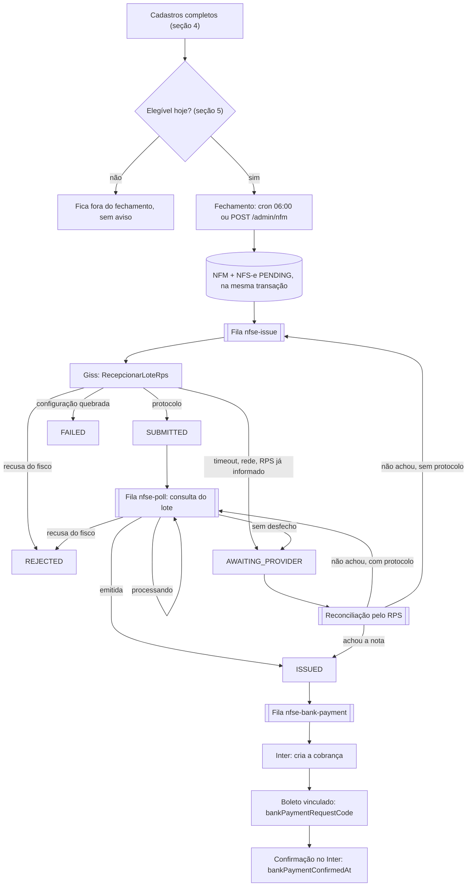
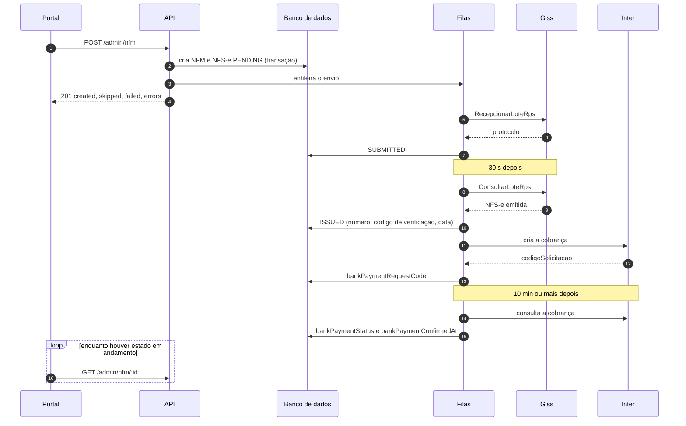
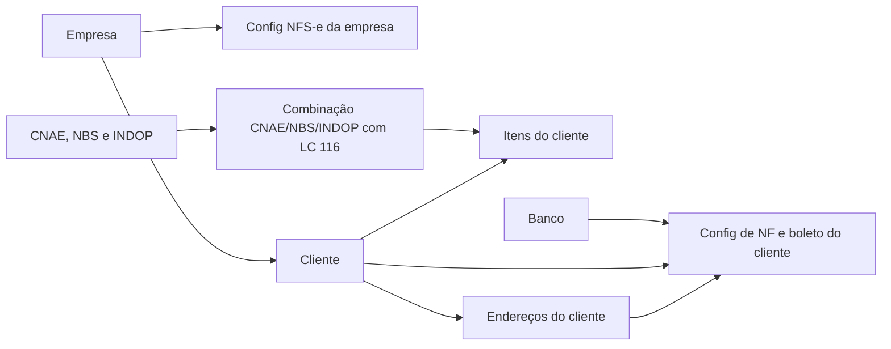
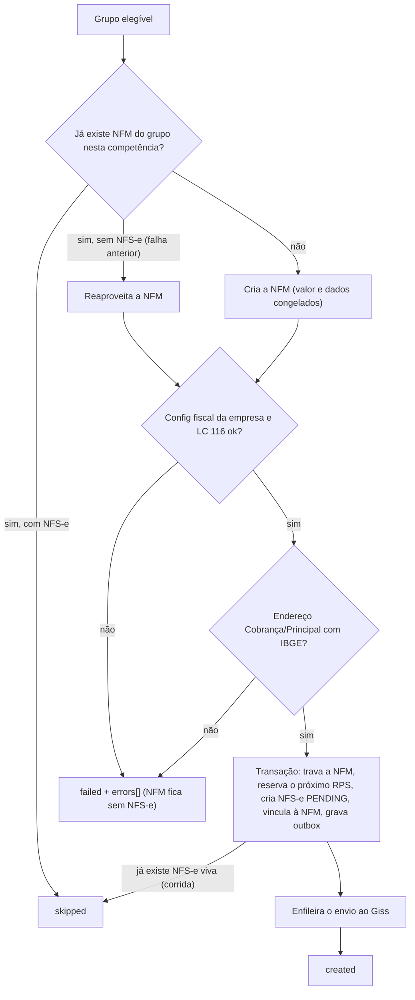
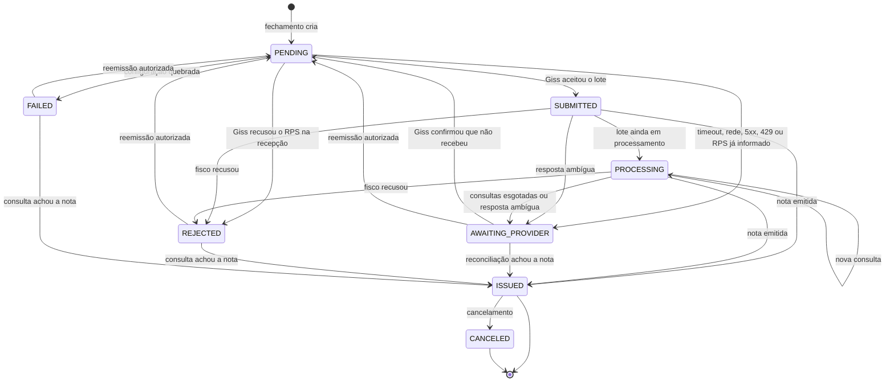

# Fluxo de NFM — guia para o portal web

> **Público:** dev frontend que vai planejar as telas de faturamento (NFM) no portal web.
>
> **Base:** backend em `main`, commit `71472625`, em 10/09/2026. O guia descreve o comportamento
> **atual** do código, não o desejado. Onde o comportamento atual tem armadilhas, a
> [seção 15](#15-comportamentos-atuais-que-o-portal-precisa-conhecer) diz qual é e o que a UI deve
> fazer.
>
> **Contrato detalhado:** Swagger em `/swagger` (tags `NFM`, `Cobrança bancária` e as de cadastro).
> Este guia explica o fluxo; o Swagger é a referência de tipos.
>
> **Autenticação:** todas as rotas citadas exigem JWT de admin (role `ADMIN`) e a claim indicada em
> cada uma.

## Sumário

1. [Resumo em 1 minuto](#1-resumo-em-1-minuto)
2. [Glossário](#2-glossário)
3. [Visão geral do fluxo](#3-visão-geral-do-fluxo)
4. [Pré-requisitos de cadastro](#4-pré-requisitos-de-cadastro)
5. [Elegibilidade](#5-elegibilidade)
6. [Fechamento: a geração das NFMs](#6-fechamento-a-geração-das-nfms)
7. [Ciclo de vida da NFS-e](#7-ciclo-de-vida-da-nfs-e)
8. [Boleto](#8-boleto)
9. [Retentativas e recuperação automática](#9-retentativas-e-recuperação-automática)
10. [Erros da API](#10-erros-da-api)
11. [Ferramentas de conserto](#11-ferramentas-de-conserto)
12. [Cancelamento](#12-cancelamento)
13. [Referência de rotas](#13-referência-de-rotas)
14. [Recomendações para o portal](#14-recomendações-para-o-portal)
15. [Comportamentos atuais que o portal precisa conhecer](#15-comportamentos-atuais-que-o-portal-precisa-conhecer)
16. [Apêndice](#16-apêndice)

---

## 1. Resumo em 1 minuto

- **NFM** é o faturamento mensal de um cliente de contrato para um **grupo fiscal** — o cliente mais a
  combinação CNAE/NBS/INDOP dos itens — numa **competência** (mês/ano). Um cliente com itens em duas
  combinações gera duas NFMs no mês.
- Cada NFM gera **uma NFS-e** (nota fiscal de serviço, emitida na prefeitura via Giss) e, depois de
  emitida, **um boleto** (cobrança no Banco Inter).
- O **fechamento roda sozinho todo dia às 06:00** (horário de Brasília). O botão "Gerar NFMs"
  (`POST /admin/nfm`) faz a mesma coisa sob demanda e é idempotente: rodar de novo não duplica nada.
- A API responde assim que grava e enfileira. Envio à prefeitura, consulta do resultado, boleto e
  confirmação do boleto acontecem **em segundo plano**, com retentativas automáticas. O portal
  acompanha por **polling** — não há websocket nem push.
- A NFM não tem status próprio. O estado vive em `nfse.status` (8 valores) e nos campos
  `nfse.bankPayment*`.
- Três estados pedem olhar humano: `REJECTED` (prefeitura recusou), `FAILED` (configuração quebrada)
  e `AWAITING_PROVIDER` (não se sabe se a nota saiu — **não é erro**; o backend investiga sozinho).
- A regra que a UI precisa preservar: **nunca oferecer "emitir de novo" às cegas.** Toda reemissão
  passa por `POST /admin/nfm/:id/reissue`, que consulta a prefeitura antes e reaproveita o mesmo
  número de RPS. Emitir uma nota que já existe é o único erro irreversível deste fluxo.

---

## 2. Glossário

| Termo | Significado |
|---|---|
| **NFM** | Registro de faturamento de um grupo fiscal numa competência. Chave única: `clientId` + `referenceMonth` + `referenceYear` + `cnaeNbsIndopId`. |
| **Grupo fiscal** | Itens ativos de um cliente que apontam para a mesma combinação CNAE/NBS/INDOP. |
| **Competência** | `referenceMonth`/`referenceYear`: mês e ano (fuso de Brasília) em que o fechamento criou a NFM. |
| **RPS** | Recibo Provisório de Serviços, o documento que o sistema envia à prefeitura. Número sequencial por empresa (`rpsNumber`) + série (`rpsSeries`). Número + série + prestador identificam a nota na prefeitura. |
| **Lote / protocolo** | O RPS viaja dentro de um lote (hoje, 1 RPS por lote). Ao aceitar o lote, o Giss devolve um protocolo (`batchProtocol`), usado para consultar o resultado depois. |
| **NFS-e** | A nota fiscal emitida pela prefeitura: `nfseNumber`, `verificationCode`, `issuedAt`. |
| **Giss** | Giss Online, webservice SOAP da prefeitura (hoje Mauá), chamado com o certificado digital A1 da empresa. |
| **Inter** | API de cobrança do Banco Inter (boleto com Pix). O identificador da cobrança é o `codigoSolicitacao`, guardado em `nfse.bankPaymentRequestCode`. |
| **`seuNumero`** | Nosso identificador da cobrança no Inter. É o id da NFS-e. |
| **Snapshot** | Cópia dos dados do tomador, do serviço e da regra de vencimento, gravada em `nfse.data` quando a NFS-e é criada. Todo envio e reenvio usa essa cópia ([6.5](#65-o-snapshot-o-que-congela-e-o-que-é-lido-na-hora)). |
| **Fechamento** | Execução que percorre os grupos elegíveis do dia e cria NFMs e NFS-e. |
| **Reconciliação** | Consulta à prefeitura pelo RPS para descobrir o que aconteceu com uma nota. |

---

## 3. Visão geral do fluxo



Caminho feliz, com o que o portal enxerga em cada momento:



### Tempos esperados

| Etapa | Tempo típico | Por quê |
|---|---|---|
| `POST /admin/nfm` responder | de segundos a minutos | percorre todos os elegíveis em série, dentro da requisição |
| `PENDING` → `SUBMITTED` | segundos depois de o job rodar | a fila de envio processa no máximo 30 envios/min, 2 por vez: um fechamento de 300 notas leva ~10 min só para enviar tudo |
| `SUBMITTED` → `ISSUED` | 1ª consulta 30 s após o envio | se a prefeitura ainda estiver processando, as consultas seguintes seguem a escada da [seção 9](#92-retentativa-por-etapa) |
| `ISSUED` → boleto solicitado | segundos | fila própria de boleto |
| Boleto solicitado → confirmado | 10 min ou mais | a confirmação é uma varredura a cada 5 min, para cobranças solicitadas há mais de 10 min |

---

## 4. Pré-requisitos de cadastro

Nada no fechamento é informado na hora: tudo sai do cadastro. Um cadastro incompleto aparece de três
jeitos diferentes, e o portal precisa saber qual é qual:

1. **O cliente some da lista de elegíveis, sem aviso** — ex.: cliente avulso, sem itens ativos,
   configuração com "Prazo faturamento".
2. **Entra na lista, mas falha no fechamento** com mensagem em `errors[]` — ex.: combinação sem
   LC 116, endereço sem código IBGE, configuração fiscal da empresa incompleta.
3. **A NFS-e é criada, mas termina `FAILED` ou `REJECTED`** — ex.: certificado ou `municipioSlug`
   errados (`FAILED`), dado recusado pela prefeitura (`REJECTED`).

### 4.1 Ordem de cadastro



| # | Cadastro | Rotas | Claims |
|---|---|---|---|
| 1 | Empresa (prestador) | `/admin/company` | `COMPANY_READ` / `COMPANY_WRITE` |
| 2 | Config NFS-e da empresa | `/admin/company-nfs-config` | `COMPANY_NFS_CONFIG_READ` / `_WRITE` |
| 3 | CNAE, NBS, INDOP e a combinação | `/admin/cnae`, `/admin/nbs`, `/admin/indop`, `/admin/cnae-nbs-indop` | `CNAE_NBS_INDOP_READ` / `_WRITE` (combinação) |
| 4 | Banco | `/admin/bank` | `BANK_READ` / `BANK_WRITE` |
| 5 | Cliente | `/admin/client` | `CLIENT_READ` / `CLIENT_WRITE` |
| 6 | Endereços do cliente | `/admin/client-address` | `CLIENT_ADDRESS_READ` / `_WRITE` |
| 7 | Itens do cliente | `/admin/client-item` | `CLIENT_ITEM_READ` / `_WRITE` |
| 8 | Config de NF e boleto do cliente | `/admin/client-invoice-config` | `CLIENT_INVOICE_CONFIG_READ` / `_WRITE` |

### 4.2 O que cada cadastro precisa ter

#### Empresa — `/admin/company`

- É o **prestador** da nota. O `document` (CNPJ) da empresa vai no RPS.
- O `companyId` do cliente decide qual empresa emite e qual configuração fiscal é usada.
- O fechamento não confere se a empresa está ativa.

#### Configuração de NFS-e da empresa — `/admin/company-nfs-config`

Rotas: `POST /admin/company-nfs-config` (cria; `409` se a empresa já tem uma),
`GET /admin/company-nfs-config/company/:companyId` (`404` se não existe) e
`PATCH /admin/company-nfs-config/:id` (parcial). Uma por empresa.

| Campo | Para que serve | Observação |
|---|---|---|
| `vendor` | provedor | hoje `giss` |
| `municipalRegistration` | inscrição municipal do prestador | vai no RPS e nas consultas |
| `municipalCodeIbge` | município onde o serviço é prestado | 7 dígitos (Mauá: `3529401`) |
| `serieRps` | série do RPS | ex.: `NFSE` |
| `environment` | ambiente do provedor | `PRODUCTION`, `DEMONSTRATION` ou `FICTITIOUS` |
| `certFilePath` | caminho do certificado A1 (`.pfx`) **no servidor** | não é upload; quem preenche é a operação |
| `certPasswordEnvVar` | **nome** da variável de ambiente com a senha do certificado | nunca a senha em si |
| `vendorConfig.municipioSlug` | define o endpoint `ws-{slug}.giss.com.br` | ex.: `maua`; obrigatório na prática |
| `issRate` | alíquota de ISS **em fração** | `0.0387` = 3,87% (vai no XML com 4 casas) |
| `issExigibility` | exigibilidade do ISS | 1 exigível, 2 não incidência, 3 isenção, 4 exportação, 5 imunidade, 6 suspensa (judicial), 7 suspensa (administrativa) |
| `municipalTaxCode` | código de tributação do município | até 20 caracteres (ex.: `620910000`) |
| `simpleNationalOptant`, `fiscalIncentive` | flags do RPS | optante pelo Simples, incentivo fiscal |

O que acontece se estiver errado:

| Situação | Onde aparece | Mensagem |
|---|---|---|
| Empresa sem configuração | `errors[]` do fechamento | `Configuração de NFS-e da empresa não encontrada.` |
| `issRate` vazio | `errors[]` do fechamento | `Config NFS-e da empresa {id} sem alíquota de ISS.` |
| `municipalTaxCode` vazio | `errors[]` do fechamento | `Config NFS-e da empresa {id} sem código de tributação municipal.` |
| `municipioSlug` ausente | NFS-e criada termina `FAILED` | `Configuração do prestador não define "municipioSlug" (vendorConfig) para o Giss` |
| Certificado ausente, senha errada ou vencido | NFS-e termina `FAILED` | mensagem do carregador do certificado |
| Código de tributação ou alíquota com valor que a prefeitura não aceita | NFS-e termina `REJECTED` | código da prefeitura (ex.: `E35`) |

#### CNAE, NBS, INDOP e a combinação — `/admin/cnae-nbs-indop`

- Criar a combinação: `POST /admin/cnae-nbs-indop` com `{ cnaeId, nbsId, indopId, serviceListItemCode }`.
  `serviceListItemCode` é o item da lista de serviços da LC 116 (ex.: `01.07`), obrigatório, até 10
  caracteres.
- **Não existe rota para editar uma combinação** — só criar, listar, inverter status
  (`PATCH /:id/status`) e excluir (`DELETE /:id`). Combinações antigas sem `serviceListItemCode`
  só se corrigem criando outra e reapontando os itens.
- Grupo cuja combinação não tem LC 116 → `errors[]`:
  `Correspondência CNAE/NBS/INDOP {id} sem ItemListaServico (LC 116).`
- O fechamento não confere se a combinação está ativa.
- Vão para o RPS: `serviceListItemCode`, `nbs.code`, `indop.code` e `cnae.code` (só dígitos).
  `cClassTrib = 000001` e o CST de IBS/CBS `000` são fixos no código, iguais para todos.

#### Banco — `/admin/bank`

- Campos: `drawer`, `wallet`, `account`, `agency`, `bankCode`, `bankName`, `paymentLocation?`,
  `fineRate?`, `moraRate?`.
- `fineRate` (multa após o vencimento) e `moraRate` (mora ao mês) em **pontos percentuais**: `2` =
  2%, nunca `0.02`. Faixa de 0 a 100, até 2 casas decimais. Vazio = boleto sem multa/mora.
- `PATCH /admin/bank/:id` usa o mesmo DTO do create — **não é parcial**. Reenviar sempre o
  cadastro inteiro, inclusive multa e mora.
- O banco precisa estar ativo para ser vinculado na configuração de NF e boleto.
- Multa e mora são lidas **no momento em que o boleto é emitido**, não no fechamento.
- O boleto do fluxo NFM sai sempre pelo Inter, qualquer que seja o `bankCode` do banco vinculado.

#### Cliente — `/admin/client`

| Campo | Exigência para a NFM |
|---|---|
| `invoiceType` | `Contrato` (clientes `Avulso` nunca entram) |
| `generateInvoice` | `true` |
| `active` | `true` (`PATCH /admin/client/:id/activate`) |
| `companyId` | empresa que emite a nota |
| `type` | `PF` ou `PJ` — vira o tipo de pessoa do pagador no boleto |
| `document` | CPF/CNPJ real do tomador; a prefeitura recusa documento fictício (`E155`) |
| `companyName` | razão social do tomador (vai na nota e no boleto) |
| `address` | obrigatório no cadastro; vira o endereço `Principal` |

Sub-clientes (`parentClientId`) não têm tratamento especial: cada um fatura pelo próprio cadastro.

#### Endereços — `/admin/client-address`

- Tipos: `Principal`, `Cobrança`, `Chamado`, `Correspondência` — no máximo um de cada por cliente.
- **Qual endereço vai na nota e no boleto:** o de tipo `Cobrança`, se existir; senão o `Principal`.
  - O `billingAddressId` da configuração de NF e boleto **não** é usado para isso.
  - Se o endereço de `Cobrança` existir **sem** código IBGE, a emissão falha — não cai para o
    `Principal`.
  - O status ativo do endereço não é conferido: um endereço de cobrança desativado continua sendo
    usado.
- O endereço escolhido precisa de `cityCodeIbge` (7 dígitos). Sem ele → `errors[]`:
  `Cliente não possui endereço de cobrança ou principal com código IBGE do município cadastrado.`
- `cityCodeIbge` é opcional no cadastro. Se vier vazio, um job em segundo plano consulta o CEP
  (ViaCEP) e preenche; se o CEP não resolver, o campo fica vazio **sem aviso nenhum**. Vale mostrar
  o campo, permitir preenchimento manual e destacar endereço sem IBGE na tela de prontidão.
- O boleto usa rua, número, complemento, bairro, cidade (obrigatória), UF e CEP desse mesmo endereço.

#### Itens do cliente — `/admin/client-item`

- Campos: `description` (até 255), `quantity` (inteiro ≥ 0), `unitValueInCents` (inteiro ≥ 0),
  `cnaeNbsIndopId`. Criação em lote: `POST /admin/client-item/bulk`.
- Só itens ativos entram (`PATCH /admin/client-item/:id/activate` e `/deactivate`).
- `totalValueInCents = ceil(quantity × unitValueInCents)`.
- **Agrupamento:** itens do mesmo cliente com a mesma combinação viram uma NFM. A descrição da NFS-e
  é a lista das descrições dos itens, uma por linha; o valor é a soma dos totais.
- Evitar grupo com valor total 0: o boleto recusa (`Valor dos serviços inválido para emissão do boleto.`).
- Cliente sem nenhum item ativo não aparece nos elegíveis.

#### Configuração de NF e boleto do cliente — `/admin/client-invoice-config`

Rotas: `POST /admin/client-invoice-config`, `GET /admin/client-invoice-config/client/:clientId`,
`PATCH /admin/client-invoice-config/:id`, `DELETE /admin/client-invoice-config/:id`. Uma por cliente.

| Campo | Efeito no fluxo NFM |
|---|---|
| `generateNf` | precisa ser `true` |
| `dueDateType` | precisa ser `Dia de vencimento`. Com `Prazo faturamento` o cliente **nunca** fica elegível ([seção 15](#15-comportamentos-atuais-que-o-portal-precisa-conhecer)) |
| `dueDateDay` | decide **quando** o cliente entra no fechamento (`dueDateDay ≤ dia de hoje`) e o dia de vencimento do boleto |
| `dueMonth` | a validação exige (1–12) com `Dia de vencimento`; só é usado no vencimento de contrato `Anual` |
| `emissionDay` | validado (`dueDateDay − emissionDay ≥ 15`), mas **não** usado pelo fechamento |
| `type` | `Mensal` ou `Anual`. `Anual` exige `months[]`, mas o fechamento não olha `months` |
| `issWithheld` | ISS retido: `true` informa o tomador como responsável pela retenção |
| `bankId` | banco de onde saem multa e mora do boleto |
| `billingAddressId` | obrigatório no cadastro, **não** usado pela nota nem pelo boleto |
| `deadlineDays` | só para `Prazo faturamento`, que hoje não entra no fluxo |
| `autoProtestBoleto`, `message` | não usados no fluxo NFM |

#### Ambiente do servidor (responsabilidade da operação)

Não é cadastro do portal, mas explica falhas em massa. Duas rotas de leitura, ambas com claim
`COMPANY_NFS_CONFIG_READ`:

- `GET /admin/health/certificates` →
  `{ status, certificates: [{ provider, owner, path, notAfter, daysToExpire, status, message }] }`.
  `status` é `OK`, `EXPIRING` (vence em 30 dias ou menos), `EXPIRED` ou `ERROR`; o do topo é o pior.
  Certificado vencido para toda a emissão.
- `GET /admin/health/smtp` → `{ status: OK | UNAVAILABLE, host, port, to, message }`. Sem SMTP,
  nenhum alerta chega à operação.

Sugestão: banner no topo das telas de NFM quando qualquer um dos dois não estiver `OK`.

### 4.3 Checklist de prontidão (montável pelo portal)

O backend não tem uma rota de "cliente pronto para faturar". O portal consegue montar o checklist
com as leituras que já existem:

| Verificação | Como conferir |
|---|---|
| Cliente `invoiceType = Contrato`, `generateInvoice`, `active` | `GET /admin/client/:id` |
| Config de NF e boleto existe, `generateNf`, `dueDateType = Dia de vencimento`, `dueDateDay` preenchido | `GET /admin/client-invoice-config/client/:clientId` (`404` = não existe) |
| Pelo menos 1 item ativo; toda combinação usada tem `serviceListItemCode`; total de cada grupo > 0 | `GET /admin/client-item?clientId={id}&active=true` (cada item traz `cnaeNbsIndop`) |
| Endereço `Cobrança` (se existir) ou `Principal` com `cityCodeIbge` | `GET /admin/client-address?clientId={id}` |
| Empresa do cliente com config NFS-e: `issRate`, `municipalTaxCode`, `vendorConfig.municipioSlug` | `GET /admin/company-nfs-config/company/:companyId` |
| Certificados válidos | `GET /admin/health/certificates` |

---

## 5. Elegibilidade

`GET /admin/nfm/elegible` · claim `NFM_READ` · resposta `NfmDto[]` (sem paginação).

Um grupo é elegível quando, no momento da chamada e no fuso de Brasília:

1. a config de NF e boleto do cliente tem `generateNf = true` e `dueDateDay ≤ dia de hoje`;
2. o cliente tem `invoiceType = Contrato`, `active = true` e `generateInvoice = true`;
3. o cliente tem pelo menos um item ativo.

Os itens ativos são agrupados por combinação CNAE/NBS/INDOP, e cada grupo vira um `NfmDto`.

**Por que `≤` e não `=`:** no dia 20 entram todos os contratos com vencimento de 1 a 20. Assim um
dia sem fechamento (feriado, sistema fora) não deixa contrato sem faturar — ele entra no dia
seguinte. A consequência para a tela: **a lista de elegíveis também traz o que já foi emitido nos
dias anteriores.** O `POST /admin/nfm` pula esses (`skipped`), mas para mostrar "já emitida" o portal
precisa cruzar com `GET /admin/nfm` (chave: `clientId` + `cnaeNbsIndopId` + competência corrente;
ver [14.1](#141-telas-sugeridas)).

A elegibilidade **não** considera:

- se a NFM do grupo já foi emitida no mês (acima);
- `emissionDay`, `months` (contrato anual) e configs com `Prazo faturamento` (ficam sempre de fora);
- descontos do cliente (`client-discount`), inclusive "não gerar cobrança" e "encerrar contrato";
- a configuração fiscal da empresa, o endereço e a LC 116 — problemas nesses só aparecem no fechamento.

Formato de cada item:

```json
{
  "client": {
    "id": 10,
    "type": "PJ",
    "document": "12345678000190",
    "companyName": "Cliente Exemplo Ltda",
    "invoiceType": "Contrato",
    "generateInvoice": true,
    "active": true,
    "company": { "id": 1, "name": "Empresa Emissora" }
  },
  "clientInvoiceConfig": {
    "id": 3,
    "generateNf": true,
    "type": "Mensal",
    "dueDateType": "Dia de vencimento",
    "dueDateDay": 15,
    "issWithheld": false,
    "bank": { "id": 1, "bankName": "Banco Inter", "fineRate": 2, "moraRate": 1 },
    "billingAddress": { "id": 20, "type": "Cobrança", "cityCodeIbge": "3529401" }
  },
  "clientItems": [
    {
      "id": 7,
      "description": "Locação de relógio de ponto",
      "quantity": 1,
      "unitValueInCents": 150000,
      "totalValueInCents": 150000,
      "active": true,
      "cnaeNbsIndop": {
        "id": 3,
        "serviceListItemCode": "01.07",
        "cnae": { "id": 1, "code": "6209-1/00", "description": "..." },
        "nbs": { "id": 1, "code": "1.1501.30.00", "description": "..." },
        "indop": { "id": 1, "code": "050101", "description": "..." }
      }
    }
  ]
}
```

(Campos resumidos; o objeto completo está no Swagger.)

---

## 6. Fechamento: a geração das NFMs

### 6.1 Os dois gatilhos

| | Automático | Manual |
|---|---|---|
| Quando | todo dia às 06:00 (Brasília) | `POST /admin/nfm`, sem body |
| Quem pode | agendador do servidor | usuário com `NFM_WRITE` |
| Execução única | trava diária no Redis. Sem Redis, **não emite** e avisa a operação por e-mail | sem trava própria; a duplicidade é barrada no banco e vira `skipped` |
| Resultado | e-mail para a operação quando há falhas (lista até 20); gravado internamente, **sem rota de consulta** | resposta HTTP `201`; também gravado internamente |

Os dois executam exatamente o mesmo código. O `POST` é o caminho de exceção: antecipar o
fechamento do dia ou reprocessar depois de corrigir um cadastro. Rodá-lo depois do automático não
duplica nada — o que já saiu volta como `skipped`.

**Atenção:** o `POST /admin/nfm` percorre todos os elegíveis **em série, dentro da requisição**.
Com muitos clientes ele pode levar minutos e estourar timeout de proxy/navegador. O trabalho não se
perde — cada grupo é gravado sozinho —, mas a resposta sim. Ver [14.5](#145-duplo-clique-timeout-e-idempotência).

### 6.2 O que acontece com cada grupo



1. **Competência** = mês e ano de hoje, no fuso de Brasília. Uma NFM atrasada (vencimento dia 15
   faturado no dia 20) nasce com a competência do mês corrente.
2. A NFM é buscada pela chave (cliente, mês, ano, combinação). Se já tem NFS-e → `skipped`.
3. Se não existe, é criada com `totalValueInCents` e os dados do grupo congelados naquele momento.
   Se existe sem NFS-e (uma falha anterior no mesmo mês), é reaproveitada.
4. Valida a configuração fiscal da empresa e a LC 116 da combinação.
5. Cria a NFS-e numa **transação única**: trava a linha da NFM, reserva o próximo número de RPS da
   empresa, cria a NFS-e em `PENDING` com uma reconciliação agendada para 15 min depois, vincula
   NFM ↔ NFS-e e grava a intenção de enfileirar (outbox). Não existe janela em que a nota exista sem
   estar vinculada.
6. Depois do commit, enfileira o envio. Se o Redis falhar nesse instante, a varredura de
   recuperação enfileira em até 5 min.

Um índice único no banco impede duas NFS-e "vivas" para a mesma NFM. Duas execuções simultâneas
(cron + botão, ou dois cliques) resultam numa nota só; a perdedora conta como `skipped`.

### 6.3 Resposta

```json
{
  "created": 2,
  "skipped": 1,
  "failed": 1,
  "errors": [
    {
      "clientId": 10,
      "cnaeNbsIndopId": 3,
      "message": "Correspondência CNAE/NBS/INDOP 3 sem ItemListaServico (LC 116)."
    }
  ]
}
```

| Campo | Significado |
|---|---|
| `created` | NFS-e criada e enfileirada nesta execução. **Ainda não emitida** — o resultado vem depois. |
| `skipped` | grupo que já tinha NFS-e nesta competência (ou perdeu a corrida para outra execução) |
| `failed` | grupo que não chegou a criar NFS-e |
| `errors[]` | um item por grupo que falhou: `clientId`, `cnaeNbsIndopId`, `message` |

### 6.4 Mensagens de `errors[]` e onde corrigir

| Mensagem | Onde corrigir |
|---|---|
| `Configuração de NFS-e da empresa não encontrada.` | criar a config NFS-e da empresa do cliente |
| `Correspondência CNAE/NBS/INDOP {id} sem ItemListaServico (LC 116).` | criar combinação com LC 116 e reapontar os itens do cliente |
| `Config NFS-e da empresa {id} sem alíquota de ISS.` | `PATCH /admin/company-nfs-config/:id` com `issRate` |
| `Config NFS-e da empresa {id} sem código de tributação municipal.` | idem, com `municipalTaxCode` |
| `Cliente não possui endereço de cobrança ou principal com código IBGE do município cadastrado.` | preencher `cityCodeIbge` no endereço `Cobrança` (ou no `Principal`, se não houver `Cobrança`) |
| `Grupo NFM sem itens de serviço.` | defensivo; não deveria ocorrer (vem com `cnaeNbsIndopId: 0`) |

Depois de corrigir, o grupo é retentado sozinho no próximo fechamento do mesmo mês (06:00 do dia
seguinte), ou na hora com `POST /admin/nfm`.

**O grupo que falha aqui fica invisível no resto da API:** a NFM existe, mas sem NFS-e, e
`GET /admin/nfm` só lista NFMs com NFS-e (`GET /admin/nfm/:id` dessa NFM responde `500`). A resposta
do `POST` e o e-mail da operação são os únicos lugares onde a falha aparece. Por isso a tela de
fechamento deve cruzar elegíveis × emitidas ([14.1](#141-telas-sugeridas)): o que é elegível e não
tem NFS-e está pendente ou falhou.

### 6.5 O snapshot: o que congela e o que é lido na hora

Quando a NFS-e é criada, o backend copia para `nfse.data` tudo que a nota e o boleto vão precisar.
Os jobs seguintes usam essa cópia, não o cadastro atual.

| Congelado na criação da NFS-e | Lido de novo a cada job |
|---|---|
| Tomador: documento, razão social, tipo PF/PJ | Certificado (`certFilePath`) e senha (`certPasswordEnvVar`) |
| Endereço do tomador (`Cobrança`/`Principal`) | Ambiente (`environment`) e `vendorConfig.municipioSlug` |
| Serviço: LC 116, NBS, INDOP, CNAE, descrição, valor | Multa e mora do banco (no boleto) |
| Alíquota de ISS, exigibilidade, código de tributação, município da prestação, ISS retido, Simples, incentivo fiscal | |
| CNPJ e inscrição municipal do prestador | |
| Regra de vencimento do boleto e competência | |

Consequência prática: **corrigir o cadastro depois que a NFS-e existe não altera essa NFS-e** —
nem num reenvio pela rota de reemissão ([11.3](#113-reemitir--post-adminnfmidreissue)).

Dois detalhes que decorrem disso:

- O valor gravado na NFM (`totalValueInCents`) é o do dia em que a NFM foi criada; o valor da nota é
  calculado quando a NFS-e é criada. Numa NFM reaproveitada (falhou num dia, saiu no outro) com itens
  alterados no meio, os dois divergem. O valor fiscal de verdade está em
  `nfse.data.input.service.servicesValue` (em reais) — estrutura interna, sem garantia de contrato.
- O endereço efetivamente usado está em `nfse.data.takerAddress` (mesma ressalva).

---

## 7. Ciclo de vida da NFS-e



| Status | Significado | Automação mexe? | Tom na UI | Ações |
|---|---|---|---|---|
| `PENDING` | criada, aguardando envio (ou reenvio) à prefeitura | sim | progresso — "Na fila de envio" | — |
| `SUBMITTED` | lote aceito, com protocolo, aguardando processamento | sim | progresso — "Em processamento na prefeitura" | — |
| `PROCESSING` | consulta do lote reagendada | sim | progresso — "Em processamento na prefeitura" | — |
| `AWAITING_PROVIDER` | não se sabe se a prefeitura emitiu | sim (reconciliação) | **atenção, não erro** — "Aguardando confirmação da prefeitura" | Verificar agora, Consultar na prefeitura, Reemitir (a rota decide) |
| `ISSUED` | emitida: `nfseNumber`, `verificationCode`, `issuedAt` | só o boleto | sucesso — "Emitida" | Cancelar; Gerar boleto se faltar |
| `REJECTED` | a prefeitura recusou o conteúdo do RPS | não | erro — "Recusada pela prefeitura" | mostrar `errorMessage`; Reemitir (ver ressalva em 11.3); Verificar agora |
| `FAILED` | falha determinística de configuração (certificado, senha, `municipioSlug`); nada chegou à prefeitura | não | erro — "Falha de configuração" | mostrar `errorMessage`; corrigir a config e Reemitir |
| `CANCELED` | cancelada: `canceledAt`, `cancelReasonCode` | não | neutro — "Cancelada" | — |

`ISSUED` e `CANCELED` são definitivos: nada tira a nota deles. `REJECTED`, `FAILED` e
`AWAITING_PROVIDER` saem por ação humana (reemitir ou verificar); `AWAITING_PROVIDER` também sai
sozinho pela reconciliação.

Três detalhes que afetam a tela:

- **`AWAITING_PROVIDER` aparece em processamento normal, não só em incidente.** Toda NFS-e nasce com
  uma reconciliação agendada para 15 min depois. Se nesse momento a prefeitura ainda não conhece o
  RPS (lote na fila dela, ou fechamento grande ainda enviando), a nota passa para
  `AWAITING_PROVIDER` e segue sendo consultada. Por isso a UI nunca deve pintar esse estado de erro.
- **`errorMessage` não é limpo quando a nota vira `ISSUED`.** Uma nota que passou por
  `AWAITING_PROVIDER` e depois foi emitida ainda carrega o motivo antigo. Mostrar `errorMessage` só
  quando o status for `REJECTED`, `FAILED` ou `AWAITING_PROVIDER`.
- `reconcileAttemptCount` e `nextReconcileAt` dizem quantas vezes o backend já perguntou à prefeitura
  e quando pergunta de novo. Úteis só numa área de diagnóstico.

---

## 8. Boleto

### 8.1 Quando e como é emitido

- Assim que a NFS-e vira `ISSUED`, um job na fila `nfse-bank-payment` cria a cobrança no Inter. Se
  esse job se perder, a varredura a cada 5 min reenfileira toda nota `ISSUED` sem cobrança e sem
  falha registrada.
- Se a emissão falhar por instabilidade do Inter (5xx, 408/425/429, timeout), a nota agenda a
  própria retentativa em `bankPaymentNextRetryAt` e a varredura tenta de novo sozinha por até 24h
  ([9.2](#92-retentativa-por-etapa)).
- Dados enviados: valor = valor da nota; `seuNumero` = id da NFS-e; multa e mora do banco vinculado
  ao cliente (lidas na hora); pagador = tomador do snapshot (`PF` → pessoa física, `PJ` → jurídica);
  cobrança pagável até 30 dias depois do vencimento.
- Antes do POST ao Inter o backend grava `bankPaymentRequestedAt`/`bankPaymentIdempotencyKey`. Toda
  tentativa seguinte consulta o Inter por `seuNumero` antes de emitir, e uma recusa por duplicidade
  do Inter é resolvida vinculando a cobrança que já existe. É isso que impede boleto duplicado — o
  portal não precisa se preocupar com isso, só com o duplo clique ([14.5](#145-duplo-clique-timeout-e-idempotência)).

### 8.2 Vencimento

| Configuração do cliente | Vencimento |
|---|---|
| `Dia de vencimento` + `Mensal` | dia `dueDateDay` do mês da competência (limitado ao fim do mês: 31 em fevereiro vira 28/29) |
| `Dia de vencimento` + `Anual` | dia `dueDateDay` do mês `dueMonth`, no ano da competência |
| `Prazo faturamento` | data de emissão + `deadlineDays` (hoje não acontece no fluxo NFM — seção 15) |

**Piso:** o vencimento nunca fica antes da data de emissão da nota. Nota emitida depois das 19h59
tem piso no dia seguinte (limite do Inter). Exemplo: vencimento dia 15 faturado no dia 20 → boleto
vence dia 20.

### 8.3 Estados do boleto na UI

A API não tem um campo "status do boleto" pronto; ele se deriva dos campos da NFS-e:

```ts
type EstadoBoleto =
  | 'sem-boleto'          // nota ainda não emitida
  | 'gerando'             // emissão automática em andamento
  | 'retentando'          // Inter instável; nova tentativa automática já agendada
  | 'falhou'              // mostrar bankPaymentErrorMessage + botão "Gerar boleto"
  | 'confirmando'         // Inter aceitou; aguardando confirmação (>= 10 min)
  | 'emitido'             // Inter confirmou que o boleto existe
  | 'falha-no-banco'      // Inter não conseguiu produzir o boleto; botão "Reemitir boleto"
  | 'consultar-no-banco'; // nota cancelada: a API não registra se o boleto foi cancelado

function estadoBoleto(nfse: NfseDto): EstadoBoleto {
  if (nfse.status === 'CANCELED') {
    return nfse.bankPaymentRequestCode ? 'consultar-no-banco' : 'sem-boleto';
  }
  if (nfse.status !== 'ISSUED') return 'sem-boleto';
  if (!nfse.bankPaymentRequestCode) {
    if (nfse.bankPaymentNextRetryAt) return 'retentando';
    return nfse.bankPaymentErrorMessage ? 'falhou' : 'gerando';
  }
  if (nfse.bankPaymentStatus === 'FAILED') return 'falha-no-banco';
  if (!nfse.bankPaymentConfirmedAt) return 'confirmando';
  return 'emitido';
}
```

| Estado | O que mostrar |
|---|---|
| `gerando` | "Gerando boleto". Normalmente segundos; a operação recebe alerta se passar de 1h. |
| `retentando` | aviso, não erro: o motivo (`bankPaymentErrorMessage`, que já termina com o horário da próxima tentativa). O sistema retenta sozinho por até 24h da primeira solicitação, ou até 19h59 do vencimento. O botão **Gerar boleto** antecipa, mas não é necessário. |
| `falhou` | o motivo (`bankPaymentErrorMessage`) e o botão **Gerar boleto** ([8.5](#85-gerar-boleto-manualmente--post-adminbank-paymentnfmid)). Chega aqui o que não tem retentativa automática: erro permanente (dado recusado pelo Inter) ou a retentativa de 24h/vencimento esgotada. |
| `confirmando` | "Boleto solicitado, aguardando confirmação do banco". |
| `emitido` | `bankPaymentStatus` (ex.: `EMITTED`) e os links de PDF/linha digitável ([8.4](#84-dados-do-boleto-pdf-e-situação-atual)). |
| `falha-no-banco` | o Inter aceitou a solicitação mas não produziu o boleto (`FALHA_EMISSAO`). Botão **Reemitir boleto** ([8.6](#86-reemitir-boleto-com-falha-no-banco--post-adminbank-paymentnfmidreissue)). |
| `consultar-no-banco` | a nota foi cancelada; se o boleto foi cancelado junto só a resposta do cancelamento disse ([seção 12](#12-cancelamento)). Para saber depois, consultar a situação no Inter. |

Motivos que podem aparecer em `bankPaymentErrorMessage`:

| Mensagem | Causa |
|---|---|
| `Valor dos serviços inválido para emissão do boleto.` | grupo com valor 0 |
| `Cidade do tomador ausente para emissão do boleto.` | endereço sem cidade |
| `Configuração de faturamento do cliente ausente para emissão do boleto.` | config de NF e boleto excluída depois da nota |
| `Provedor reportou falha na emissão da cobrança {codigo}` | Inter não produziu o boleto (estado `falha-no-banco`) |
| `Provedor bancário não suportado: INTER.` | integração com o Inter desligada no servidor |
| `Banco Inter indisponível no momento (HTTP 429).`, `Banco Inter respondeu com erro 5xx.`, `Falha na comunicação com a API de cobrança do Banco Inter.` | instabilidade do Inter. Com retentativa agendada a mensagem termina com `Nova tentativa automática em dd/MM/aaaa HH:mm.` (estado `retentando`); sem, com `Retentativa automática encerrada: …` (estado `falhou`) |
| `Cobrança {codigo} com falha de emissão ainda ocupa a chave de idempotência do Banco Inter (janela de 30 minutos).` | reemissão feita logo depois de uma `FALHA_EMISSAO`; retentado sozinho até a janela do Inter passar |
| `Banco Inter recusou por duplicidade, mas a cobrança {codigo} não corresponde a esta NFS-e (…)` | o Inter tem uma cobrança com a mesma chave e valor ou vencimento diferentes; tratamento manual |
| outras | mensagem de validação devolvida pelo próprio Inter |

`bankPaymentStatus` pode valer `AWAITING_APPROVAL`, `EMITTED`, `RECEIVED`, `PAID`,
`MARKED_RECEIVED`, `EXPIRED`, `CANCELLED`, `FAILED` ou `UNKNOWN`. Ele é gravado **uma vez**, na
confirmação, e não é atualizado depois: **o sistema não acompanha pagamento** (não há webhook do
Inter). Para saber se o cliente pagou, consultar o Inter na hora (8.4).

### 8.4 Dados do boleto, PDF e situação atual

- `GET /admin/bank-payment/:codigoSolicitacao?provider=INTER` (claim `BANK_PAYMENT_READ`) → situação
  atual no Inter: `{ provider, requestCode, yourNumber, status, amount, dueDate, daysAfterDue, payer,
  boleto: { ourNumber, barcode, digitableLine }, pix: { txid, copyAndPaste } }`.
- `GET /admin/bank-payment/:codigoSolicitacao/pdf?provider=INTER` → `{ provider, requestCode, pdf }`,
  com o PDF em base64.
- `provider` é obrigatório na query. `:codigoSolicitacao` = `nfse.bankPaymentRequestCode`.
- Essas rotas chamam o Inter a cada requisição (cota de 120 chamadas/min compartilhada com o fluxo
  automático): buscar sob demanda no detalhe, nunca por linha numa lista nem em polling.

### 8.5 Gerar boleto manualmente — `POST /admin/bank-payment/nfm/:id`

- `:id` é o id da **NFM**. Claim `BANK_PAYMENT_WRITE`. Síncrono: chama o Inter dentro da requisição.
- Mesmas proteções contra duplicidade do fluxo automático (consulta por `seuNumero` antes de emitir).
- Respostas:

| Status | Quando |
|---|---|
| `201` | `{ provider, requestCode }` — boleto emitido e vinculado |
| `409` | `NFS-e da NFM não está emitida.` ou `NFS-e já possui boleto vinculado.` |
| `400` | dados recusados (o mesmo motivo fica em `bankPaymentErrorMessage`), ou `Não foi possível emitir o boleto. Verifique os logs de cobrança.` |
| `404` | NFM não encontrada |
| `500` | NFM sem NFS-e |
| `503` | Inter indisponível — a mensagem traz o horário da próxima tentativa automática, que já ficou agendada |

- Não há trava contra clique duplo nesta rota: desabilitar o botão enquanto a requisição estiver
  em andamento.
- Mostrar o botão só nos estados `falhou` e `retentando` (ou `gerando` há mais de 1h), para não
  competir com o job automático.

### 8.6 Reemitir boleto com falha no banco — `POST /admin/bank-payment/nfm/:id/reissue`

Para o estado `falha-no-banco`: o Inter aceitou a solicitação e depois reportou `FALHA_EMISSAO`.

- `:id` é o id da **NFM**. Claim `BANK_PAYMENT_WRITE`. Corpo `{ reason, confirm: true }` — motivo de
  5 a 500 caracteres; `confirm` tem de ser `true`. Assíncrono: responde `202` e o boleto sai pela fila.
- A rota **consulta o Inter ela mesma** antes de decidir. Só quando o Inter confirma que a cobrança
  vinculada falhou ela desfaz o vínculo e enfileira uma emissão nova. A cobrança com falha continua no
  Inter, sem cobrar ninguém.
- O `seuNumero` continua sendo o id da NFS-e. Se a reemissão acontecer menos de 30 min depois da
  cobrança com falha, o Inter ainda devolve a chave antiga; o backend trata isso como instabilidade e
  retenta sozinho (estado `retentando`) até a janela passar.
- O payload é o mesmo da primeira emissão: pagador e endereço vêm do snapshot da nota. Reemitir resolve
  falha do lado do banco; **não** leva uma correção de cadastro para o boleto.

| Status | Quando |
|---|---|
| `202` | `{ nfseId, replacedRequestCode }` — vínculo desfeito, emissão nova na fila |
| `409` | `NFS-e da NFM não está emitida.`, `NFS-e sem boleto vinculado; …` ou `Cobrança {codigo} está {status} no provedor; só cobrança com falha de emissão pode ser reemitida.` |
| `400` | `reason` ou `confirm` inválidos |
| `404` | NFM não encontrada, ou cobrança não encontrada no Inter |
| `503` | Inter indisponível na consulta — nada foi alterado |

- Depois do `202`, acompanhar pelo estado do boleto (8.3): `gerando` → `confirmando` → `emitido`.

---

## 9. Retentativas e recuperação automática

O backend foi desenhado para que o operador quase nunca precise agir: cada etapa tem retentativa
própria e varreduras periódicas recolocam em movimento o que parou. O portal não deve reimplementar
nada disso — só precisa entender o suficiente para não pintar de erro o que ainda está sendo
resolvido, e para não oferecer um botão que concorre com a automação.

### 9.1 Filas

| Fila | Jobs | Concorrência | Limite | Por quê |
|---|---|---|---|---|
| `nfse-issue` | envio do RPS | 2 | 30/min | a prefeitura é o recurso escasso; envio é a chamada cara |
| `nfse-poll` | consulta do lote, reconciliação pelo RPS | 6 | 120/min | leitura, idempotente |
| `nfse-bank-payment` | emissão e confirmação do boleto | 6 | 100/min | o Inter aceita 120/min, cota compartilhada com as rotas de boleto |

Jobs concluídos são descartados. Jobs que esgotam as tentativas ficam retidos 30 dias e aparecem no
Bull Board (`/admin/queues`, com usuário e senha próprios — ferramenta da operação, não do portal).

### 9.2 Retentativa por etapa

| Etapa | Tentativas do job | Escada de negócio | Ao desistir |
|---|---|---|---|
| **Envio do RPS** | 5×, exponencial a partir de 30 s (30 s, 1 min, 2 min, 4 min) — só para erro **antes** de chamar a prefeitura (banco de dados, config não encontrada) | erro **da prefeitura** não é retentado pela fila: vira estado — `REJECTED` (recusa de negócio), `FAILED` (configuração) ou `AWAITING_PROVIDER` (todo o resto) | estado final gravado; job retido |
| **Consulta do lote** | 5×, exponencial a partir de 30 s (erros inesperados) | consultas em ~30 s, 1 min, 2 min, 7 min, 22 min, 1h22, 7h22 e 31h22 após o envio (8 no total). Timeout ou erro de rede numa consulta gasta um degrau | `AWAITING_PROVIDER` — **nunca** `FAILED` |
| **Reconciliação pelo RPS** | 3×, exponencial a partir de 60 s | agendada na própria nota: a 1ª 15 min depois da criação; depois +5 min, +15 min, +1h, +6h, +24h e então diária | aos 25 dias da criação para de reagendar: decisão humana (o prazo de cancelamento da prefeitura é de 30 dias) |
| **Emissão do boleto** | 5×, exponencial a partir de 5 s (5 s, 10 s, 20 s, 40 s) — só para erro inesperado (banco de dados, resposta do Inter sem código) | falha **transitória** do Inter (5xx, 408/425/429, timeout) não é retentada pela fila: a nota grava `bankPaymentNextRetryAt` e a varredura tenta de novo em +5 min, +15 min, +30 min, +1h, +2h, +4h e depois a cada 6h, respeitando `Retry-After`. Erro permanente (dado inválido, 4xx) não é retentado | 24h depois da primeira solicitação ou às 19h59 do vencimento, o que vier primeiro: `bankPaymentErrorMessage` gravado sem retentativa + alerta; depois só o botão manual |
| **Confirmação do boleto** | 3×, exponencial a partir de 60 s | varredura a cada 5 min pega cobranças solicitadas há mais de 10 min e ainda não confirmadas | enquanto não confirmada nem falhada, segue sendo varrida |

### 9.3 Varreduras agendadas (horário de Brasília)

| Quando | O que faz |
|---|---|
| 06:00 | fechamento diário ([seção 6](#6-fechamento-a-geração-das-nfms)) |
| a cada 5 min | recuperação — só enfileira, até 200 notas por braço: (1) NFS-e criada e não enfileirada há mais de 1 min; (2) reconciliações vencidas; (3) `ISSUED` sem boleto e sem falha registrada; (4) `ISSUED` sem boleto com retentativa vencida — cada nota é reivindicada antes de ir para a fila, para não duplicar entre réplicas; (5) boletos solicitados há mais de 10 min sem confirmação |
| a cada 15 min | alertas por e-mail ([9.5](#95-alertas-para-a-operação)) |
| 07:00 | validade dos certificados |
| 07:30 | conciliação do dia anterior contra a prefeitura, corrigindo o que achar |
| 08:00 | resumo do dia anterior: emitidas × com boleto (e-mail só se divergir) |

### 9.4 Proteções contra provedor fora do ar

- **Timeout** de 60 s nas chamadas à prefeitura e 30 s nas do Inter.
- **Disjuntor por município** na prefeitura: 5 falhas transitórias seguidas abrem o circuito por
  60 s. Com o circuito aberto as chamadas falham na hora, como transitórias — a nota vai para
  `AWAITING_PROVIDER` (envio) ou gasta um degrau da escada (consulta), em vez de cada job esperar o
  timeout inteiro.
- **Classificação dos erros da prefeitura (Giss):**
  - transitório: HTTP 408, 425, 429, 5xx, timeout, conexão recusada ou cortada, DNS;
  - permanente: erro de configuração (certificado, senha, `municipioSlug`) → `FAILED`;
  - recusa de negócio (códigos `E…` na resposta) → `REJECTED`;
  - "já conheço este RPS" (`E10`, `E71`, `A12`) → `AWAITING_PROVIDER`, porque a nota provavelmente
    existe;
  - "não achei" (`E89`, `E212`) → resposta legítima de consulta, nunca erro.
- **Classificação dos erros do Inter:** 404 → cobrança não encontrada; 408, 425, 429 e 5xx →
  transitório (respeita `Retry-After`); demais 4xx → permanente, **exceto** a recusa por
  duplicidade, que vira vínculo com a cobrança existente; sem resposta (timeout) → transitório.

### 9.5 Alertas para a operação

E-mails em formato de resumo (um por janela, listando tudo), para a caixa da operação — **nunca**
para o cliente. O portal não precisa notificar nada disso; pode exibir os mesmos números via
`GET /admin/metrics/nfse`, que usa os mesmos limiares.

| Alerta | Condição | Repete no máximo a cada |
|---|---|---|
| Notas presas | `PENDING`, `SUBMITTED` ou `PROCESSING` sem movimento há mais de 2h | 15 min |
| Emitidas sem boleto | `ISSUED` sem cobrança há mais de 1h | 15 min |
| Aguardando prefeitura | qualquer nota em `AWAITING_PROVIDER` | 12h |
| Boleto com falha | `ISSUED` com falha de boleto registrada **e sem retentativa agendada** (inclui `FALHA_EMISSAO`); o e-mail aponta a rota de conserto de cada caso | 15 min |
| Ressalvas da prefeitura | nota emitida com alertas `A…` (uma vez por nota) | 15 min |
| Filas | mais de 200 jobs pendentes numa fila, ou qualquer job na fila de falhas | 15 min |
| Fechamento diário | fechamento com falhas, trava indisponível ou erro | 23h |
| Certificados | vence em 30, 15 ou 7 dias; vencido; ilegível | 23h |
| Resumo diário | emitidas ontem ≠ com boleto | 23h |

---

## 10. Erros da API

### 10.1 Formato

- Erros de negócio: `{ "message": "texto em português" }` com o status HTTP.
- Erros de validação de body/query: `400` no formato padrão do NestJS, com `message` podendo ser um
  **array** de strings. Tratar os dois formatos.
- `429`: limite de requisições (global por janela; `GET /admin/nfm/:id/provider-status` tem metade do
  limite global).
- As mensagens já estão em português e podem ser exibidas ao usuário.

### 10.2 Status HTTP

| Status | Quando |
|---|---|
| `400` | validação; `dateStart` posterior a `dateEnd`; dado recusado pelo provedor; configuração do prestador inválida |
| `404` | NFM, NFS-e, configuração ou cobrança não encontrada |
| `409` | ação incompatível com o estado atual: cancelar nota não emitida ou já cancelada; reemitir fora dos estados permitidos; nota já existe na prefeitura; lote ainda em processamento; consulta inconclusiva; boleto já vinculado; configuração já existe |
| `429` | limite de requisições |
| `500` | `NFM {id} sem NFS-e vinculada.` — NFM que falhou no fechamento antes de ter nota ([6.4](#64-mensagens-de-errors-e-onde-corrigir)) |
| `503` | prefeitura ou Inter indisponível, ou resposta inesperada do provedor |

### 10.3 Onde ler o erro em cada momento

| Momento | Onde |
|---|---|
| Fechamento | `errors[]` da resposta do `POST /admin/nfm` |
| Emissão da nota | `nfse.errorMessage`, quando o status é `REJECTED`, `FAILED` ou `AWAITING_PROVIDER` |
| Boleto | `nfse.bankPaymentErrorMessage`, `nfse.bankPaymentFailedAt` e, se houver retentativa agendada, `nfse.bankPaymentNextRetryAt` |
| Ressalvas da prefeitura numa nota emitida | não expostas na API hoje ([seção 15](#15-comportamentos-atuais-que-o-portal-precisa-conhecer)) |
| Ações manuais | corpo da resposta HTTP |

### 10.4 Códigos da prefeitura já vistos em `errorMessage`

O formato é `CÓDIGO: mensagem`, separado por `; ` quando há mais de um.

| Código | Significado | O que fazer |
|---|---|---|
| `E10`, `E71`, `A12` | RPS já informado / duplicado | nada: a nota provavelmente existe; a reconciliação resolve |
| `E89` | não existe NFS-e para o RPS (resposta de consulta) | informativo |
| `E212` | NFS-e não encontrada / fim da paginação (consulta) | informativo |
| `E155` | documento do tomador não aceito (ex.: CNPJ fictício) | cadastro do cliente — ver a ressalva de 11.3 |
| `E202` | falta código de tributação municipal | config NFS-e da empresa |
| `E35` | código de tributação com valor errado | config NFS-e da empresa |
| `E384` | código de país rejeitado | backend |
| `E174`, `V999` | assinatura ausente / erro genérico com o código real dentro da mensagem | backend |
| `A10`, `A13`, `A21` | ressalvas numa nota **emitida**: inscrição municipal paralisada, prazo de conversão do RPS vencido, Simples fora do cadastro | a nota é válida; regularizar junto à prefeitura |

---

## 11. Ferramentas de conserto

Quatro rotas para quando algo trava. Todas role `ADMIN`.

### 11.1 Consultar na prefeitura — `GET /admin/nfm/:id/provider-status`

- Claim `NFM_READ`. **Só leitura**: pergunta à prefeitura o que ela sabe sobre o RPS desta NFM e não
  altera nada. Limite de requisições reduzido (metade do global).
- `200`:

```json
{
  "nfseId": 118,
  "rpsNumber": 1234,
  "rpsSeries": "NFSE",
  "found": true,
  "note": {
    "rpsNumber": 1234,
    "rpsSeries": "NFSE",
    "nfseNumber": "5678",
    "verificationCode": "ABCD1234",
    "issueDate": "2026-09-10T09:00:40.000Z"
  },
  "errors": [],
  "consultedAt": "2026-09-10T12:00:00.000Z"
}
```

- `errors[]` traz `{ code, message, kind }` (`kind`: `ALREADY_SUBMITTED`, `BUSINESS_REJECTION`,
  `NOT_FOUND`). `found: false` com `E89` = a prefeitura não conhece o RPS.
- Uso: botão "Consultar na prefeitura" numa área de diagnóstico.

### 11.2 Verificar agora — `POST /admin/nfm/:id/reconcile`

- Claim `NFM_WRITE`. Body `{ "reason": "..." }` (5 a 500 caracteres). `200`.
- Consulta a prefeitura pelo RPS e **corrige o estado local** com o que ela responder. É o mesmo
  código que a automação roda — a rota só antecipa.
- Resposta `{ nfseId, previousStatus, newStatus, source, nfseNumber?, message? }`:

| `source` | Significado | UI |
|---|---|---|
| `PROVIDER_ISSUED` | a prefeitura tem a nota → local virou `ISSUED` e o boleto foi enfileirado | sucesso |
| `PROVIDER_NOT_FOUND_POLLING` | a prefeitura não conhece o RPS, mas o lote foi aceito → nota em `AWAITING_PROVIDER`, consulta do lote reagendada | aguardar |
| `PROVIDER_NOT_FOUND_REQUEUED` | a prefeitura confirmou que não recebeu e nunca houve protocolo → nota volta a `PENDING` e o **mesmo** RPS é reenviado | acompanhar |
| `PROVIDER_NOT_FOUND` | a prefeitura não conhece o RPS e a nota já está `REJECTED`/`FAILED` → nada muda | pode reemitir |
| `PROVIDER_QUERY_FAILED` | a consulta falhou por motivo próprio (`message`) → nota fica (ou passa a ficar) em `AWAITING_PROVIDER` | tentar depois |
| `NO_OP` | nota já `ISSUED` ou `CANCELED` | nada a fazer |

- Atenção: numa nota `REJECTED`, uma consulta inconclusiva (`PROVIDER_QUERY_FAILED`) move a nota para
  `AWAITING_PROVIDER`.
- Erros: `404`, `500` (NFM sem NFS-e), `503`/`400` (prefeitura indisponível ou config inválida).

### 11.3 Reemitir — `POST /admin/nfm/:id/reissue`

- Claim `NFM_WRITE`. Body `{ "reason": "...", "confirm": true }` — `reason` de 5 a 500 caracteres,
  `confirm` exatamente `true` (reemitir gera documento fiscal).
- Permitido só com `nfse.status` em `REJECTED`, `FAILED` ou `AWAITING_PROVIDER`.
- A rota **consulta a prefeitura ela mesma** antes de decidir:

| Situação | Resposta |
|---|---|
| status fora dos permitidos | `409` `NFS-e em {status} não pode ser reemitida.` |
| a prefeitura já tem a nota | `409` `NFS-e já emitida no provedor sob o número {n}; estado local reconciliado.` — a nota vira `ISSUED` e **nada** é reenviado |
| o lote ainda está em processamento | `409` `Lote {protocolo} ainda em processamento no provedor; consulta reagendada.` |
| a consulta não foi conclusiva | `409` `Consulta ao provedor não foi conclusiva: {motivo}` |
| a prefeitura confirma que não existe nota para o RPS | `202` `{ nfseId, rpsNumber, rpsSeries, status: "PENDING" }` — reenvio com o **mesmo** RPS |
| prefeitura indisponível | `503` |

- Um `409` aqui é a proteção funcionando, não uma falha: mostrar a mensagem e recarregar o detalhe
  (o status pode ter virado `ISSUED`).

> **Ressalva importante — o reenvio usa o snapshot.** A reemissão reenvia exatamente os dados
> congelados na criação da NFS-e ([6.5](#65-o-snapshot-o-que-congela-e-o-que-é-lido-na-hora)). Corrigir
> tomador, endereço, itens, LC 116, alíquota, código de tributação ou inscrição municipal **não muda**
> o RPS reenviado. Hoje a reemissão resolve:
>
> - `FAILED` por certificado, senha, ambiente ou `municipioSlug` (lidos na hora);
> - `AWAITING_PROVIDER` em que nada chegou à prefeitura;
> - `REJECTED` causado por instabilidade do lado da prefeitura.
>
> Para `REJECTED` por **dado cadastral**, reemitir tende a devolver a mesma rejeição — não existe rota
> que regenere o snapshot. O texto da UI não deve prometer "corrija o cadastro e reemita" nesse caso;
> melhor: "A reemissão reenvia os mesmos dados da nota original. Se a recusa foi por cadastro, acione
> o time responsável."

### 11.4 Conciliar um período — `POST /admin/nfm/reconcile-period`

- Claim `NFM_WRITE`. Body `{ "startDate": "2026-09-03", "endDate": "2026-09-03", "dryRun": true }`
  (datas `YYYY-MM-DD`, fuso de Brasília, inclusivas). **`dryRun` é `true` por padrão** — só relata.
- Confere as NFS-e locais ainda em aberto (`PENDING`, `SUBMITTED`, `PROCESSING`,
  `AWAITING_PROVIDER`) criadas no período contra tudo que a empresa emitiu na prefeitura (páginas de
  50 notas). Com `dryRun: false`, corrige as que achar.
- `200`: `{ checked, corrected, pagesRead, divergences: [{ nfseId, rpsNumber, rpsSeries, status,
  foundAtProvider }], dryRun }`.
- Roda sozinho às 07:30 para o dia anterior. Pode demorar (várias páginas por empresa): usar timeout
  generoso. Lugar natural: tela de diagnóstico, sempre com `dryRun` primeiro.

---

## 12. Cancelamento

`POST /admin/nfm/:id/cancel` · claim `NFM_WRITE` · síncrono (prefeitura e Inter dentro da requisição).

- `:id` é o id da **NFM**.
- Body `{ "cancelReasonCode": 2 }` — `1` erro na emissão, `2` serviço não prestado, `4` duplicidade da
  nota. `3` e `5` são recusados (exclusivos da administração tributária).
- Só funciona com `nfse.status = ISSUED`.
- **Ordem:** cancela o boleto vinculado (se houver) **primeiro** e a nota depois. Uma falha no boleto
  não impede o cancelamento da nota.

Resposta `200`:

```json
{
  "id": 42,
  "status": "CANCELED",
  "canceledAt": "2026-09-10T12:00:00.000Z",
  "bankPaymentCanceled": true
}
```

Quando havia boleto e o cancelamento dele falhou:

```json
{
  "id": 42,
  "status": "CANCELED",
  "canceledAt": "2026-09-10T12:00:00.000Z",
  "bankPaymentCanceled": false,
  "bankPaymentError": "Falha na comunicação com a API de cobrança do Banco Inter."
}
```

| Campo | Significado |
|---|---|
| `bankPaymentCanceled: true` | havia boleto e ele foi cancelado |
| `bankPaymentCanceled: false` sem `bankPaymentError` | não havia boleto — não mostrar nada |
| `bankPaymentError` presente | a nota foi cancelada, **a cobrança não**: continua viva e cobrável. Mostrar aviso persistente (não toast). Cancelamento manual: `POST /admin/bank-payment/:codigoSolicitacao/cancel` com `{ "provider": "INTER", "reason": "..." }` (`reason` até 50 caracteres, claim `BANK_PAYMENT_WRITE`). |

Erros:

| Status | Quando |
|---|---|
| `400` | `cancelReasonCode` inválido |
| `404` | NFM não encontrada |
| `409` | `Nfse já está cancelada.` ou `Nfse não está emitida e não pode ser cancelada.` |
| `500` | NFM sem NFS-e |
| `503` | prefeitura indisponível **ou recusou o cancelamento** (ex.: `Giss não confirmou o cancelamento (...)`) |

Pontos de atenção:

- **O resultado do boleto só existe na resposta.** Depois do cancelamento, `GET /admin/nfm/:id` não
  diz se o boleto foi cancelado (os campos `bankPayment*` não mudam). Guardar/mostrar a resposta, ou
  consultar o Inter ([8.4](#84-dados-do-boleto-pdf-e-situação-atual)).
- **Se a prefeitura recusar**, o boleto pode já ter sido cancelado e a nota continua `ISSUED`. Num
  erro `503`, conferir a situação do boleto no Inter antes de qualquer outra ação.
- **Prazo:** a prefeitura aceita cancelamento até 30 dias depois da emissão. A API não verifica o
  prazo antes — quem recusa é a prefeitura. Vale mostrar os dias desde `issuedAt` e avisar perto do
  limite.
- **Cancelar encerra aquela competência daquele grupo.** O fechamento não gera outra nota para ela (a
  NFM continua vinculada à NFS-e cancelada) e a substituição de nota não está implementada.

---

## 13. Referência de rotas

### NFM — `/admin/nfm`

| Método | Rota | Claim | Execução | Resposta |
|---|---|---|---|---|
| `GET` | `/admin/nfm` | `NFM_READ` | leitura | `200` paginado de `NfmWithNfseDto` |
| `GET` | `/admin/nfm/elegible` | `NFM_READ` | leitura | `200` `NfmDto[]` |
| `GET` | `/admin/nfm/:id` | `NFM_READ` | leitura | `200` `NfmWithNfseDto` · `404` · `500` |
| `POST` | `/admin/nfm` | `NFM_WRITE` | síncrono até gravar e enfileirar; emissão assíncrona | `201` `{ created, skipped, failed, errors }` |
| `POST` | `/admin/nfm/:id/cancel` | `NFM_WRITE` | síncrono (prefeitura + Inter) | `200` |
| `GET` | `/admin/nfm/:id/provider-status` | `NFM_READ` | síncrono (prefeitura), só leitura | `200` |
| `POST` | `/admin/nfm/:id/reconcile` | `NFM_WRITE` | síncrono (prefeitura) | `200` |
| `POST` | `/admin/nfm/:id/reissue` | `NFM_WRITE` | síncrono (prefeitura) + reenvio assíncrono | `202` · `409` |
| `POST` | `/admin/nfm/reconcile-period` | `NFM_WRITE` | síncrono (prefeitura, várias páginas) | `200` |

**`GET /admin/nfm` — query:**

| Parâmetro | Tipo | Efeito |
|---|---|---|
| `dateStart`, `dateEnd` | `YYYY-MM-DD` | filtram pela data de **criação da NFM**, no fuso de Brasília, inclusivas e independentes. `dateStart > dateEnd` → `400` |
| `status` | `NfseStatus` | status da NFS-e vinculada |
| `stuckForHours` | inteiro > 0 | só notas em `PENDING`/`SUBMITTED`/`PROCESSING`/`AWAITING_PROVIDER` sem movimento há mais de N horas |
| `missingBankPayment` | boolean | `true` = `ISSUED` sem cobrança; `false` = só as que têm cobrança |
| `page`, `size` | inteiro > 0 | paginação. **Sem eles a rota devolve tudo** — sempre enviar |

- Só lista NFMs **com** NFS-e. Ordenação: mais recentes primeiro (`createdAt`).
- Resposta: `{ currentPage, itemsPerPage, totalItems, totalPages, data: NfmWithNfseDto[] }`.
- `NfmWithNfseDto`: `id`, `clientId`, `clientDocument`, `companyName` (razão social do **cliente**,
  não da empresa emissora), `referenceMonth`, `referenceYear`, `totalValueInCents`,
  `cnaeNbsIndopId`, `createdAt`, `updatedAt`, `nfse` (exemplo completo no [apêndice](#16a-exemplo-de-nfmwithnfsedto)).

### Boleto — `/admin/bank-payment`

| Método | Rota | Claim | Resposta |
|---|---|---|---|
| `POST` | `/admin/bank-payment/nfm/:id` | `BANK_PAYMENT_WRITE` | `201` `{ provider, requestCode }` |
| `POST` | `/admin/bank-payment/nfm/:id/reissue` | `BANK_PAYMENT_WRITE` | `202` `{ nfseId, replacedRequestCode }` — só boleto em `FALHA_EMISSAO` ([8.6](#86-reemitir-boleto-com-falha-no-banco--post-adminbank-paymentnfmidreissue)) |
| `GET` | `/admin/bank-payment/:codigoSolicitacao?provider=INTER` | `BANK_PAYMENT_READ` | `200` situação atual no Inter |
| `GET` | `/admin/bank-payment/:codigoSolicitacao/pdf?provider=INTER` | `BANK_PAYMENT_READ` | `200` `{ provider, requestCode, pdf }` (base64) |
| `POST` | `/admin/bank-payment/:codigoSolicitacao/cancel` | `BANK_PAYMENT_WRITE` | `200` |
| `GET` | `/admin/bank-payment?provider=INTER&startDate&endDate` | `BANK_PAYMENT_READ` | cobranças no Inter por período (filtros `status`, `payerName`, `payerDocument`) |

### Operação

| Método | Rota | Claim | Uso |
|---|---|---|---|
| `GET` | `/admin/metrics/nfse` | `NFM_READ` | contadores do fluxo (abaixo) |
| `GET` | `/admin/health/certificates` | `COMPANY_NFS_CONFIG_READ` | validade dos certificados |
| `GET` | `/admin/health/smtp` | `COMPANY_NFS_CONFIG_READ` | canal de alerta da operação |
| `GET` | `/admin/audit-log?method=JOB&startDate&endDate` | `AUDIT_READ` | trilha das transições feitas pelos jobs |

**`GET /admin/metrics/nfse`:**

| Campo | O que é |
|---|---|
| `generatedAt` | instante da coleta |
| `byStatus[]` | `{ key, count }` — NFS-e por status |
| `stuck` | notas em `PENDING`/`SUBMITTED`/`PROCESSING` sem movimento há mais de 2h |
| `issuedWithoutBankPayment` | `ISSUED` sem cobrança há mais de 1h |
| `bankPaymentByStatus[]` | `{ key, count }` — cobranças por situação; `UNCONFIRMED` = solicitada e ainda não confirmada |
| `providerCalls[]` | `{ operation, calls, errors, averageDurationMs, maxDurationMs }` — chamadas às APIs externas nas últimas 24h |
| `queues[]` | `{ queue, waiting, active, delayed, failed }` — profundidade das filas (`failed` = desistiram) |

**Auditoria dos jobs:** cada transição feita por um job vira uma linha com `method: "JOB"`,
`url: "job:{nome-do-job}"` (`issue-nfse-batch`, `poll-nfse-batch`, `reconcile-nfse`,
`issue-nfse-bank-payment`, `confirm-nfse-bank-payment`, `reissue-nfse-bank-payment`), `params: { nfseId }`,
`body: { from, to, reason }` e `statusCode` 200 (sucesso) ou 500 (falha). Não há filtro por nota: para
montar a linha do tempo de uma NFS-e, buscar o período e filtrar por `params.nfseId` no portal.

---

## 14. Recomendações para o portal

### 14.1 Telas sugeridas

1. **Prontidão e saúde.** Checklist da [seção 4.3](#43-checklist-de-prontidão-montável-pelo-portal)
   por cliente de contrato (ou uma lista de clientes com selos "pronto"/"falta X"), e o banner de
   certificados/SMTP. É a tela que evita a maior parte das falhas do fechamento.
2. **Fechamento do mês.** Cruza `GET /admin/nfm/elegible` com
   `GET /admin/nfm?dateStart={1º dia do mês}&dateEnd={hoje}` pela chave `clientId` + `cnaeNbsIndopId`
   (uma NFM criada no mês tem a competência do mês). Cada grupo elegível fica em um de dois estados:
   - **com NFS-e** → mostrar o status da nota;
   - **sem NFS-e** → pendente ou falhou (inclui as falhas do fechamento automático, que não aparecem
     em nenhuma outra rota).

   Botão **Emitir agora** (`POST /admin/nfm`) com confirmação ("o fechamento roda sozinho às 06:00;
   use para antecipar ou reprocessar"). Mostrar o resultado (`created`/`skipped`/`failed` e cada item
   de `errors[]` com link para o cadastro do cliente) de forma persistente, não em toast.
3. **Notas do período.** `GET /admin/nfm` paginado, com filtros de período, status, "presas há mais de
   N horas" (`stuckForHours`) e "emitidas sem boleto" (`missingBankPayment=true`). Colunas: cliente
   (`companyName`, `clientDocument`), competência, valor, status da nota, número da NFS-e, estado do
   boleto ([8.3](#83-estados-do-boleto-na-ui)), atualizado em.
4. **Detalhe da NFM.** Status e ações ([14.2](#142-matriz-status--ações)); dados da nota (número,
   código de verificação, RPS, protocolo); linha do tempo com `nfse.createdAt`, `issuedAt`,
   `bankPaymentRequestedAt`, `bankPaymentConfirmedAt`, `bankPaymentFailedAt`, `canceledAt`; boleto
   (estado, PDF e linha digitável sob demanda); `errorMessage` quando pertinente; área de diagnóstico
   recolhida com `reconcileAttemptCount`, `nextReconcileAt`, "Consultar na prefeitura" e a trilha de
   auditoria.
5. **Precisa de atenção.** Abas `AWAITING_PROVIDER`, `REJECTED`, `FAILED`, presas
   (`stuckForHours=2`) e sem boleto (`missingBankPayment=true`), com os contadores de
   `GET /admin/metrics/nfse` no topo.
6. **Diagnóstico** (restrito). Conciliação por período em `dryRun`, métricas de chamadas e filas,
   auditoria dos jobs.

### 14.2 Matriz status × ações

| `nfse.status` | Cancelar | Reemitir | Verificar agora | Consultar na prefeitura | Gerar boleto |
|---|---|---|---|---|---|
| `PENDING` | — | — | só se presa (> 2h sem movimento) | ✓ | — |
| `SUBMITTED` | — | — | só se presa | ✓ | — |
| `PROCESSING` | — | — | só se presa | ✓ | — |
| `AWAITING_PROVIDER` | — | ✓ (a rota decide) | ✓ (ação principal) | ✓ | — |
| `ISSUED` | ✓ | — | — | ✓ | ✓ se boleto `falhou` ou `retentando` (ou `gerando` há > 1h); **Reemitir boleto** se `falha-no-banco` |
| `REJECTED` | — | ✓ (com a ressalva de 11.3) | ✓ | ✓ | — |
| `FAILED` | — | ✓ depois de corrigir a config | ✓ | ✓ | — |
| `CANCELED` | — | — | — | ✓ | — |

"Verificar agora" em nota em andamento que não está presa só atrapalha: pode mudar a nota para
`AWAITING_PROVIDER` enquanto a consulta normal ainda está correndo.

### 14.3 Polling

- Não há websocket nem SSE. Recarregar enquanto houver algo em andamento na tela: status `PENDING`,
  `SUBMITTED` ou `PROCESSING`, ou boleto `gerando`/`confirmando`.
- Sugestão: no detalhe, a cada 10–15 s nos primeiros minutos depois de uma ação (a primeira resposta
  da prefeitura leva pelo menos 30 s), depois a cada 60 s; em listas, a cada 30–60 s; parar quando
  tudo estiver resolvido. `AWAITING_PROVIDER` não precisa de polling rápido — a resolução leva de
  minutos a horas.
- `nfse.updatedAt` indica se algo mudou.
- Nunca fazer polling automático de `provider-status` nem das rotas de boleto que consultam o Inter:
  elas chamam os provedores a cada requisição e têm limite.

### 14.4 Confirmações e textos

| Ação | Modal |
|---|---|
| Emitir agora | confirmação simples + aviso de que o fechamento roda sozinho às 06:00 |
| Reemitir | campo motivo (5–500), confirmação explícita "isto gera documento fiscal" (`confirm: true`), número do RPS que será reaproveitado, ressalva de 11.3 |
| Verificar agora | campo motivo (5–500) |
| Cancelar | motivo `1`, `2` ou `4` com rótulo; aviso de que é irreversível e cancela o boleto junto; dias desde a emissão (limite de 30) |
| Gerar boleto | confirmação simples |
| Reemitir boleto | campo motivo (5–500) e confirmação explícita "isto gera uma nova cobrança no banco" (`confirm: true`) |

Rótulos sugeridos: `PENDING` "Na fila de envio"; `SUBMITTED`/`PROCESSING` "Em processamento na
prefeitura"; `AWAITING_PROVIDER` "Aguardando confirmação da prefeitura"; `ISSUED` "Emitida";
`REJECTED` "Recusada pela prefeitura"; `FAILED` "Falha de configuração"; `CANCELED` "Cancelada".

### 14.5 Duplo clique, timeout e idempotência

| Rota | Chamar duas vezes | O que o portal faz |
|---|---|---|
| `POST /admin/nfm` | seguro (a segunda devolve `skipped`) | desabilitar o botão durante a requisição; timeout de minutos; em timeout, **não repetir**: recarregar as listas primeiro |
| `POST /admin/nfm/:id/reissue` | a segunda recebe `409` (a nota já está `PENDING`) | desabilitar o botão |
| `POST /admin/nfm/:id/cancel` | a segunda recebe `409` (já cancelada) | desabilitar o botão |
| `POST /admin/bank-payment/nfm/:id` | **sem trava local** — a proteção é a do Inter | desabilitar o botão, obrigatoriamente |
| `POST /admin/bank-payment/nfm/:id/reissue` | a segunda recebe `409` (o vínculo já saiu, ou o boleto novo já não está em falha) | desabilitar o botão |

---

## 15. Comportamentos atuais que o portal precisa conhecer

Tudo abaixo foi conferido no código. Parte é decisão, parte é lacuna — os primeiros itens são
candidatos a correção no backend; vale confirmar com o time antes de desenhar a UI em cima deles.

| # | Comportamento atual | Impacto para o portal |
|---|---|---|
| 1 | Config com `dueDateType = Prazo faturamento` grava `dueDateDay` vazio e **nunca** fica elegível | avisar no formulário da config que esse tipo não fatura pela NFM hoje |
| 2 | Contrato `Anual` entra **todo mês**: o fechamento não olha `months` | avisar; não prometer faturamento anual |
| 3 | `emissionDay` não é usado: o cliente entra no fechamento pelo **dia de vencimento** | não rotular `emissionDay` como "dia em que a nota é emitida" |
| 4 | Descontos do cliente (inclusive "não gerar cobrança" e "encerrar contrato") não afetam a NFM | não sugerir que um desconto muda o valor da nota ou suspende a cobrança |
| 5 | Endereço da nota/boleto = `Cobrança` ou `Principal`; `billingAddressId` é ignorado; `Cobrança` sem IBGE não cai para `Principal`; endereço inativo é usado | na config, mostrar qual endereço será de fato usado |
| 6 | Reemissão reenvia o snapshot congelado: correção de cadastro não chega ao RPS reenviado | ver 11.3 — não prometer "corrija e reemita" para rejeição cadastral |
| 7 | Valor da NFM (`totalValueInCents`) pode divergir do valor da nota numa NFM reaproveitada | exibir o valor da nota quando ele existir (6.5) |
| 8 | NFM que falha antes de ter NFS-e não aparece em `GET /admin/nfm` e `GET /admin/nfm/:id` responde `500`; o resultado do fechamento automático só vai por e-mail | tela de fechamento cruzando elegíveis × emitidas (14.1) |
| 9 | Virada do mês: grupo que não saiu até o último dia fica sem nota daquela competência (no mês seguinte é outra competência) | destacar pendências nos últimos dias do mês |
| 10 | `GET /admin/nfm/elegible` inclui grupos já emitidos | cruzar com `GET /admin/nfm` |
| 11 | As ressalvas da prefeitura numa nota emitida (`A10`, `A13`, `A21`) são gravadas mas **não expostas** na API | hoje só chegam por e-mail à operação |
| 12 | Boleto cancelado por engano não tem rota de reemissão (a de [8.6](#86-reemitir-boleto-com-falha-no-banco--post-adminbank-paymentnfmidreissue) só aceita `FALHA_EMISSAO`), e o vencimento seria o da primeira emissão | tratamento manual; mostrar orientação em vez de botão |
| 13 | Cancelamento: se a prefeitura recusar depois de o boleto ter sido cancelado, a nota segue `ISSUED` com a cobrança cancelada (e ainda vinculada) | num erro de cancelamento, conferir o boleto no Inter |
| 14 | O resultado do cancelamento do boleto não é gravado na NFS-e | guardar a resposta do cancelamento ou consultar o Inter |
| 15 | Pagamento não é acompanhado: `bankPaymentStatus` para de ser atualizado depois da confirmação | "pago" só consultando o Inter na hora |
| 16 | Nota descoberta tarde pela reconciliação tem `issuedAt` no passado; o vencimento do boleto também fica no passado e o Inter recusa | boleto em `falhou`; tratamento manual |
| 17 | `POST /admin/nfm` é síncrono e serial | timeout longo e sem repetição automática (14.5) |
| 18 | Combinação CNAE/NBS/INDOP não tem edição | corrigir LC 116 = nova combinação + reapontar itens |
| 19 | 1 RPS por lote e fluxo assíncrono: a nota leva pelo menos ~30 s para ficar `ISSUED` | feedback de "processando", não de travamento |
| 20 | `errorMessage` não é limpo quando a nota vira `ISSUED` | exibir só nos status de erro/atenção (seção 7) |
| 21 | `autoProtestBoleto` e `message` da config de NF e boleto não têm efeito no fluxo | não sugerir que alteram a nota ou o boleto |

---

## 16. Apêndice

### 16.A Exemplo de `NfmWithNfseDto`

Nota emitida, com boleto confirmado:

```json
{
  "id": 42,
  "clientId": 10,
  "clientDocument": "12345678000190",
  "companyName": "Cliente Exemplo Ltda",
  "referenceMonth": 9,
  "referenceYear": 2026,
  "totalValueInCents": 150000,
  "cnaeNbsIndopId": 3,
  "createdAt": "2026-09-10T09:00:02.000Z",
  "updatedAt": "2026-09-10T09:00:02.000Z",
  "nfse": {
    "id": 118,
    "companyId": 1,
    "clientId": 10,
    "rpsNumber": 1234,
    "rpsSeries": "NFSE",
    "status": "ISSUED",
    "batchProtocol": "998877",
    "nfseNumber": "5678",
    "verificationCode": "ABCD1234",
    "issuedAt": "2026-09-10T09:00:40.000Z",
    "errorMessage": null,
    "canceledAt": null,
    "cancelReasonCode": null,
    "bankPaymentProvider": "INTER",
    "bankPaymentRequestCode": "a1b2c3d4-e5f6-7890-abcd-ef1234567890",
    "bankPaymentIdempotencyKey": "nfse-118",
    "bankPaymentRequestedAt": "2026-09-10T09:00:42.000Z",
    "bankPaymentErrorMessage": null,
    "bankPaymentFailedAt": null,
    "bankPaymentRetryCount": 0,
    "bankPaymentNextRetryAt": null,
    "bankPaymentStatus": "EMITTED",
    "bankPaymentConfirmedAt": "2026-09-10T09:15:00.000Z",
    "reconcileAttemptCount": 0,
    "nextReconcileAt": "2026-09-10T09:15:02.000Z",
    "nfmId": 42,
    "data": { "...": "snapshot interno — ver 6.5" },
    "createdAt": "2026-09-10T09:00:02.000Z",
    "updatedAt": "2026-09-10T09:15:00.000Z"
  }
}
```

Campos de uso interno, que a UI não precisa exibir fora do diagnóstico: `bankPaymentIdempotencyKey`,
`reconcileAttemptCount`, `nextReconcileAt`, `data`, `nfmId` (redundante com o `id` da NFM).

### 16.B Fuso horário

"Hoje", competência, `dateStart`/`dateEnd` de `GET /admin/nfm` e as datas de `reconcile-period` são
interpretados no fuso `America/Sao_Paulo`. Os timestamps da API vêm em ISO 8601 UTC (`Z`); converter
para exibição.

### 16.C Onde cada assunto está no backend

| Assunto | Caminho |
|---|---|
| Rotas de NFM | `src/app/tax-invoice/nfm/infra/drivers/http/admin/nfm-admin.controller.ts` |
| Elegibilidade | `src/app/tax-invoice/nfm/application/usecases/find-elegible-clients/` |
| Fechamento (manual e automático) | `src/app/tax-invoice/nfm/application/usecases/save-elegible-nfms/`, `.../run-daily-nfm-issuance/`, `src/app/tax-invoice/nfm/infra/drivers/schedule/nfm-issuance.scheduler.ts` |
| Validações fiscais do grupo | `src/app/tax-invoice/nfm/application/mappers/nfm-to-issue-nfse.mapper.ts` |
| Criação da NFS-e e snapshot | `src/app/tax-invoice/nfse/application/usecases/issue-nfse/`, `src/app/tax-invoice/nfse/infra/driven/persistence/prisma/nfse-prisma.repository.ts` |
| Envio e consulta do lote | `src/app/tax-invoice/nfse/application/usecases/process-issue-nfse-batch/`, `.../process-poll-nfse-batch/` |
| Reconciliação, reemissão, consulta | `src/app/tax-invoice/nfse/application/usecases/reconcile-nfse/`, `.../reconcile-nfse-period/`, `src/app/tax-invoice/nfm/application/usecases/{reconcile-nfm,reissue-nfm,find-nfm-provider-status}/` |
| Estados da NFS-e | `src/app/tax-invoice/nfse/domain/entities/nfse.entity.ts`, `src/app/tax-invoice/nfse/domain/enums/nfse-status.enum.ts` |
| Boleto | `src/app/tax-invoice/nfse/application/usecases/process-issue-nfse-bank-payment/`, `.../confirm-nfse-bank-payment/`, `src/app/tax-invoice/nfse/application/mappers/nfse-to-issue-bank-payment.mapper.ts`, `src/app/bank-payment/` |
| Cancelamento | `src/app/tax-invoice/nfm/application/usecases/cancel-nfm/`, `src/app/tax-invoice/nfse/application/usecases/cancel-nfse/` |
| Filas e retentativas | `src/app/tax-invoice/nfse/infra/driven/queue/bullmq/nfse-queue-bullmq.producer.ts`, `src/app/tax-invoice/nfse/infra/drivers/queue/bullmq/` |
| Varreduras, alertas, saúde | `src/app/maintenance/` |
| Integração com a prefeitura (Giss) | `src/infra/nfs-generation/adapters/giss/` |
| Integração com o Inter | `src/infra/bank-payment/adapters/inter/` |
| Disjuntor | `src/shared/circuit-breaker/circuit-breaker.ts` |
| Modelo de dados | `prisma/schema/nfm.prisma`, `prisma/schema/nfse.prisma` |
